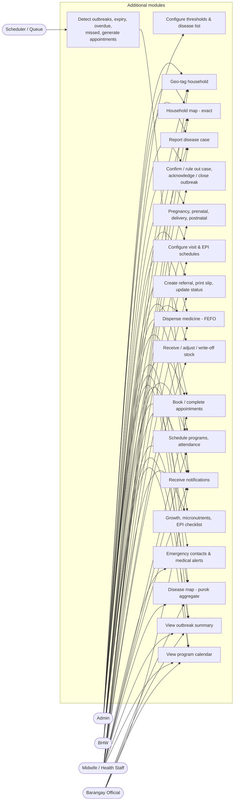
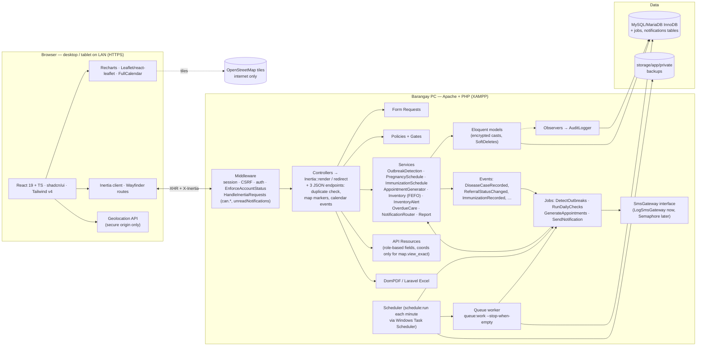
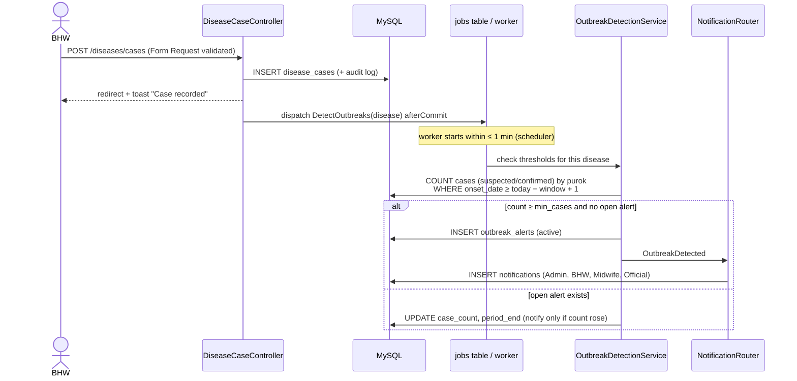
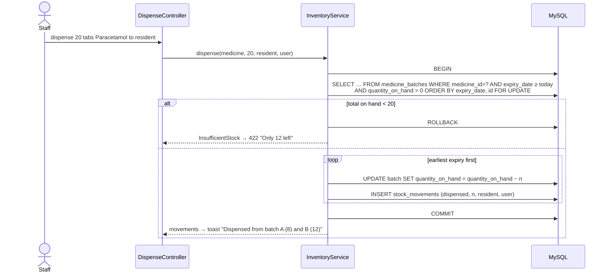

# Phase 1 (Additional Modules) — Requirements, Architecture & Security Plan

> **Role speaking: SOFTWARE ENGINEER / SYSTEM ARCHITECT**

Scope: modules **9–17 + notifications** from `featured.md` (the teacher's evaluation), added on top of the
core system already built in `docs/phase-1` … `docs/phase-5`. `featured.md` now replaces `brgy.md` as the spec.

---

## 0. Where we are and how the 8 new phases map to existing work

| New phase (featured.md) | Core modules 1–8                                     | Additional modules 9–17                            |
| ----------------------- | ---------------------------------------------------- | -------------------------------------------------- |
| 1 Architecture          | ✅ `docs/phase-1-architecture.md`                    | **this document**                                  |
| 2 Database              | ✅ `docs/phase-2-database.md`                        | next                                               |
| 3 Backend (core)        | ✅ `docs/phase-3-backend.md`                         | —                                                  |
| 4 Backend (additional)  | —                                                    | to do                                              |
| 5 Frontend design       | ✅ `docs/phase-4-design.md`                          | to do (new components)                             |
| 6 Pages                 | ✅ `docs/phase-5-frontend.md`                        | to do                                              |
| 7 Reports & exports     | ✅ summary report (PDF/XLSX/CSV)                     | to do (new reports, referral slip, family summary) |
| 8 Testing & deployment  | 107 Pest tests; **deployment guide never delivered** | to do (new tests + full deployment guide)          |

Baseline at the start of this phase: see §8.

### 0.1 Decisions carried over (already confirmed)

Laravel 13 · Inertia 3 · **Wayfinder** (not Ziggy) · XAMPP MariaDB/MySQL (utf8mb4, InnoDB) · Pest on in-memory SQLite ·
username login · Admin-created accounts · 2FA/passkeys optional · phase-by-phase delivery.

### 0.2 New technical decisions

| Topic          | Spec allows                        | We use                                                                                                                                                                                                                                                 | Why                                                                                                                                                       |
| -------------- | ---------------------------------- | ------------------------------------------------------------------------------------------------------------------------------------------------------------------------------------------------------------------------------------------------------ | --------------------------------------------------------------------------------------------------------------------------------------------------------- |
| Map            | Leaflet + react-leaflet, OSM tiles | **leaflet 1.9 + react-leaflet 5** (React 19 compatible). Markers drawn as `CircleMarker`s, CSS from npm                                                                                                                                                | No marker PNGs → no broken-icon bundler problem, and colour-by-flag is just a prop. No CDN, so only the _tiles_ need internet.                            |
| Calendar       | FullCalendar React **or** custom   | **FullCalendar 6 React**, MIT plugins only (daygrid, timegrid, list, interaction), themed with shadcn CSS variables                                                                                                                                    | Day/week/month/list views, keyboard nav and drag-to-reschedule out of the box; a custom one would be weeks of work for a worse result.                    |
| Queue          | database driver                    | **database** (already `QUEUE_CONNECTION=database`); worker started by the scheduler with `queue:work --stop-when-empty` every minute                                                                                                                   | Windows has no Supervisor. A short-lived worker per minute survives reboots and uses no RAM when idle — right for a modest PC.                            |
| Notifications  | Laravel database notifications     | **Daily digest per topic** ("3 prenatal visits overdue") + immediate ones for outbreaks and referral status                                                                                                                                            | One notification per overdue child would bury BHWs. Digests also keep **names and diagnoses out of the `notifications` table** (see §5.3).                |
| SMS            | optional                           | `App\Contracts\SmsGateway` interface + `LogSmsGateway` (writes to the log). Semaphore driver can be added later via config                                                                                                                             | Ships nothing that needs internet or money; one class to add later. Sending also requires an `sms_reminders` consent (third-party data sharing).          |
| Geolocation    | browser Geolocation API            | Same, **plus HTTPS on the LAN is now mandatory**                                                                                                                                                                                                       | Browsers only allow `navigator.geolocation` on secure origins. `http://192.168.x.x` will not work on tablets; `https://` with the local CA (mkcert) will. |
| Business logic | Service classes                    | `OutbreakDetectionService`, `PregnancyScheduleService`, `ImmunizationScheduleService` (existing `ImmunizationSchedule` grows into it), `AppointmentGenerator`, `InventoryService`, `InventoryAlertService`, `OverdueCareService`, `NotificationRouter` | Controllers stay thin; the same logic runs from web requests, queued jobs and tests.                                                                      |

---

## 1. Requirements summary (modules 9–17)

### 1.1 Functional requirements

| #   | Module                      | Key acceptance criteria                                                                                                                                                                                                                                                                                                                                                                                                                                                                                                                       |
| --- | --------------------------- | --------------------------------------------------------------------------------------------------------------------------------------------------------------------------------------------------------------------------------------------------------------------------------------------------------------------------------------------------------------------------------------------------------------------------------------------------------------------------------------------------------------------------------------------- |
| F9  | Geo-tagging                 | "Use my location" (shows GPS accuracy, refuses > 100 m with a warning) or click/drag on the map; saved as DECIMAL(10,7) with `geotagged_at/by`. **Refused unless a household member has an active geo-tagging consent.** Map of all households filterable by purok and flags (pregnant member, senior, active disease case, 4Ps, PWD, not yet geo-tagged).                                                                                                                                                                                    |
| F10 | Disease surveillance        | Case = resident + disease + onset date + classification (suspected / confirmed / ruled out) + outcome (active / recovered / died) + reported by. Admin-editable disease list seeded from **DOH PIDSR** Category I (immediately notifiable) and Category II (weekly). Admin thresholds per disease (min cases, days window, purok or barangay scope). Detection runs **when a case is saved** and in the **daily sweep**; alert lifecycle active → monitoring → closed with acknowledge. Trend chart (cases per week) and cases-per-purok map. |
| F11 | Maternal & child tracker    | Pregnancy: LMP → EDD auto (Naegele, LMP + 280 d, editable for ultrasound dating), AOG computed, gravida/para, risk factors (checklist) → risk level. Prenatal & postnatal visits generated from **configurable schedule rules**; delivery record (date, place, attendant, outcome, link to newborn's resident record). Flags: high-risk, overdue visit, due within 2 weeks. Child: mother link, growth measurements + nutritional status, EPI checklist (due/overdue/done) from **configurable** rules, deworming / vitamin A / iron.         |
| F12 | Family health profile       | Household page: members with health flags, water source, toilet type, 4Ps, family planning method (only for members with family-planning consent), mini map. **Printable PDF** family health summary (export audited).                                                                                                                                                                                                                                                                                                                        |
| F13 | Referrals                   | Resident, reason, urgency (routine / urgent / emergency), facility (lookup: RHU, hospital, other), referred by, date. Status pending → sent → received → completed (or cancelled), each change timestamped and notified to the referrer; feedback note on return. **Printable referral slip PDF.**                                                                                                                                                                                                                                            |
| F14 | Medicine inventory          | Medicines with reorder level; batches (batch no., expiry, qty received, qty on hand); movements (in / dispensed / expired / adjustment). **FEFO dispensing** across batches inside a transaction with row locks — stock can never go negative. Alerts: expiring in ≤ 90 / ≤ 60 / ≤ 30 days (once per band per batch), expired, low stock.                                                                                                                                                                                                     |
| F15 | Emergency contacts & alerts | Contacts (name, relationship, phone, one primary). Medical alerts (allergy / chronic / disability / other, severity info / warning / critical, active flag). **Critical alerts = red banner** on the profile and on every health-visit, prenatal, dispensing and referral form.                                                                                                                                                                                                                                                               |
| F16 | Appointments                | Type (lookup: prenatal, postnatal, immunization, check-up, follow-up, family planning, …), date/time, assigned staff, status scheduled / completed / missed / cancelled. Calendar (month/week/day) + list. **Auto-generated** from pregnancy and immunization schedules (idempotent, re-planned when a visit/dose is recorded). Missed = automatically set the day after. Dashboard: today's + missed.                                                                                                                                        |
| F17 | Community health programs   | Title, type, start/end, venue, target puroks + target group, assigned staff. Attendance checklist by resident (search + "add all eligible"). Shown on the **same calendar** as appointments; Officials see programs only.                                                                                                                                                                                                                                                                                                                     |
| N   | Notifications               | Bell with unread count (shared prop), popover list, "mark all read", full page. Sources and recipients in §2.3. Generated by the daily job / events, delivered through the queue.                                                                                                                                                                                                                                                                                                                                                             |

### 1.2 Non-functional additions

| Category    | Requirement                                                                                                                                                                           |
| ----------- | ------------------------------------------------------------------------------------------------------------------------------------------------------------------------------------- |
| Performance | Map loads ≤ 2 s with 2,500 households (markers as a **deferred** prop of compact arrays, not resources). Calendar fetches only the visible range. Outbreak sweep < 5 s for 10k cases. |
| Offline     | Everything works without internet **except map tiles**: the map still shows markers on a plain background with a "Map tiles need internet" notice.                                    |
| Reliability | The barangay PC may be switched off at night: daily checks are **idempotent and re-attempted hourly 06:00–18:00** until they have run that day.                                       |
| Field use   | Map, geo-tag, attendance and appointment screens usable one-handed on a 10" tablet (44 px targets, no hover-only actions).                                                            |

---

## 2. Roles, use cases and permissions

### 2.1 New use cases per role

**Admin** — UC-A8 configure outbreak thresholds and the notifiable disease list · UC-A9 configure prenatal/postnatal and immunization schedules · UC-A10 manage facilities, water sources, toilet types, FP methods, appointment and program types · UC-A11 set purok map centres · plus everything the Midwife can do.

**BHW** — UC-B9 geo-tag a household (GPS or map) · UC-B10 view household map · UC-B11 report a disease case · UC-B12 book/complete appointments · UC-B13 schedule programs and record attendance · UC-B14 record growth, deworming, vitamin A · UC-B15 dispense medicine · UC-B16 manage emergency contacts and medical alerts.

**Midwife / Health Staff** — UC-M5 register pregnancy, record prenatal/postnatal visits and delivery (link newborn) · UC-M6 create referrals, update status, print slip · UC-M7 receive stock, adjust, write off expired batches · UC-M8 confirm/rule out disease cases, acknowledge/close outbreak alerts · UC-M9 configure schedules · plus UC-B9…B16.

**Barangay Official** — UC-O3 view outbreak alert summary (disease, purok, count — no names) · UC-O4 view aggregated purok-level disease map · UC-O5 view community program calendar · plus existing aggregated reports.



### 2.2 Permission matrix additions

Same mechanism as the core (permissions table → Gates, Policies on every action, `can:` route middleware as second line).
Existing keys are unchanged; `health.record` now also covers growth measurements, micronutrients, emergency contacts and medical alerts.

| Permission key                                                                   | Admin | BHW | Midwife | Official | Notes                                                  |
| -------------------------------------------------------------------------------- | :---: | :-: | :-----: | :------: | ------------------------------------------------------ |
| `households.geotag`                                                              |  ✅   | ✅  |   ✅    |          | Also needs a geo-tagging consent on the household      |
| `map.view_exact` (household coordinates)                                         |  ✅   | ✅  |   ✅    |          | Viewing is audit-logged                                |
| `map.view_aggregate` (purok-level counts)                                        |  ✅   | ✅  |   ✅    |    ✅    |                                                        |
| `diseases.view` (case list with names)                                           |  ✅   | ✅  |   ✅    |          |                                                        |
| `diseases.record` (report a case)                                                |  ✅   | ✅  |   ✅    |          | ⚠️ Q4                                                  |
| `diseases.classify` (confirm / rule out, set outcome)                            |  ✅   |     |   ✅    |          | ⚠️ Q4                                                  |
| `outbreaks.view_summary`                                                         |  ✅   | ✅  |   ✅    |    ✅    | Disease, purok, count, period — never names            |
| `outbreaks.manage` (acknowledge, monitoring, close)                              |  ✅   |     |   ✅    |          |                                                        |
| `maternal.manage` (pregnancy, prenatal, delivery, postnatal)                     |  ✅   |     |   ✅    |          | ⚠️ Q4 — BHWs still _see_ the tracker                   |
| `referrals.manage`                                                               |  ✅   |     |   ✅    |          | Viewing referrals uses `health.view_sensitive`         |
| `inventory.view`                                                                 |  ✅   | ✅  |   ✅    |          |                                                        |
| `inventory.dispense`                                                             |  ✅   | ✅  |   ✅    |          | ⚠️ Q4                                                  |
| `inventory.manage` (receive, adjust, write-off, reorder levels)                  |  ✅   |     |   ✅    |          |                                                        |
| `appointments.manage`                                                            |  ✅   | ✅  |   ✅    |          |                                                        |
| `programs.view`                                                                  |  ✅   | ✅  |   ✅    |    ✅    | Officials: program details, **attendance counts only** |
| `programs.manage` (create, edit, attendance)                                     |  ✅   | ✅  |   ✅    |          |                                                        |
| `schedules.manage` (prenatal/postnatal & EPI rules)                              |  ✅   |     |   ✅    |          | Spec: "configurable by the midwife/Admin"              |
| `settings.manage` (thresholds, disease list, facilities, lookups, purok centres) |  ✅   |     |         |          | Extends existing `lookups.manage`                      |

### 2.3 Notification routing (who gets what)

| Source                                  | Trigger                           | Recipients (by permission, active users only)           | Payload (no names/diagnoses)                |
| --------------------------------------- | --------------------------------- | ------------------------------------------------------- | ------------------------------------------- |
| Outbreak alert created / count rises    | case saved (queued) + daily sweep | `outbreaks.view_summary` (incl. Officials)              | disease, purok, case count, period, link    |
| Medicine expiring 90/60/30 d, expired   | daily                             | `inventory.manage`                                      | counts per band, link to filtered inventory |
| Low stock                               | daily + after each dispense       | `inventory.manage`                                      | medicine name, on-hand, reorder level       |
| Overdue prenatal / postnatal visits     | daily digest                      | `maternal.manage`                                       | count, link to tracker filtered "overdue"   |
| Overdue immunizations                   | daily digest                      | `health.record`                                         | count, link to child health "overdue"       |
| Missed appointments                     | daily (after marking missed)      | assigned staff; unassigned ones → `appointments.manage` | count, link                                 |
| Referral status changed                 | status update                     | the referring user                                      | referral no., new status, link              |
| Upcoming program (in 3 days, and today) | daily                             | assigned staff + `programs.view`                        | title, date, venue, link                    |

Each digest has a **dedupe key** (type + date [+ id]) so re-running the daily job never sends twice.

---

## 3. Module list

| #   | Module                    | Main tables (designed in Phase 2)                                                                                                                    | Services / jobs                                           | Pages (`resources/js/pages/…`)                                               |
| --- | ------------------------- | ---------------------------------------------------------------------------------------------------------------------------------------------------- | --------------------------------------------------------- | ---------------------------------------------------------------------------- |
| 1–8 | Core (built)              | users, roles, residents, households, consents, health_visits, vital_signs, conditions, immunizations, audit_logs, backups                            | existing                                                  | existing                                                                     |
| 9   | Geo-tagging & map         | households + lat/lng/geotag cols; puroks + centre point                                                                                              | `HouseholdMapService`                                     | `map/index`, geo-tag dialog on `households/show`                             |
| 10  | Disease surveillance      | diseases, disease_cases, outbreak_thresholds, outbreak_alerts                                                                                        | `OutbreakDetectionService`, `DetectOutbreaksJob`          | `diseases/index`, `diseases/alerts`, `diseases/map`                          |
| 11  | Maternal & child          | pregnancies, prenatal_visits, deliveries, postnatal_visits, maternal_visit_rules, growth_measurements, micronutrient_records, vaccine schedule rules | `PregnancyScheduleService`, `ImmunizationScheduleService` | `maternal/index`, `maternal/show`, `child-health/index`, `child-health/show` |
| 12  | Family health profile     | water_sources, toilet_types, family_planning_methods, resident_family_planning                                                                       | `FamilyHealthSummary` (PDF)                               | `households/show` (extended)                                                 |
| 13  | Referrals                 | facilities, referrals, referral_status_history                                                                                                       | `ReferralService`, `ReferralSlip` (PDF)                   | `referrals/index`, `referrals/show`                                          |
| 14  | Inventory                 | medicines, medicine_batches, stock_movements                                                                                                         | `InventoryService` (FEFO, locks), `InventoryAlertService` | `inventory/index`, `inventory/show`                                          |
| 15  | Contacts & medical alerts | emergency_contacts, medical_alerts                                                                                                                   | —                                                         | resident profile tab, `MedicalAlertBanner`                                   |
| 16  | Appointments              | appointment_types, appointments                                                                                                                      | `AppointmentGenerator`, `MarkMissedAppointments`          | `appointments/index` (calendar + list)                                       |
| 17  | Programs                  | program_types, health_programs, program_puroks, program_staff, program_attendance                                                                    | `ProgramReminderService`                                  | `programs/index`, `programs/show`                                            |
| N   | Notifications             | notifications (Laravel), consent types                                                                                                               | `NotificationRouter`, `RunDailyChecks` command            | `notifications/index`, header bell                                           |
| —   | Settings                  | (lookups above)                                                                                                                                      | —                                                         | `settings/health/*` (thresholds, schedules, facilities, lookups)             |

---

## 4. System architecture

### 4.1 Component view (updated)



### 4.2 Disease case → outbreak alert



The same `OutbreakDetectionService::sweep()` runs for **every** threshold in the daily job, so an alert is
still raised if a worker was down when the case was saved.

### 4.3 FEFO dispensing (no negative stock)



`FOR UPDATE` serialises two staff dispensing the same medicine at once; a `CHECK (quantity_on_hand >= 0)` is the last line of defence.

### 4.4 Daily checks

| When (Task Scheduler → `schedule:run` every minute) | What                                                                                                                                                                                                                                                                                                                      |
| --------------------------------------------------- | ------------------------------------------------------------------------------------------------------------------------------------------------------------------------------------------------------------------------------------------------------------------------------------------------------------------------- |
| every minute                                        | `queue:work --stop-when-empty --max-time=55`                                                                                                                                                                                                                                                                              |
| **hourly 06:00–18:00**                              | `health:daily-checks` — skips if it already completed today (cache key `daily-checks:Y-m-d`), so a PC switched on at 8 AM still gets its checks. Runs: mark missed appointments → outbreak sweep → expiry/low-stock → overdue prenatal/postnatal/EPI → program reminders → (re)generate appointments for the next 60 days |
| 23:00                                               | `backup:run` (existing)                                                                                                                                                                                                                                                                                                   |
| daily                                               | `model:prune` (existing; also prunes read notifications > 90 days)                                                                                                                                                                                                                                                        |

### 4.5 Key business rules (to be implemented in Phase 4)

- **EDD** = LMP + 280 days; **AOG** (weeks + days) is computed from EDD and today/visit date — never stored.
- **Risk level** = high if any risk factor flagged (age < 18 or > 35, gravida ≥ 5, previous C-section, hypertension, diabetes, bleeding, …; list is a lookup) or set manually by the midwife.
- **Prenatal/postnatal schedule** comes from `maternal_visit_rules` rows (week of gestation / days after delivery). Default seed: Q5.
- **Overdue** = a scheduled visit/dose whose date has passed with no matching record; **due soon** = within 14 days.
- **Outbreak counts** include _suspected + confirmed_, exclude _ruled out_; outcome (recovered/died) doesn't remove a case from the count.
- **Alert lifecycle:** active → (acknowledged by …) → monitoring → closed. A closed alert never re-opens; a new one is created if the threshold is crossed again.
- **Expiry bands:** ≤ 90, ≤ 60, ≤ 30 days, expired — each band notified once per batch (band stored on the batch). Expired batches are excluded from FEFO and from "stock on hand"; write-off creates an `expired` movement.
- **Low stock:** Σ on-hand of non-expired batches ≤ medicine.reorder_level.
- **Appointment generation** is idempotent (unique source + rule) and never overwrites an appointment staff have edited, completed or cancelled.

---

## 5. Security plan additions (RA 10173)

### 5.1 Household coordinates are personal data

| Control               | Implementation                                                                                                                                                                                                |
| --------------------- | ------------------------------------------------------------------------------------------------------------------------------------------------------------------------------------------------------------- |
| Consent               | New consent type **`geotagging`**. `GeotagHouseholdRequest` rejects coordinates unless a current household member has an active geo-tagging consent. Revoking it clears the coordinates (audited).            |
| Who sees exact points | Only `map.view_exact`. `HouseholdResource` and the markers endpoint omit `latitude/longitude` for everyone else — the keys are absent, not null-masked.                                                       |
| Officials             | Purok-level only: one circle per purok, drawn at an **Admin-set purok centre** (not an average of houses, which would reveal a lone household), labelled with counts. No household IDs, no popups with names. |
| Access logging        | Loading exact markers writes one `viewed_sensitive` audit entry (map, filters used).                                                                                                                          |
| Precision             | Stored at 7 decimals (≈ 1 cm) as the spec requires; **displayed** to staff at 5 (≈ 1 m).                                                                                                                      |

### 5.2 Health data in new modules

- Disease cases, pregnancies, referrals (reason), medical alerts, dispensing history and FP methods are **sensitive personal information**. Lists show them only to roles with the module's view permission; free-text clinical fields (referral reason/feedback, case notes, delivery/prenatal findings, risk-factor notes) use **encrypted casts**.
- Family planning method is shown only where the resident has an active **`family_planning`** consent; otherwise the field is absent from props.
- Referral slip and family health summary PDFs: `health.view_sensitive` only, each download audited as `export`.
- Program attendance for Officials: counts per purok/group only.
- Inventory movements are **append-only** (like audit logs): corrections are new `adjustment` rows with a reason.

### 5.3 Notifications, jobs and JSON endpoints

- `notifications.data` is plain JSON in the DB and readable by anyone with DB access → payloads hold **counts, IDs and links only**. The page you land on re-checks permissions.
- Notification routes (`mark read`, `mark all read`) are scoped to `auth()->user()->notifications()` — users can't touch others' rows.
- Recipients are resolved by **permission at send time**; deactivated users are skipped.
- Jobs run without a logged-in user: audit entries from jobs have `user_id = NULL` and `action` prefixed `system.` (e.g. `system.appointment_marked_missed`).
- JSON endpoints (markers, calendar events) are `GET`, behind the same auth/`can:` middleware, return only the fields the role may see, and are rate-limited. Calendar events for Officials contain **programs only**.
- SMS (future): requires an `sms_reminders` consent per resident and a data-sharing note in the privacy notice, because phone numbers would leave the system.

### 5.4 Threats specific to the new modules

| Threat                                               | Mitigation                                                                                 |
| ---------------------------------------------------- | ------------------------------------------------------------------------------------------ |
| Two staff dispense the last stock at the same time   | `SELECT … FOR UPDATE` in one transaction + CHECK constraint                                |
| Forged coordinates / mis-click far away              | Server validates lat/lng inside an Isulan bounding box (config); accuracy shown and stored |
| Duplicate alerts or notifications when a job re-runs | Unique open-alert rule + notification dedupe keys                                          |
| Mass scraping of the household map                   | Auth + permission + throttle on the markers endpoint; audit entry per load                 |
| Officials inferring identities from small counts     | Purok-level only, no drill-down; counts shown as numbers (spec requires them for response) |

---

## 6. Folder structure additions

```
app/
├── Console/Commands/      RunDailyChecks (health:daily-checks)
├── Contracts/             SmsGateway
├── Events/                DiseaseCaseRecorded, ReferralStatusChanged, PregnancyRegistered, ImmunizationRecorded
├── Jobs/                  DetectOutbreaks, GenerateAppointments
├── Notifications/         OutbreakDetected, MedicineExpiryDigest, LowStock, OverdueCareDigest,
│                          MissedAppointmentsDigest, ReferralStatusUpdated, UpcomingProgram
├── Services/              OutbreakDetectionService, PregnancyScheduleService, ImmunizationScheduleService,
│                          AppointmentGenerator, InventoryService, InventoryAlertService,
│                          OverdueCareService, NotificationRouter, HouseholdMapService, Sms/LogSmsGateway
├── Http/Controllers/      Map, Geotag, Disease{Case,Alert,Threshold}, Pregnancy, PrenatalVisit, Delivery,
│                          PostnatalVisit, ChildHealth, GrowthMeasurement, Micronutrient, Referral,
│                          Medicine, StockBatch, Dispense, EmergencyContact, MedicalAlert, Appointment,
│                          CalendarEvents, HealthProgram, ProgramAttendance, Notification, Settings/*
resources/js/
├── pages/                 map/ diseases/ maternal/ child-health/ referrals/ inventory/
│                          appointments/ programs/ notifications/ settings/health/
├── components/app/        MedicalAlertBanner, HouseholdMap, GeotagPicker, CalendarView, ExpiryBadge,
│                          NotificationBell, GrowthChart, ImmunizationChecklist, StatusStepper
resources/views/pdf/       referral-slip.blade.php, family-health-summary.blade.php
```

---

## 7. Plan for the remaining phases

| Phase | Deliverables                                                                                                                                                                                                                                                                                                                                              |
| ----- | --------------------------------------------------------------------------------------------------------------------------------------------------------------------------------------------------------------------------------------------------------------------------------------------------------------------------------------------------------- |
| 2     | ERD per module (Mermaid), data dictionary for every new/changed table, migrations, seeders (Kalawag II puroks with centres, geo-tagged households around Isulan, pregnancies, children with growth data, disease cases incl. one that triggers an outbreak, medicines with varied expiry, programs, appointments), index plan + EXPLAIN for alert queries |
| 3     | (core — done)                                                                                                                                                                                                                                                                                                                                             |
| 4     | Models, Form Requests, Policies, Resources, controllers, services, events/jobs, notifications, daily command, route list, Pest tests for every service rule                                                                                                                                                                                               |
| 5     | Theme additions (status/expiry/marker colours with AA contrast), component specs for the 11 components above, page layouts                                                                                                                                                                                                                                |
| 6     | All new pages + sidebar regrouped (Overview / Records / Health / Services / Reports / Admin), bell, dashboard additions, browser verification + screenshots                                                                                                                                                                                               |
| 7     | New reports (disease cases, referrals, program attendance, medicine stock), referral slip PDF, family health summary PDF, Excel exports                                                                                                                                                                                                                   |
| 8     | Remaining tests from the spec list, scheduler/queue setup on Windows Task Scheduler, HTTPS on LAN (mkcert) for geolocation, `npm run build`, deployment guide, BHW manual outline                                                                                                                                                                         |

---

## 8. Baseline at the start of this phase

No application code changed in this phase. Existing suite on 2026-10-31: **107/107 Pest tests pass** (686 assertions, PHP 8.5.6).
New packages (`leaflet`, `react-leaflet`, `@types/leaflet`, `@fullcalendar/react` + daygrid/timegrid/list/interaction)
will be installed in Phase 6 when the first page uses them.

---

## 9. Open questions (please confirm before Phase 2)

1. **Existing data / migration style.** Does the `barangay_health` database hold any _real_ resident data yet?
    - _If no (default assumed):_ I'll **edit the existing migrations** to the final design and `migrate:fresh --seed` — cleaner for your project defense.
    - _If yes:_ I'll write **additive migrations** that transform the data in place.
2. **Maternal tables.** The core build has `maternal_records` + `maternal_visits` (prenatal/postnatal linked to a health visit for vitals). Default: **replace them with the spec's `pregnancies`, `prenatal_visits`, `postnatal_visits`, `deliveries`**, keeping the link to `health_visits` so BP/weight aren't stored twice (3NF).
3. **4Ps.** The spec moves `is_4ps` from residents to **households** (4Ps is a household program). Default: move it; a household is 4Ps if any member was flagged.
4. **Permission defaults** (marked ⚠️ in §2.2): BHWs may _report_ disease cases but only Midwife/Admin _confirm/rule out_; BHWs may _dispense_ but not receive/adjust stock; pregnancy/delivery records are Midwife/Admin only (BHWs view them and record growth, vitamin A, deworming). OK?
5. **Default prenatal schedule.** Seed the **WHO 2016 / DOH 8 ANC contacts** (12, 20, 26, 30, 34, 36, 38, 40 weeks) or the older **4-visit** schedule? Postnatal default: within 24 h, day 3, day 7, week 6. (Either way it's editable.)
6. **Nutritional status.** Default: BHW picks the status from the OPT Plus chart (normal, underweight, severely underweight, stunted, wasted, overweight/obese) and the growth chart plots the values. Alternative: the system **auto-classifies with WHO z-scores** (I'd import the official WHO Child Growth Standards tables) and the BHW can override.
7. **Map centre & puroks.** Do you have the real purok names of Kalawag II and the health center's coordinates? Otherwise I'll keep Purok 1–7 and centre the map on Isulan (~6.63° N, 124.61° E) with sample households placed around it.
