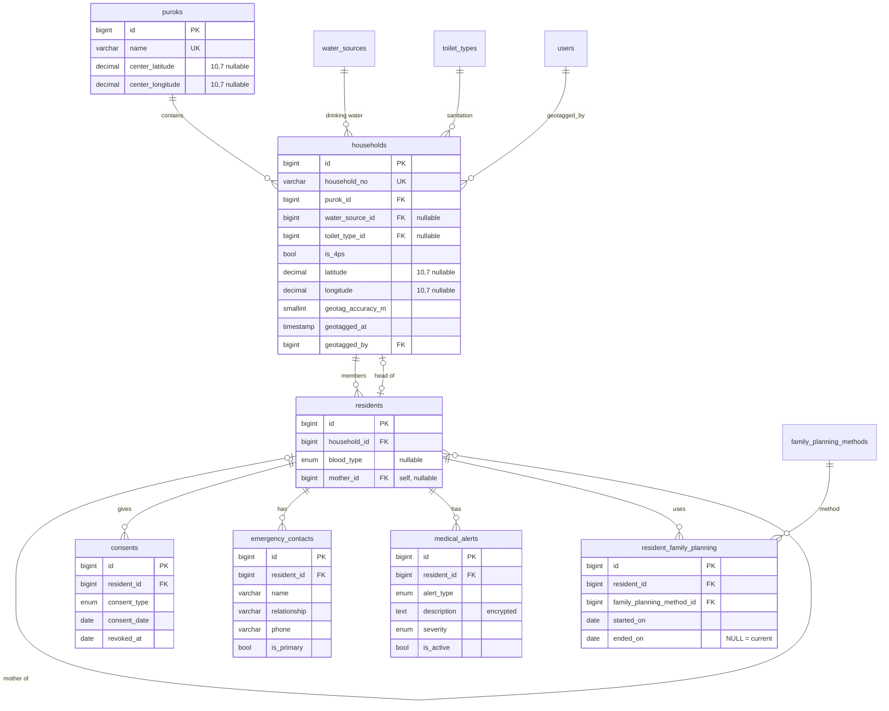
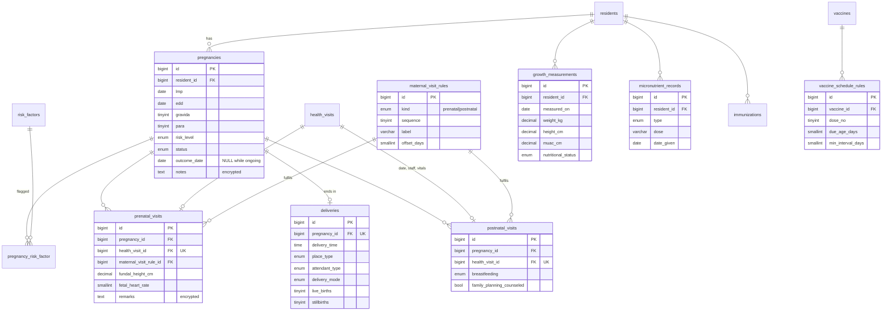
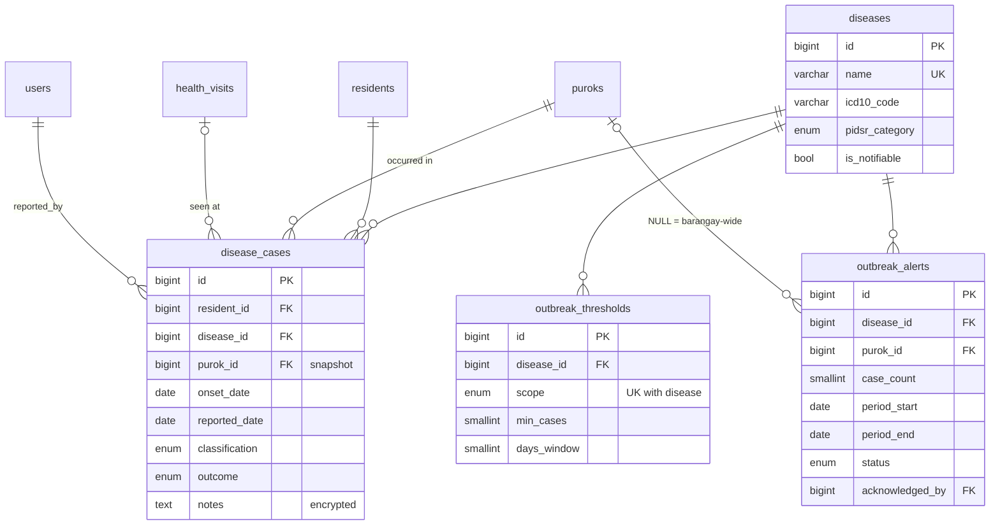
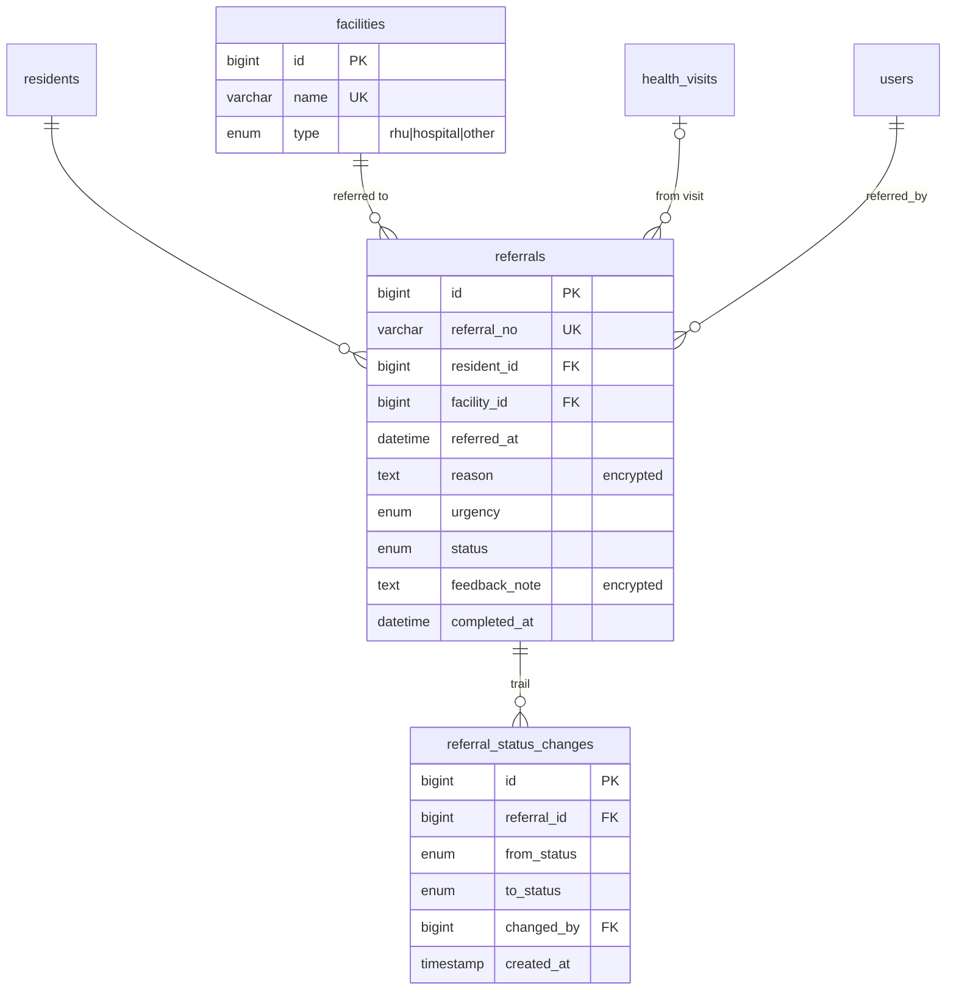
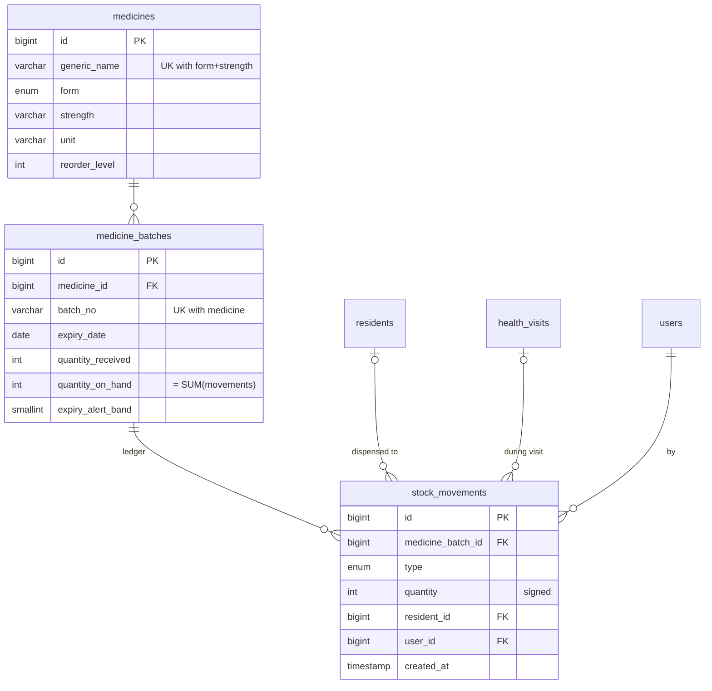
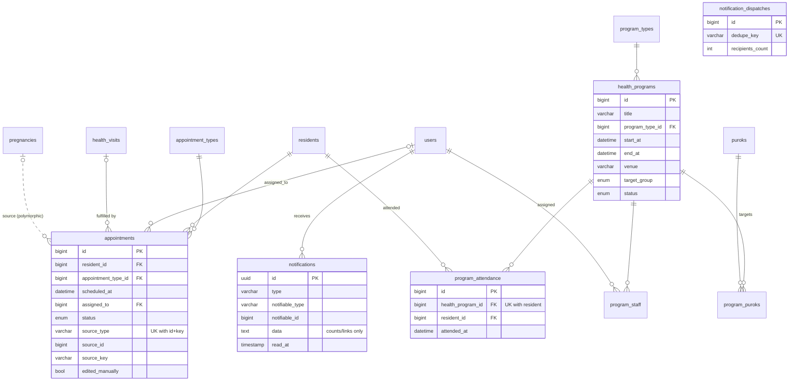

# Phase 2 (Additional Modules) — Database Design

> **Role speaking: DATABASE ARCHITECT / BACKEND DEVELOPER**

Extends the core schema (`docs/phase-2-database.md`) for modules 9–17 and notifications. All seven Phase 1 defaults
were accepted ("continue"), so this phase:

| Q   | Decision applied                                                                                                                                                                                                                          |
| --- | ----------------------------------------------------------------------------------------------------------------------------------------------------------------------------------------------------------------------------------------- |
| 1   | The database held only seed data (51 sample residents), so the **existing migrations were edited** and the DB rebuilt with `migrate:fresh --seed`. An encrypted backup was taken first (`backup-2026-10-31_134622-scheduled.sql.gz.enc`). |
| 2   | `maternal_records` / `maternal_visits` replaced by **`pregnancies`, `prenatal_visits`, `postnatal_visits`, `deliveries`**.                                                                                                                |
| 3   | `is_4ps` moved from `residents` to **`households`**.                                                                                                                                                                                      |
| 4   | Permission defaults from Phase 1 §2.2 seeded (`settings.manage` was folded into the existing Admin-only `lookups.manage`).                                                                                                                |
| 5   | Default prenatal schedule = **8 ANC contacts** (12, 20, 26, 30, 34, 36, 38, 40 weeks); postnatal = 24 h, day 3, day 7, week 6.                                                                                                            |
| 6   | Nutritional status is **picked by the BHW** (OPT Plus categories) — stored, not computed.                                                                                                                                                 |
| 7   | Purok 1–7 placeholders; map centred on Isulan (6.6290° N, 124.6060° E, `MAP_CENTER_LAT/LNG` in `.env`).                                                                                                                                   |

---

## 1. Where the design deviates from the field list in `featured.md` (and why)

| Spec field / table                                | Implemented as                                                                                                  | Reason                                                                                                                                                                                               |
| ------------------------------------------------- | --------------------------------------------------------------------------------------------------------------- | ---------------------------------------------------------------------------------------------------------------------------------------------------------------------------------------------------- |
| `prenatal_visits.bp, weight`                      | On the linked `health_visits` → `vital_signs` row                                                               | 3NF: BP/weight are facts about a visit, already stored once for every visit type.                                                                                                                    |
| `prenatal_visits.age_of_gestation_weeks`          | **Computed** from `pregnancies.edd` and the visit date                                                          | Derived value; storing it would go stale when the EDD is corrected by ultrasound.                                                                                                                    |
| `prenatal_visits.next_visit_date`                 | An **`appointments`** row (`source = pregnancy`, `source_key = anc:N`)                                          | The next visit _is_ an appointment; storing it twice creates two truths. Appointments also get status (missed/completed).                                                                            |
| `prenatal_visits` / `postnatal_visits` → schedule | + `maternal_visit_rule_id` (nullable)                                                                           | Records which scheduled contact the visit fulfils → "overdue contact" is a simple anti-join (§6, A12).                                                                                               |
| `deliveries.delivery_date`                        | `pregnancies.outcome_date`                                                                                      | 1:1 with the pregnancy; the end date is needed for _terminated_ pregnancies too, so it lives once on the pregnancy.                                                                                  |
| `deliveries.child_resident_id`                    | `live_births` + `stillbirths` counts; newborn linked by **`residents.mother_id`**                               | One FK can't record twins. `mother_id` is required anyway for child tracking, so a second link would duplicate it.                                                                                   |
| `deliveries.outcome`                              | `delivery_mode` + birth counts (+ `place_type`, `attendant_type`)                                               | DOH indicators (facility-based delivery, skilled birth attendant) need these as separate, groupable columns.                                                                                         |
| `pregnancies.risk_factors`                        | Lookup **`risk_factors`** + pivot **`pregnancy_risk_factor`**                                                   | A list inside one column violates 1NF and can't be counted in reports.                                                                                                                               |
| `disease_cases.case_status`, `outcome`            | `classification` (suspected / probable / confirmed / ruled_out) + `outcome` (ongoing / recovered / died)        | The spec's status mixes two independent facts (how sure, how it ended). "Ruled out" lets a negative test stop a case counting toward an outbreak.                                                    |
| —                                                 | `disease_cases.purok_id`                                                                                        | Where the case occurred **at reporting time**. Not derived from the current household: a family moving must not move past cases into another purok's count. Also gives the threshold query an index. |
| `outbreak_alerts`                                 | + `threshold_min_cases/days_window` snapshot, `acknowledged_at`, `closed_by/at`, `closing_note`                 | Thresholds are editable; an alert must keep the rule that raised it. Lifecycle columns support acknowledge/close.                                                                                    |
| `referrals`                                       | + `referral_no`, `health_visit_id`, **`referral_status_changes`** (append-only)                                 | Printed slip number; vitals on the slip; status stepper shows who moved it and when.                                                                                                                 |
| `stock_movements.quantity`                        | **Signed** integer (+ in, − out)                                                                                | `SUM(quantity)` = on-hand, so the ledger can be reconciled with one query (tested).                                                                                                                  |
| `appointments.source_type/source_id`              | + `source_key` ("anc:3", "pnc:1", "epi:PENTA:2"), `edited_manually`, `health_visit_id`, `reminder_sent_at`      | Unique (source, key) makes the generator idempotent; `edited_manually` stops it overwriting staff changes; `reminder_sent_at` is for the future SMS gateway.                                         |
| `health_programs.program_type`, `target_group`    | Lookup **`program_types`** (with calendar colour); `target_group` ENUM; + `status`; + **`program_staff`** (M:N) | Spec asks for "assigned staff" (more than one person). Target group drives "add all eligible residents", so the code branches on it.                                                                 |
| `consents.consent_type`                           | ENUM `health_profiling`, `geotagging`, `family_planning`, `sms_reminders`                                       | The application refuses geo-tags / FP data without the matching consent.                                                                                                                             |
| `vaccine_schedule_rules (age_in_days/weeks)`      | Renamed from `vaccine_schedules`; `due_age_days` + **`min_interval_days`**                                      | A late dose 1 must push dose 2 back instead of showing it overdue (DOH: ≥ 4 weeks between Penta/OPV/PCV doses).                                                                                      |
| `notifications`                                   | Laravel table + **`notification_dispatches`** (dedupe keys)                                                     | Lets the daily job re-run (hourly retries, Phase 1 §4.4) without notifying twice.                                                                                                                    |
| `puroks`                                          | + `center_latitude/longitude`                                                                                   | Officials' map draws one circle per purok at an Admin-set point, never at a household.                                                                                                               |
| `households`                                      | + `geotag_accuracy_m`                                                                                           | GPS accuracy is shown to staff and kept as evidence of data quality.                                                                                                                                 |

---

## 2. ERD (by module)

Core tables (users, roles, audit_logs, health_visits, …) are drawn only where new tables connect to them.
Full core ERD: `docs/phase-2-database.md`.

### 2.1 Residents, households & family health (changed + new)

### 2.2 Maternal & child health

### 2.3 Disease surveillance

### 2.4 Referrals

### 2.5 Medicine inventory

### 2.6 Scheduling, programs & notifications

---

## 3. Data dictionary (new and changed tables)

Conventions: every table has `id BIGINT UNSIGNED PK` and, unless noted, `created_at/updated_at`. **NN** = NOT NULL,
**UK** = unique, **enc** = Laravel `encrypted` cast (AES-256-CBC + HMAC; ciphertext in TEXT, never indexed or searched).
FK rules: `R` = RESTRICT, `C` = CASCADE, `N` = SET NULL (all `ON UPDATE CASCADE`).

### 3.1 Changed core tables

| Table                                          | Column                             | Type                                                               | Constraints                                      | Notes                                            |
| ---------------------------------------------- | ---------------------------------- | ------------------------------------------------------------------ | ------------------------------------------------ | ------------------------------------------------ |
| puroks                                         | center_latitude / center_longitude | DECIMAL(10,7)                                                      | both NULL or both set (CHECK)                    | Officials' map circle                            |
| households                                     | water_source_id / toilet_type_id   | BIGINT                                                             | FK R, nullable                                   | Family health profile                            |
|                                                | is_4ps                             | BOOLEAN                                                            | NN, default 0                                    | Moved from residents                             |
|                                                | latitude / longitude               | DECIMAL(10,7)                                                      | CHECK ranges; lat, lng, geotagged_at all-or-none | ≈ 1 cm precision; exact for staff only           |
|                                                | geotag_accuracy_m                  | SMALLINT UNSIGNED                                                  | nullable                                         | From the Geolocation API                         |
|                                                | geotagged_at / geotagged_by        | TIMESTAMP / BIGINT                                                 | FK users R                                       |                                                  |
| residents                                      | ~~is_4ps~~                         | —                                                                  | removed                                          | Now on households                                |
|                                                | blood_type                         | ENUM(A+,A−,B+,B−,AB+,AB−,O+,O−)                                    | nullable                                         | Sent only to `health.view_sensitive` roles       |
|                                                | mother_id                          | BIGINT                                                             | FK residents **N**                               | Child keeps its record if the mother's is purged |
| consents                                       | consent_type                       | ENUM(health_profiling, geotagging, family_planning, sms_reminders) | NN, default health_profiling                     | Index (resident_id, consent_type, revoked_at)    |
| vaccine_schedule_rules (was vaccine_schedules) | min_interval_days                  | SMALLINT UNSIGNED                                                  | nullable                                         | 28 for doses 2+                                  |

### 3.2 Lookups (Admin-editable)

| Table                   | Columns                                                                                           | Notes                                                       |
| ----------------------- | ------------------------------------------------------------------------------------------------- | ----------------------------------------------------------- |
| water_sources           | name UK, is_safe, sort_order                                                                      | 8 rows: Level I–III, protected spring, refilling, unsafe ×3 |
| toilet_types            | name UK, is_sanitary, sort_order                                                                  | 7 rows                                                      |
| family_planning_methods | name UK, category ENUM(modern_artificial, modern_natural, traditional), is_active                 | 15 DOH FP methods                                           |
| risk_factors            | code UK, name, is_active                                                                          | 15 high-risk pregnancy factors                              |
| maternal_visit_rules    | kind ENUM, sequence, label, offset_days (CHECK ≤ 300), is_active; UK(kind, sequence)              | 8 prenatal + 4 postnatal                                    |
| diseases                | name UK, icd10_code, pidsr_category ENUM(category_1, category_2, other), is_notifiable, is_active | 28 rows                                                     |
| facilities              | name UK, type ENUM(rhu, hospital, other), address, contact_no, is_active                          | 3 rows                                                      |
| appointment_types       | code UK, name, color CHAR-like (CHECK `^#[0-9A-Fa-f]{6}$`), default_duration_minutes              | 7 rows; colours ≥ 4.5:1 on white                            |
| program_types           | name UK, color (same CHECK)                                                                       | 6 rows                                                      |

### 3.3 Resident safety & family planning

| Table                    | Column                                 | Type                                      | Constraints                 | Notes                                                                                          |
| ------------------------ | -------------------------------------- | ----------------------------------------- | --------------------------- | ---------------------------------------------------------------------------------------------- |
| emergency_contacts       | resident_id                            | BIGINT                                    | NN, FK C                    |                                                                                                |
|                          | name / relationship / phone            | VARCHAR(150/40/20)                        | NN                          | Relationship is free text: contacts are often non-residents                                    |
|                          | is_primary                             | BOOLEAN                                   | NN                          | ≤ 1 per resident, enforced by the service in a transaction (MySQL has no partial unique index) |
| medical_alerts           | resident_id                            | BIGINT                                    | NN, FK C                    | Index (resident_id, is_active, severity) → banner query                                        |
|                          | alert_type                             | ENUM(allergy, chronic, disability, other) | NN                          |                                                                                                |
|                          | description                            | TEXT                                      | NN, **enc**                 |                                                                                                |
|                          | severity                               | ENUM(info, warning, critical)             | NN, default warning         | critical = red banner                                                                          |
|                          | is_active, recorded_by                 | BOOLEAN, BIGINT                           | FK users R                  | soft deletes                                                                                   |
| resident_family_planning | resident_id, family_planning_method_id | BIGINT                                    | FK C / FK R                 | Only with a `family_planning` consent (application rule)                                       |
|                          | started_on, ended_on                   | DATE                                      | CHECK ended_on ≥ started_on | Current method = `ended_on IS NULL`                                                            |

### 3.4 Maternal & child

| Table                 | Column                                                     | Type                                                                                                                   | Constraints                                             | Notes                                                              |
| --------------------- | ---------------------------------------------------------- | ---------------------------------------------------------------------------------------------------------------------- | ------------------------------------------------------- | ------------------------------------------------------------------ |
| pregnancies           | resident_id                                                | BIGINT                                                                                                                 | NN, FK C                                                |                                                                    |
|                       | lmp / edd                                                  | DATE                                                                                                                   | edd NN; CHECK edd > lmp                                 | EDD stored (ultrasound may override LMP + 280)                     |
|                       | gravida / para                                             | TINYINT UNSIGNED                                                                                                       | CHECK gravida 1–20, para ≤ gravida                      |                                                                    |
|                       | risk_level                                                 | ENUM(low, high)                                                                                                        | NN                                                      | High if any risk factor or midwife's judgement                     |
|                       | status                                                     | ENUM(ongoing, delivered, terminated)                                                                                   | NN                                                      |                                                                    |
|                       | outcome_date                                               | DATE                                                                                                                   | **CHECK (status = 'ongoing') = (outcome_date IS NULL)** | Delivery or loss date                                              |
|                       | notes                                                      | TEXT                                                                                                                   | **enc**                                                 | soft deletes; created_by/updated_by                                |
| pregnancy_risk_factor | pregnancy_id, risk_factor_id                               | BIGINT                                                                                                                 | PK (both); FK C / FK R                                  |                                                                    |
| prenatal_visits       | pregnancy_id                                               | BIGINT                                                                                                                 | NN, FK C                                                |                                                                    |
|                       | health_visit_id                                            | BIGINT                                                                                                                 | NN, **UK**, FK C                                        | 1:1 with the visit                                                 |
|                       | maternal_visit_rule_id                                     | BIGINT                                                                                                                 | FK **N**                                                | NULL = extra (unscheduled) visit                                   |
|                       | fundal_height_cm                                           | DECIMAL(4,1)                                                                                                           | CHECK 0–60                                              |                                                                    |
|                       | fetal_heart_rate                                           | SMALLINT UNSIGNED                                                                                                      | CHECK 60–220                                            |                                                                    |
|                       | remarks                                                    | TEXT                                                                                                                   | **enc**                                                 |                                                                    |
| postnatal_visits      | pregnancy_id, health_visit_id (UK), maternal_visit_rule_id | BIGINT                                                                                                                 | as above                                                |                                                                    |
|                       | breastfeeding                                              | ENUM(exclusive, mixed, none)                                                                                           | nullable                                                |                                                                    |
|                       | family_planning_counseled                                  | BOOLEAN                                                                                                                | NN                                                      |                                                                    |
|                       | remarks                                                    | TEXT                                                                                                                   | **enc**                                                 |                                                                    |
| deliveries            | pregnancy_id                                               | BIGINT                                                                                                                 | NN, **UK**, FK C                                        | 1:1                                                                |
|                       | delivery_time                                              | TIME                                                                                                                   | nullable                                                | Date = pregnancy.outcome_date                                      |
|                       | place_type                                                 | ENUM(health_facility, birthing_home, home, in_transit, other)                                                          | NN                                                      | FBD indicator                                                      |
|                       | place_name                                                 | VARCHAR(150)                                                                                                           |                                                         |                                                                    |
|                       | attendant_type                                             | ENUM(doctor, nurse, midwife, hilot, other)                                                                             | NN                                                      | SBA indicator                                                      |
|                       | delivery_mode                                              | ENUM(normal, cesarean, assisted)                                                                                       | NN                                                      |                                                                    |
|                       | live_births / stillbirths                                  | TINYINT UNSIGNED                                                                                                       | CHECK sum 1–5                                           |                                                                    |
|                       | remarks                                                    | TEXT                                                                                                                   | **enc**                                                 |                                                                    |
| growth_measurements   | resident_id                                                | BIGINT                                                                                                                 | NN, FK C; **UK(resident_id, measured_on)**              | One weighing per child per day                                     |
|                       | measured_on                                                | DATE                                                                                                                   | NN                                                      |                                                                    |
|                       | weight_kg / height_cm / muac_cm                            | DECIMAL(5,2)/(5,1)/(4,1)                                                                                               | CHECK 0.5–150 / 30–200 / 5–40                           | Kept apart from vital_signs: Operation Timbang has no consultation |
|                       | nutritional_status                                         | ENUM(normal, underweight, severely_underweight, stunted, severely_stunted, wasted, severely_wasted, overweight, obese) | nullable                                                | Picked from OPT Plus chart                                         |
|                       | measured_by                                                | BIGINT                                                                                                                 | FK users R                                              | soft deletes                                                       |
| micronutrient_records | resident_id                                                | BIGINT                                                                                                                 | NN, FK C                                                |                                                                    |
|                       | type                                                       | ENUM(vitamin_a, deworming, iron, micronutrient_powder)                                                                 | NN                                                      |                                                                    |
|                       | dose                                                       | VARCHAR(100)                                                                                                           |                                                         | "200,000 IU", "Albendazole 400 mg"                                 |
|                       | date_given, given_by                                       | DATE, BIGINT                                                                                                           | NN; FK users R                                          | soft deletes                                                       |

### 3.5 Disease surveillance

| Table               | Column                                         | Type                                            | Constraints                     | Notes                                                  |
| ------------------- | ---------------------------------------------- | ----------------------------------------------- | ------------------------------- | ------------------------------------------------------ |
| disease_cases       | resident_id                                    | BIGINT                                          | NN, FK C                        |                                                        |
|                     | disease_id                                     | BIGINT                                          | NN, FK R                        | A disease with cases can't be deleted (deactivate it)  |
|                     | purok_id                                       | BIGINT                                          | NN, FK R                        | Snapshot at reporting time (§1)                        |
|                     | onset_date / reported_date                     | DATE                                            | NN; CHECK reported ≥ onset      |                                                        |
|                     | classification                                 | ENUM(suspected, probable, confirmed, ruled_out) | NN, default suspected           | ruled_out never counts                                 |
|                     | outcome / outcome_date                         | ENUM(ongoing, recovered, died) / DATE           | CHECK ongoing ⇔ date NULL       |                                                        |
|                     | notes                                          | TEXT                                            | **enc**                         |                                                        |
|                     | reported_by / classified_by                    | BIGINT                                          | FK users R                      |                                                        |
|                     | health_visit_id                                | BIGINT                                          | FK N                            | soft deletes                                           |
| outbreak_thresholds | disease_id, scope                              | BIGINT, ENUM(purok, barangay)                   | **UK(disease_id, scope)**, FK C |                                                        |
|                     | min_cases / days_window                        | SMALLINT UNSIGNED                               | CHECK 1–1000 / 1–365            |                                                        |
|                     | is_active, updated_by                          | BOOLEAN, BIGINT                                 |                                 |                                                        |
| outbreak_alerts     | disease_id / purok_id                          | BIGINT                                          | FK R; purok nullable            | NULL purok = barangay-wide                             |
|                     | threshold_min_cases / threshold_days_window    | SMALLINT                                        | NN                              | Rule in force when raised                              |
|                     | case_count, period_start, period_end           | SMALLINT, DATE                                  | CHECK period_end ≥ period_start |                                                        |
|                     | status                                         | ENUM(active, monitoring, closed)                | NN                              |                                                        |
|                     | acknowledged_by/at, closed_by/at, closing_note | BIGINT, TIMESTAMP, VARCHAR                      | FK users R                      | "One open alert per disease + purok" is a service rule |

### 3.6 Referrals

| Table                   | Column                                                            | Type                                                | Constraints                      | Notes                                       |
| ----------------------- | ----------------------------------------------------------------- | --------------------------------------------------- | -------------------------------- | ------------------------------------------- |
| referrals               | referral_no                                                       | VARCHAR(20)                                         | NN, UK                           | REF-2026-00001                              |
|                         | resident_id / facility_id                                         | BIGINT                                              | FK C / FK R                      |                                             |
|                         | health_visit_id                                                   | BIGINT                                              | FK N                             |                                             |
|                         | referred_by / referred_at                                         | BIGINT / DATETIME                                   | FK users R, NN                   |                                             |
|                         | reason / feedback_note                                            | TEXT                                                | **enc**                          |                                             |
|                         | urgency                                                           | ENUM(routine, urgent, emergency)                    | NN                               |                                             |
|                         | status                                                            | ENUM(pending, sent, received, completed, cancelled) | NN                               | Transitions enforced by the service         |
|                         | completed_at                                                      | DATETIME                                            |                                  | soft deletes                                |
| referral_status_changes | referral_id, from_status, to_status, changed_by, note, created_at | —                                                   | FK C / FK users R; no updated_at | Append-only (model throws on update/delete) |

### 3.7 Inventory

| Table            | Column                        | Type                                                                                         | Constraints                        | Notes                                                                                  |
| ---------------- | ----------------------------- | -------------------------------------------------------------------------------------------- | ---------------------------------- | -------------------------------------------------------------------------------------- |
| medicines        | generic_name, brand_name      | VARCHAR(120)                                                                                 | UK(generic_name, form, strength)   |                                                                                        |
|                  | form                          | ENUM(tablet, capsule, syrup, suspension, drops, injection, sachet, ointment, inhaler, other) | NN                                 |                                                                                        |
|                  | strength / unit               | VARCHAR(40/20)                                                                               | NN                                 | "250 mg/5 mL" / bottle                                                                 |
|                  | reorder_level                 | INT UNSIGNED                                                                                 | NN                                 |                                                                                        |
| medicine_batches | medicine_id                   | BIGINT                                                                                       | FK **R**                           | Stock history can't vanish                                                             |
|                  | batch_no                      | VARCHAR(40)                                                                                  | UK(medicine_id, batch_no)          |                                                                                        |
|                  | expiry_date / received_at     | DATE                                                                                         | CHECK expiry > received            |                                                                                        |
|                  | quantity_received             | INT UNSIGNED                                                                                 | CHECK > 0                          |                                                                                        |
|                  | quantity_on_hand              | INT **UNSIGNED**                                                                             | CHECK ≥ 0                          | **Stored derived value** — see §4                                                      |
|                  | expiry_alert_band             | SMALLINT UNSIGNED                                                                            | nullable                           | Last band notified: 90/60/30/0                                                         |
|                  | source, received_by           | VARCHAR, BIGINT                                                                              | FK users R                         |                                                                                        |
| stock_movements  | medicine_batch_id             | BIGINT                                                                                       | FK R                               | No updated_at; append-only                                                             |
|                  | type                          | ENUM(in, out, dispensed, expired, adjustment)                                                | NN                                 |                                                                                        |
|                  | quantity                      | INT (signed)                                                                                 | CHECK ≠ 0; CHECK sign matches type |                                                                                        |
|                  | resident_id / health_visit_id | BIGINT                                                                                       | FK N                               | "Dispensed needs a resident" is a service rule (a CHECK would block SET NULL on purge) |
|                  | user_id, reason               | BIGINT, VARCHAR                                                                              | FK users R                         |                                                                                        |

### 3.8 Scheduling, programs, notifications

| Table                   | Column                                                | Type                                                                                                                    | Constraints                                       | Notes                                                   |
| ----------------------- | ----------------------------------------------------- | ----------------------------------------------------------------------------------------------------------------------- | ------------------------------------------------- | ------------------------------------------------------- |
| appointments            | resident_id / appointment_type_id                     | BIGINT                                                                                                                  | FK C / FK R                                       |                                                         |
|                         | scheduled_at                                          | DATETIME                                                                                                                | NN                                                | DATETIME not TIMESTAMP: no 2038 limit, no TZ conversion |
|                         | assigned_to                                           | BIGINT                                                                                                                  | FK users R                                        |                                                         |
|                         | status                                                | ENUM(scheduled, completed, missed, cancelled)                                                                           | NN                                                |                                                         |
|                         | source_type / source_id / source_key                  | VARCHAR(60) / BIGINT / VARCHAR(40)                                                                                      | **UK(type, id, key)**; CHECK type NULL ⇔ key NULL | Polymorphic: Pregnancy or Resident (EPI)                |
|                         | edited_manually                                       | BOOLEAN                                                                                                                 | NN                                                |                                                         |
|                         | health_visit_id                                       | BIGINT                                                                                                                  | FK N                                              |                                                         |
|                         | notes                                                 | TEXT                                                                                                                    | **enc**                                           |                                                         |
|                         | reminder_sent_at                                      | TIMESTAMP                                                                                                               |                                                   | Future SMS                                              |
| health_programs         | title, description, venue                             | VARCHAR/TEXT                                                                                                            |                                                   |                                                         |
|                         | program_type_id                                       | BIGINT                                                                                                                  | FK R                                              |                                                         |
|                         | start_at / end_at                                     | DATETIME                                                                                                                | CHECK end > start                                 |                                                         |
|                         | target_group                                          | ENUM(everyone, infants_0_11m, children_0_59m, school_age, adolescents, women_15_49, pregnant, seniors, pwd, households) | NN                                                |                                                         |
|                         | status                                                | ENUM(scheduled, completed, cancelled)                                                                                   | NN                                                | soft deletes                                            |
| program_puroks          | health_program_id, purok_id                           | BIGINT                                                                                                                  | PK(both); FK C / FK R                             |                                                         |
| program_staff           | health_program_id, user_id                            | BIGINT                                                                                                                  | PK(both); FK C / FK R                             |                                                         |
| program_attendance      | health_program_id, resident_id                        | BIGINT                                                                                                                  | **UK(both)**; FK C                                |                                                         |
|                         | attended_at, recorded_by                              | DATETIME, BIGINT                                                                                                        | FK users R                                        |                                                         |
| notifications           | id UUID, type, notifiable_type/id, data TEXT, read_at | —                                                                                                                       | Index (notifiable_type, notifiable_id, read_at)   | Laravel default; data has no PII                        |
| notification_dispatches | dedupe_key                                            | VARCHAR(120)                                                                                                            | NN, UK                                            | No updated_at                                           |

---

## 4. Stored values that could be derived — justified exceptions

| Column                               | Why it is stored                                                                                                                                                                                                                                                                                                                                                                                                                                                         |
| ------------------------------------ | ------------------------------------------------------------------------------------------------------------------------------------------------------------------------------------------------------------------------------------------------------------------------------------------------------------------------------------------------------------------------------------------------------------------------------------------------------------------------ |
| `medicine_batches.quantity_on_hand`  | FEFO needs `WHERE quantity_on_hand > 0 … FOR UPDATE` on one row per batch; summing the ledger inside every dispense would lock many rows. Kept correct because **only `InventoryService` changes it, in the same transaction that inserts the movement, with the batch row locked**. Guarded by `UNSIGNED` + `CHECK ≥ 0` (a negative value is rejected in strict mode — verified) and by a test that `SUM(stock_movements.quantity) = quantity_on_hand` for every batch. |
| `pregnancies.edd`                    | Usually LMP + 280, but ultrasound dating overrides it; LMP is often unknown.                                                                                                                                                                                                                                                                                                                                                                                             |
| `disease_cases.purok_id`             | Not derived — the place of the case at reporting time is its own historical fact.                                                                                                                                                                                                                                                                                                                                                                                        |
| `outbreak_alerts.threshold_*`        | Snapshot of an editable rule.                                                                                                                                                                                                                                                                                                                                                                                                                                            |
| `medicine_batches.expiry_alert_band` | Remembers which notifications were already sent (each band once).                                                                                                                                                                                                                                                                                                                                                                                                        |
| Not stored                           | Age, senior/child status, AOG, "overdue" flags, total stock per medicine, low-stock flag, current FP method (= open row), resident's 4Ps (from household).                                                                                                                                                                                                                                                                                                               |

## 5. ENUM vs lookup table

- **ENUM** when the application _branches_ on the value and it is fixed by law, biology or our own workflow: blood type, consent type, severity, case classification/outcome, alert status, referral status/urgency, stock movement type, appointment status, delivery place/attendant/mode, nutritional status (OPT Plus), micronutrient type, program target group, PIDSR category. Changing them is a code change anyway.
- **Lookup table** when the health center may add or rename values without a developer: diseases, risk factors, water sources, toilet types, FP methods, facilities, appointment types (with colour), program types (with colour), maternal visit rules, vaccine schedule rules.

## 6. Index plan and EXPLAIN (MariaDB 10.4, XAMPP)

Measured with the sample data **plus `PerformanceSeeder`** (now also adds disease cases, appointments and batches):
10,051 residents · 2,514 households · 5,010 disease cases · 20,065 appointments · 317 batches. Median of 7 runs.

| #   | Query (used by)                                                           | Index used                                                                                       | EXPLAIN                           | Time     |
| --- | ------------------------------------------------------------------------- | ------------------------------------------------------------------------------------------------ | --------------------------------- | -------- |
| A1  | Outbreak sweep, purok scope: count per purok in the window (daily job)    | `(disease_id, onset_date)`                                                                       | range, 6 rows; temp for GROUP BY  | 0.5 ms   |
| A1b | Outbreak check for the purok of a just-saved case (queued job)            | `(disease_id, purok_id, onset_date)`                                                             | range, 3 rows                     | 0.5 ms   |
| A2  | Outbreak check, barangay scope                                            | `(disease_id, onset_date)`                                                                       | range, 6 rows                     | 0.3 ms   |
| A3  | Open alert for disease + purok (before raising a new one)                 | `outbreak_alerts.purok_id` FK                                                                    | ref, 1 row                        | 0.3 ms   |
| A4  | Weekly trend chart, one disease, 1 year                                   | `(disease_id, onset_date)`                                                                       | range, 84 rows                    | 0.5 ms   |
| A5  | Officials' map: cases per purok, last 30 days                             | **`(onset_date, purok_id)`** (added after first run — was a 5,010-row index scan, 4.8 ms)        | range, 232 rows                   | 0.6 ms   |
| A6  | Expiry sweep: batches ≤ 90 days with stock                                | none — full scan                                                                                 | ALL, 317 rows                     | 1.7 ms   |
| A7  | Low stock per medicine (non-expired on hand ≤ reorder level)              | `(medicine_id, …)` on batches                                                                    | medicines ALL (16) → batches ref  | 1.9 ms   |
| A8  | **FEFO pick** inside the dispense transaction                             | `(medicine_id, expiry_date)`                                                                     | range, rows already in pick order | 0.8 ms   |
| A9  | Missed-appointment sweep (`scheduled` and before today)                   | `(status, scheduled_at)`                                                                         | range, **Using index** (covering) | 0.6 ms   |
| A10 | Today's appointments (dashboard)                                          | `(scheduled_at, status)`                                                                         | range, 49 rows                    | 1.1 ms   |
| A11 | Calendar month range                                                      | none — full scan                                                                                 | ALL, 20,065 rows → 3,079 returned | 16.6 ms  |
| A12 | Overdue prenatal contacts (anti-join)                                     | `(pregnancy_id, maternal_visit_rule_id)`                                                         | ref + **Not exists**              | 0.6 ms   |
| A13 | Map markers with 3 flags (pregnant, senior, active case) for 2,004 houses | `residents.household_id`, `pregnancies (status, edd)`, `disease_cases (resident_id, onset_date)` | 3 dependent subqueries            | 49–97 ms |
| A14 | Households inside a map viewport (bounding box)                           | **`(latitude, longitude)`**                                                                      | range, **Using index**            | 2.7 ms   |

Reasoning:

- **Every alert query is under 2 ms** at 5,000+ cases — the daily job's database work is milliseconds, not seconds.
- **A1 vs A1b:** the 3-column index is what the per-case check uses (equality on disease and purok, range on date). The sweep across all puroks prefers the 2-column index and groups 6 rows in memory — both are cheap, so both indexes stay.
- **A6 and A11 full scans are deliberate.** The optimizer chooses a scan because the result is a large share of a small table (≈ 17 % of batches; 16 % of a synthetic year of 20k appointments). A real health station has a few hundred batches and a few hundred appointments a month; the indexes are there and will be used when the table grows relative to the range.
- **A13** is the heaviest query (≤ 0.1 s for 2,000 markers, well inside the 2 s map target). It runs as a **deferred prop**; Phase 4 may replace the correlated EXISTS with three grouped `household_id` lists if it is ever slow.
- **Why DECIMAL + B-tree and not a SPATIAL index on POINT:** MariaDB's SPATIAL index requires a NOT NULL geometry column (we need "not yet geo-tagged"), SRID handling, and isn't available in the SQLite test database. Queries here are "all markers in a purok" or a bounding box; a composite B-tree on (latitude, longitude) answers the box as a range on latitude with longitude filtered inside the index (A14: Using index).
- Removed redundancy: `outbreak_alerts (disease_id, purok_id, status)` leads with `disease_id`, so it also serves that FK; explicit `notifiable_type/id` and `source_type/id` columns avoid the extra index `morphs()` would have added under our composite ones.

## 7. Integrity checks verified on MySQL

Run against the rebuilt database (each statement was rejected):

| Attempt                                                      | Stopped by                                  |
| ------------------------------------------------------------ | ------------------------------------------- |
| `quantity_on_hand = -1`                                      | UNSIGNED column (strict mode) + `CHECK ≥ 0` |
| Clear a household's latitude but keep longitude/geotagged_at | `households_geotag_pair_check`              |
| Give an ongoing pregnancy an outcome date                    | `pregnancies_outcome_check`                 |
| `dispensed` movement with a positive quantity                | `stock_movements_sign_check`                |
| Calendar colour `red`                                        | `appointment_types_color_check`             |
| Delivery with 0 live births and 0 stillbirths                | `deliveries_births_check`                   |

CHECKs are MySQL/MariaDB-only (`App\Support\MysqlSchema`); the Form Requests in Phase 4 enforce the same rules so SQLite tests and users get friendly messages.

## 8. Encryption at rest (new columns)

Encrypted: `medical_alerts.description`, `pregnancies.notes`, `prenatal_visits.remarks`, `postnatal_visits.remarks`, `deliveries.remarks`,
`disease_cases.notes`, `referrals.reason`, `referrals.feedback_note`, `appointments.notes`.

Not encrypted, on purpose: coordinates (must be range-queried for the map; protected by role-based props + audit instead), disease and
classification (counted by the outbreak job), nutritional status and FP method IDs (reported), emergency contact phones (needed in
emergencies; not health data). Notification payloads contain no names or diagnoses.

## 9. Seed data

`php artisan migrate:fresh --seed` builds the demo barangay. New seeders run after `ResidentSeeder`:

| Seeder                 | What it adds                                                                                                                                                                                                                                                                                                                                                                                                                                                              |
| ---------------------- | ------------------------------------------------------------------------------------------------------------------------------------------------------------------------------------------------------------------------------------------------------------------------------------------------------------------------------------------------------------------------------------------------------------------------------------------------------------------------- |
| `LookupSeeder`         | + purok centres, 8 water sources, 7 toilet types, 15 FP methods, 15 risk factors, 12 maternal visit rules, 28 PIDSR diseases, 10 outbreak thresholds (dengue: **3 in a purok / 14 days**, 5 barangay-wide), 3 facilities, 7 appointment types, 6 program types, EPI min intervals.                                                                                                                                                                                        |
| `ResidentSeeder`       | Households now carry 4Ps, water source, toilet, and **12 of 14 are geo-tagged** around their purok centre (HH-0013/14 left for the field test), each with a **geo-tagging consent** from the head. Blood types (~⅔), **mother links** for 13 children. Pregnancies follow the 8-contact schedule: Rhealyn (high-risk, previous CS) has **missed her 26-week contact**; Joy Ann delivered 5 weeks ago at a facility with a midwife (delivery record + 3 postnatal visits). |
| `ResidentSafetySeeder` | 15 emergency contacts; 10 medical alerts incl. **3 critical** (Kyle's penicillin allergy, Lourdes's sulfa allergy, Rhealyn's previous CS) and 1 inactive; 6 FP users, each with a family-planning consent.                                                                                                                                                                                                                                                                |
| `ChildHealthSeeder`    | Growth measurements for all under-5s from WHO median curves (Jamil **underweight**), vitamin A / deworming every 6 months (Mika Ella's **vitamin A missed**), iron for the 3 pregnant women.                                                                                                                                                                                                                                                                              |
| `SurveillanceSeeder`   | 10 cases: **dengue cluster in Purok 3 (3 cases in 9 days) with an active alert**, a closed acute-bloody-diarrhea alert in Purok 2, a measles suspect **ruled out**, ILI, an old TB case.                                                                                                                                                                                                                                                                                  |
| `InventorySeeder`      | 16 medicines, 17 batches covering **expired, ≤ 30, ≤ 60, ≤ 90 days**, two Paracetamol batches for the FEFO demo, **low stock** (Losartan 120/200) and **out of stock** (Cotrimoxazole). 85 ledger rows that reconcile exactly.                                                                                                                                                                                                                                            |
| `ReferralSeeder`       | 4 referrals, one per stage (pending, sent, received, completed with return-slip feedback), with status trails.                                                                                                                                                                                                                                                                                                                                                            |
| `SchedulingSeeder`     | 65 appointments: ANC/PNC from the schedule (completed, **1 missed**, upcoming), EPI doses due on the next Wednesday EPI day, **3 manual appointments today**, 1 missed yesterday, 1 cancelled. 6 programs (4 upcoming incl. the dengue clean-up drive, 2 completed with attendance).                                                                                                                                                                                      |

## 10. Migrations

Edited: `…000001_create_puroks_and_households_tables` (+ water/toilet lookups, geo-tag, 4Ps), `…000002_create_residents_table`
(blood type, mother_id, −is_4ps), `…000003_create_consents_table` (consent_type), `…000004_create_clinical_lookup_tables`
(vaccine_schedule_rules), `…000007_create_maternal_tables` (rewritten).

New: `2026_10_31_000001_create_resident_safety_and_family_planning_tables`, `…000002_create_child_health_tables`,
`…000003_create_disease_surveillance_tables`, `…000004_create_referral_tables`, `…000005_create_inventory_tables`,
`…000006_create_appointment_and_program_tables`, `…000007_create_notifications_tables`.

## 11. Code changed to keep the core working on the new schema

| Area     | Change                                                                                                                                                                                                                                                                                                                                      |
| -------- | ------------------------------------------------------------------------------------------------------------------------------------------------------------------------------------------------------------------------------------------------------------------------------------------------------------------------------------------- |
| Models   | `MaternalRecord` → `Pregnancy`; `MaternalVisit` → `PrenatalVisit` + `PostnatalVisit`; `VaccineSchedule` → `VaccineScheduleRule`; 26 new models (relations, casts, encrypted fields, scopes such as `DiseaseCase::countable()`, `OutbreakAlert::open()`, `MedicineBatch::usable()`); append-only `StockMovement` and `ReferralStatusChange`. |
| Enums    | 24 new backed enums with `label()` / `options()`; 17 new permissions + role matrix.                                                                                                                                                                                                                                                         |
| HTTP     | `PregnancyController/Request/Resource` (routes `residents.pregnancies.store`, `pregnancies.update`); visit quick entry writes prenatal **or** postnatal rows (switching kind moves the row); `HouseholdRequest/Resource` take 4Ps, water, toilet; coordinates only for `map.view_exact`.                                                    |
| Reports  | "4Ps members" = residents of 4Ps households.                                                                                                                                                                                                                                                                                                |
| Frontend | Wayfinder regenerated; `Pregnancy` TS type; 4Ps checkbox moved from the resident form to the household dialog. No new pages (Phase 6).                                                                                                                                                                                                      |
| Config   | `barangay.map` (centre, zoom, Isulan bounding box for geo-tag validation, max GPS accuracy).                                                                                                                                                                                                                                                |

## 12. Verification

| Check                        | Result                                                                                                                                                                                                                                                                                                                                                                                                                     |
| ---------------------------- | -------------------------------------------------------------------------------------------------------------------------------------------------------------------------------------------------------------------------------------------------------------------------------------------------------------------------------------------------------------------------------------------------------------------------- |
| Pest                         | **116 / 116 pass** (735 assertions) — 107 existing (3 updated for the renames) + 9 new in `tests/Feature/Database/AdditionalModulesSchemaTest.php` (ledger = on-hand, every expiry band seeded, append-only ledger, geo-tag consent for every geo-tagged household, encrypted alert text, 4Ps on households, newborn ↔ mother ↔ delivery, active dengue alert backed by 3 countable cases, unique appointment source keys) |
| Larastan (level 7)           | 0 errors                                                                                                                                                                                                                                                                                                                                                                                                                   |
| Pint                         | clean                                                                                                                                                                                                                                                                                                                                                                                                                      |
| `tsc --noEmit`               | clean                                                                                                                                                                                                                                                                                                                                                                                                                      |
| `vp check`                   | clean except `featured.md` (your spec file — left untouched)                                                                                                                                                                                                                                                                                                                                                               |
| `npm run build`              | succeeds                                                                                                                                                                                                                                                                                                                                                                                                                   |
| MySQL `migrate:fresh --seed` | all 23 migrations + 11 seeders succeed with every CHECK constraint active; database left with the clean demo data (performance rows removed)                                                                                                                                                                                                                                                                               |

## 13. Notes for Phase 4

- Business rules that the database deliberately leaves to services: one primary emergency contact, one open alert per disease + purok, referral status transitions, dispensed rows need a resident, FP data only with consent, geo-tag only with consent and inside the bounding box.
- `featured.md` itself fails `vp check` formatting; I left your spec file untouched.
