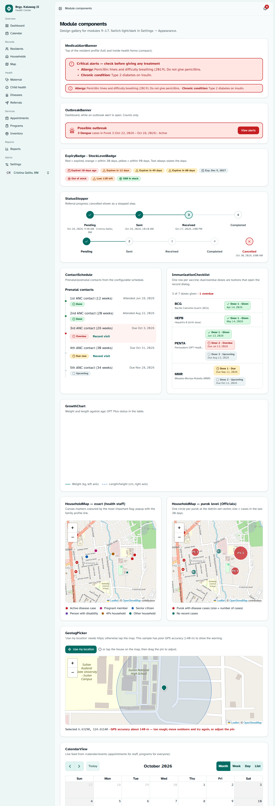
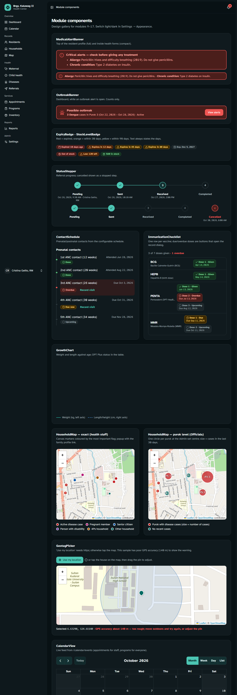
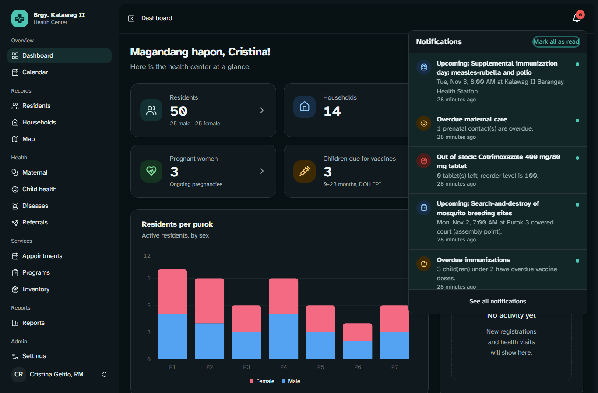
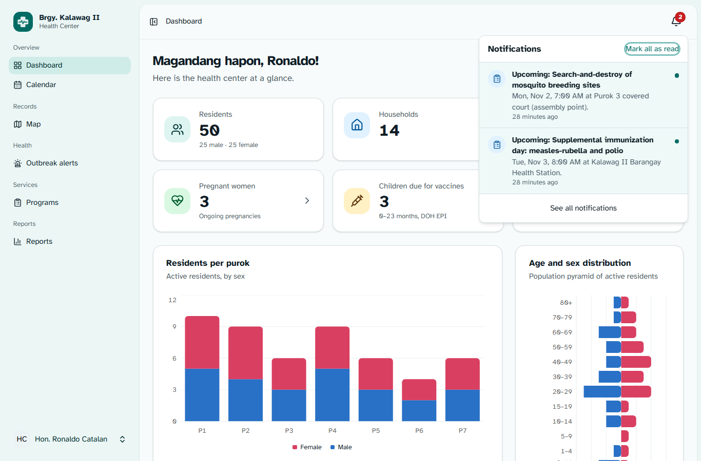

# Phase 5 (Additional Modules) — Design System & Page Designs

> **Role speaking: FRONTEND DESIGNER**

Extends the core design system (`docs/phase-4-design.md`) for modules 9–17. Same principles: readable first,
one primary action per screen, never colour alone, privacy by design, fast on a modest PC.

**See it live:** log in locally and open **`/dev/modules`** (sample data; the calendar reads the real feed).
The route exists only when `APP_ENV=local`. Screenshots: `docs/screenshots/additional/`.

|                                                                             |                                                                                                    |
| --------------------------------------------------------------------------- | -------------------------------------------------------------------------------------------------- |
|      |                               |
|  |  |

---

## 1. Theme additions (`resources/css/app.css`)

| Token                                      | Light                        | Dark                  | Use                                                                      |
| ------------------------------------------ | ---------------------------- | --------------------- | ------------------------------------------------------------------------ |
| `--caution` / `-soft` / `-soft-foreground` | orange `oklch(0.65 0.17 50)` | `oklch(0.75 0.15 55)` | Medicines expiring **within 30 days**, low stock (between amber and red) |
| `--marker-household`                       | teal                         | same                  | Household with no flag                                                   |
| `--marker-case`                            | red                          | same                  | Active disease case (highest priority)                                   |
| `--marker-pregnant`                        | magenta                      | same                  | Pregnant member                                                          |
| `--marker-senior`                          | blue                         | same                  | Senior citizen                                                           |
| `--marker-pwd`                             | violet                       | same                  | Person with disability                                                   |
| `--marker-four-ps`                         | amber-brown                  | same                  | 4Ps household                                                            |
| `.fc` variables                            | mapped to shadcn tokens      | follow dark mode      | FullCalendar borders, today, buttons (44 px), weekends, selection        |
| `.leaflet-*`                               | app font, popover colours    | follow dark mode      | Map popups and 44 px zoom buttons                                        |

Marker colours stay the same in dark mode because OpenStreetMap tiles stay light. New utilities:
`bg-caution-soft text-caution-soft-foreground border-caution`; `StatusBadge` gained `tone="caution"`.

### 1.1 Contrast — verified (WCAG 2.1 AA)

Same method as the core phase (OKLCH → sRGB → WCAG formula). **All 22 new pairs pass:**

| Pair                                                          | Ratio     | Needed |
| ------------------------------------------------------------- | --------- | ------ |
| Caution badge text on caution-soft — light / dark             | 6.1 / 8.8 | 4.5    |
| Caution border vs card (non-text)                             | 3.4       | 3      |
| Each map marker vs the lightest OSM tile (water `#aad3df`)    | 3.2 – 4.6 | 3      |
| White calendar text on each of the 7 appointment-type colours | 5.0 – 7.0 | 4.5    |
| White calendar text on each of the 6 program-type colours     | 5.0 – 8.7 | 4.5    |

## 2. New reusable components (`resources/js/components/app`)

| Component                                                  | Built from                                            | Purpose / key props                                                                                                                                                                                                                                                                                                                                                                                                                         |
| ---------------------------------------------------------- | ----------------------------------------------------- | ------------------------------------------------------------------------------------------------------------------------------------------------------------------------------------------------------------------------------------------------------------------------------------------------------------------------------------------------------------------------------------------------------------------------------------------- |
| `MedicalAlertBanner`                                       | (Alert styling)                                       | Red bordered banner of **critical** alerts; full (profile top) or `compact` (inside visit / dispense / referral forms). A labelled `<section>`, not `role="alert"`, so it is read once with the page.                                                                                                                                                                                                                                       |
| `OutbreakBanner`                                           | Button                                                | Dashboard banner while an alert is open: "3 Dengue cases in Purok 3 (dates) · Active" + **View alerts**. Counts only — same for Officials.                                                                                                                                                                                                                                                                                                  |
| `ExpiryBadge`                                              | StatusBadge                                           | From the server's `expiry_band` + `days_to_expiry`: **red** "Expired 10 days ago", **orange** "Expires in 12 days", **yellow** "Expires in 45 days", neutral "Exp. Dec 5, 2027". The text always states the days.                                                                                                                                                                                                                           |
| `StockLevelBadge`                                          | StatusBadge                                           | "Out of stock" (red) · "Low: 120 left" (orange, tooltip with reorder level) · "580 in stock" (green).                                                                                                                                                                                                                                                                                                                                       |
| `StatusStepper`                                            | —                                                     | Referral progress pending → sent → received → completed with date and person per step; a cancelled referral shows the steps reached plus a red **Cancelled** step. `<ol>` with `aria-current="step"`; vertical on phones.                                                                                                                                                                                                                   |
| `ContactSchedule`                                          | StatusBadge                                           | Prenatal/postnatal contacts as a timeline: label, due or attended date, **Done / Due now / Overdue / Upcoming / Missed / Not needed**; overdue rows tinted; "Record visit" on actionable rows.                                                                                                                                                                                                                                              |
| `ImmunizationChecklist`                                    | —                                                     | One row per vaccine, one tile per dose (✓ Given + date, Due, **Overdue**, Upcoming). Due/overdue tiles are buttons that open the record dialog, with a full spoken label. Summary "3 of 7 doses given · 1 overdue".                                                                                                                                                                                                                         |
| `GrowthChart`                                              | Chart (Recharts)                                      | Weight (solid, left axis) and length/height (dashed, right axis) against age in months; legend says which line is which (not colour alone); sr-only table with every measurement and its OPT Plus status.                                                                                                                                                                                                                                   |
| `NotificationBell`                                         | Popover, Button, Skeleton                             | In the header on every page. Badge = shared `unreadNotifications` (button label "Notifications, 8 unread"). Opening it partial-reloads `notificationsLatest`; items show category icon, level colour, message, time, unread dot; **Mark all as read**; **See all notifications**.                                                                                                                                                           |
| `HouseholdMap` + `MapLegend`                               | Leaflet, react-leaflet (`CircleMarker`, canvas)       | Exact mode: one marker per household coloured by its most important flag (case > pregnant > senior > PWD > 4Ps), bigger when flagged; popup with household no., head, purok, members, flags in words and **Open family health profile**. Purok mode (Officials, disease map): one circle per purok at the Admin-set centre, sized by cases, labelled "P3: 3". "Map background needs internet — markers are still accurate" when tiles fail. |
| `GeotagPicker`                                             | Leaflet, Alert, Button                                | **Use my location** (high-accuracy GPS, 20 s timeout) or tap the map; draggable CSS pin (no image files); accuracy circle; red warning when accuracy is worse than 100 m; plain-language messages for refused permission / timeout; explains that GPS needs the **https://** address when the page is not secure.                                                                                                                           |
| `CalendarView`                                             | FullCalendar 6 (daygrid, timegrid, list, interaction) | Month / week / day / list; reads `/calendar/events` for the visible range; colours from appointment/program types; completed events faded, missed struck through (+ sr-only text); click an event; select an empty slot to book (omitted for read-only roles); **phones start in list view**.                                                                                                                                               |
| `LazyHouseholdMap`, `LazyGeotagPicker`, `LazyCalendarView` | React.lazy + Suspense + Skeleton                      | Leaflet and FullCalendar load only on pages that use them (and never during SSR).                                                                                                                                                                                                                                                                                                                                                           |

### 2.1 Bundle

After the build: Leaflet sits in a lazy `TileLayer` chunk (152 KB), FullCalendar in `calendar-view` (270 KB);
neither is in the shared `app` chunk. The gallery initially pulled Leaflet in through the legend import — the legend
and flag labels now live in a separate light module (`map-legend.tsx`).

### 2.2 Sidebar regrouped (featured.md)

| Group    | Items (shown by permission)                                                                     |
| -------- | ----------------------------------------------------------------------------------------------- |
| Overview | Dashboard · **Calendar** (staff: appointments + programs; Officials: the program schedule)      |
| Records  | Residents · Households · **Map** (exact for staff, purok-level for Officials)                   |
| Health   | **Maternal** · **Child health** · **Diseases** (Officials: **Outbreak alerts**) · **Referrals** |
| Services | **Appointments** · **Programs** · **Inventory**                                                 |
| Reports  | Reports                                                                                         |
| Admin    | Users · Audit logs · Backups · **Settings** (Admin: all; Midwife: schedules only)               |

Empty groups are not shown. A Barangay Official sees Dashboard, Calendar, Map, Outbreak alerts, Programs and Reports.
The spec's "Visits" item gets a page in Phase 6 (a cross-resident list of health visits; visits are currently recorded
from the resident profile).

## 3. Page designs (built in Phase 6)

Legend: **[shadcn]** components · _(custom)_ app components. Every list page: _PageHeader_ → _SearchFilters_ →
_DataTable_ (server-side, URL state) → _EmptyState_. Every form: Card/Sheet/Dialog + _FormField_.

### 3.1 Map (`map/index`)

```
PageHeader "Household map"                                   [Geo-tag a household ▸] (staff)
Filter bar: Purok (Select) · Show: All / Pregnant / Senior / Active case / PWD / 4Ps (ToggleGroup)
┌ HouseholdMap (≈ 65 vh) ─────────────────────────────┐ ┌ Card: Not yet geo-tagged (12) ─┐
│  canvas markers · popups · offline notice           │ │ HH-0013 Purok 6  [Geo-tag]     │
└─────────────────────────────────────────────────────┘ │ HH-0014 Purok 7  [Geo-tag]     │
MapLegend                                               └────────────────────────────────┘
Card: "Households on the map" — DataTable of the same markers (keyboard/screen-reader alternative)
```

Officials: purok circles + Card "Disease cases per purok (last 30 days)" table; days filter 7/14/30/90; no lists of houses.

### 3.2 Geo-tag (on `households/show`)

"Location" card with a mini `HouseholdMap` (one marker), geo-tagged date/by/accuracy, **Geo-tag / Update location**
→ **Dialog** with `GeotagPicker` and Save. Without consent: an Alert "Record a geo-tagging consent first" with a button
opening the consent dialog (type preselected). **Remove location** → _ConfirmDialog_.

### 3.3 Household / family health profile (`households/show`, extended)

PageHeader (HH-0005, Purok 3) [Print family health summary] [Edit] → Cards: **Household data** (address, head, water
source ✓ safe / ✕ unsafe, toilet ✓ sanitary / ✕, 4Ps badge) · **Location** (3.2) · **Members** Table: name + _ResidentBadges_,
age, relationship, health flags (Pregnant · High-risk · Under 5 · ⚠ critical alert · conditions · active case · FP method
or "No FP consent" muted). Print uses the PDF from Phase 7.

### 3.4 Resident profile (extended)

_MedicalAlertBanner_ **above the PageHeader**. Tabs: Personal info · **Emergency contacts & alerts** · Health timeline ·
Immunizations · **Maternal / child growth** · **Referrals** · **Appointments** · History.

- Contacts & alerts: two Cards — contacts Table (★ primary, phone as `tel:` link) + Add/Edit Dialog; alerts list
  (severity badge, active/inactive Switch, Add/Edit Dialog with type Select, severity RadioGroup).
- Maternal / child growth: women → current pregnancy summary + link to the tracker; children → `GrowthChart`,
  vitamin A / deworming status, "Add measurement" Dialog (OPT Plus status Select).
- Referrals / Appointments: compact Tables with status badges and links; "New referral" / "Book appointment".
- The visit **Sheet** shows `MedicalAlertBanner compact` at the top.

### 3.5 Diseases (`diseases/index`) and outbreak alerts (`diseases/alerts`)

```
PageHeader "Disease surveillance"                          [Report a case]
OutbreakBanner (if any open)
Card: Cases per week (line chart, top 5 diseases, 26 weeks)  │ Card: Cases per purok (HouseholdMap purok mode + table)
SearchFilters: search · Disease · Purok · Classification · Outcome · Onset from/to
DataTable: Onset · Resident (link) · Disease (PIDSR badge) · Purok · Classification badge · Outcome · ⋯ (Classify — Midwife/Admin)
```

Report case **Sheet**: resident Combobox (shows critical alerts compact), disease Combobox (Category I diseases marked
"report immediately"), onset DatePicker, classification RadioGroup (BHW: fixed to Suspected with a note), notes.
Alerts page: cards per alert (status badge, disease, place, count vs threshold, period, acknowledged by) with
**Acknowledge · Monitoring · Close** (close asks for a note); Officials see the same cards without buttons.

### 3.6 Maternal tracker (`maternal/index`, `maternal/show`)

List: filter chips **All ongoing · Overdue · Due within 30 days · Postnatal (6 weeks)** + purok + risk; DataTable: name,
purok, AOG (weeks), EDD, risk badge (High-risk red), next contact + date, overdue count badge.
Detail: _MedicalAlertBanner_ → summary Card (LMP, EDD, AOG, G/P, risk factors as badges, notes) · Tabs: **Schedule**
(_ContactSchedule_ with Record visit → visit Sheet prefilled "Prenatal") · **Visits** (_HealthTimeline_ with vitals) ·
**Delivery** (form Card when ongoing: date, time, place RadioGroup, attendant, mode, births, newborn rows with
"+ Add baby"; read-only Card after) · **Appointments**. Edit pregnancy Dialog with risk-factor Checkboxes.

### 3.7 Child health (`child-health/index`, `child-health/show`)

List: filter chips **Overdue vaccines · Due now · Malnourished · Vitamin A due**; DataTable: child, age (months), purok,
EPI "5/12 · 1 overdue", latest nutritional status badge, last weighed, vitamin A due badge.
Detail: _MedicalAlertBanner_ → header (age in months, mother link) · Cards: _ImmunizationChecklist_ · _GrowthChart_ +
measurements Table · Micronutrients (status line "Vitamin A due since …" + history) with Dialogs to record.

### 3.8 Referrals (`referrals/index`, `referrals/show`)

List: status filter chips + urgency + facility; DataTable: Ref no. (mono), resident, facility, urgency badge
(Emergency red), status badge, referred at, by. **New referral** Sheet: resident Combobox, facility Select, urgency
RadioGroup, reason Textarea, link to today's visit (optional).
Detail: _MedicalAlertBanner_ → _StatusStepper_ → Cards: patient, reason, vitals of the linked visit, return-slip
feedback · actions for the allowed next statuses (feedback Textarea when completing) · **Print referral slip** (Phase 7).

### 3.9 Inventory (`inventory/index`, `inventory/show`)

List: search + chips **Expiring (≤ 90 days) · Low stock**; DataTable: medicine (generic, strength, form), usable stock
_StockLevelBadge_, nearest expiry _ExpiryBadge_, expired on hand (red text), reorder level; row actions **Dispense**
(Dialog: resident Combobox → `residentAlerts` compact banner, quantity, "taken from batch X (FEFO)" preview) and,
for managers, **Receive stock**. Detail: batches Table with _ExpiryBadge_ and actions Adjust / Transfer out / Write off
(expired only) · ledger Table (type badge, +/− quantity, batch, resident for health roles, by, reason).

### 3.10 Appointments & calendar (`appointments/index`)

Tabs **Calendar | List** (`?view=calendar` from the sidebar's Calendar item). Stat strip: today · missed (7 days).
Calendar: `CalendarView`; click an appointment → **Sheet** (resident, type, date/time, assigned staff, status, notes,
"Generated from the prenatal schedule" note, Save); click a program → its page; select a slot → booking Sheet.
List: date range + status + type + "Assigned to me / Unassigned"; DataTable with quick status buttons (Completed / Missed / Cancel).

### 3.11 Programs (`programs/index`, `programs/show`)

List: Upcoming / Past tabs + type; cards or DataTable (date, title, type colour dot, venue, target, puroks, attendance).
Detail: header with status, venue, time, target group, puroks, staff · **Attendance** Card: eligible count, search
(partial reload of `eligible`) with Checkbox list + "Mark present", attendee Table with remove; Officials see counts by
purok only. Schedule/edit program in a **Sheet**.

### 3.12 Notifications (`notifications/index`) and Settings (`health-settings/index`)

Notifications: All / Unread tabs, list like the bell, pagination, **Mark all as read**.
Settings: Tabs **Outbreak thresholds · Diseases · Prenatal & postnatal schedule · Immunization schedule · Facilities ·
Purok map centres** (tabs shown by permission). Each tab = Table + Add/Edit Dialog; purok centres use `GeotagPicker`
without GPS ("tap the centre of the purok").

### 3.13 Dashboard (extended)

```
OutbreakBanner (if any)
StatCards: Residents · Households · Pregnant · Children due · Active outbreaks · Expiring medicines (≤30 d) · Low stock · Today's appointments (missed: n)
Card: Disease cases, last 12 weeks (bar chart) │ Card: Today's appointments (list, links)
Charts: Residents per purok · Age & sex          │ Card: Upcoming programs │ Card: Recent activity
```

Each card appears only when the role has the permission (the server sends `null` otherwise).

## 4. Accessibility (applied to the new components)

- Maps: region label, legend in words, popups list flags in words, and every map page has a table/list alternative
  (Leaflet markers on canvas are not keyboard-focusable).
- Calendar: FullCalendar's buttons are real buttons (44 px), list view on phones, status in text (sr-only) not only styling.
- Bell: count in the button's accessible name; unread items say "(unread)"; the list loads only on open (`aria-busy`).
- Banners are labelled regions; banners and badges always state their meaning in text.
- Charts keep an sr-only data table; dashed vs solid lines distinguish the two series.
- Every new target is ≥ 44 px (map zoom, calendar buttons, checklist tiles, "Record visit" links).

## 5. Verification

| Check                                                                                             | Result                                                                                                                                                                                                                   |
| ------------------------------------------------------------------------------------------------- | ------------------------------------------------------------------------------------------------------------------------------------------------------------------------------------------------------------------------ |
| Headless Edge, `/dev/modules` + dashboard as Midwife, Official, BHW (desktop, phone, light, dark) | **0 JavaScript errors**; screenshots reviewed                                                                                                                                                                            |
| Problems found in the screenshots, fixed                                                          | Cancelled stepper didn't mark the last reached step; stepper labels drifted from their circles on phones; FullCalendar's default light-grey weekend shading glared in dark mode (now a themed `--fc-non-business-color`) |
| `tsc --noEmit`, `vp check`                                                                        | clean (except your `featured.md`, left untouched)                                                                                                                                                                        |
| `npm run build`                                                                                   | succeeds; Leaflet / FullCalendar in lazy chunks                                                                                                                                                                          |
| Pest                                                                                              | **168 / 168 pass** (no backend changes this phase besides the local-only gallery route)                                                                                                                                  |

During the check I temporarily cleared "must change password" on four seeded accounts and restored it afterwards; their
_last login_ now shows today.

## 6. Notes

- **Packages added (pnpm):** `leaflet` 1.9.4, `react-leaflet` 5.0.0, `@types/leaflet`, `@fullcalendar/{core,react,daygrid,timegrid,list,interaction}` 6.1.22.
  FullCalendar **7** was just released with a new API and a Temporal polyfill; 6.1.x is the stable, React 19–compatible line.
  `package-lock.json` (npm) was not updated — the project installs with **pnpm** (`pnpm-lock.yaml`).
- **OpenStreetMap tiles** need internet and follow the OSM tile usage policy (fine for one health center's light use;
  attribution is shown). If the barangay ever needs offline maps, a local tile cache can replace the tile URL in one place.
- **GPS needs HTTPS** on tablets — set up in the Phase 8 deployment guide (local certificate). Until then "Use my location"
  explains this and staff tap the map.
- The pregnancy dialog on the existing resident profile still offers "Delivered" (the server refuses it); Phase 6 replaces it.
