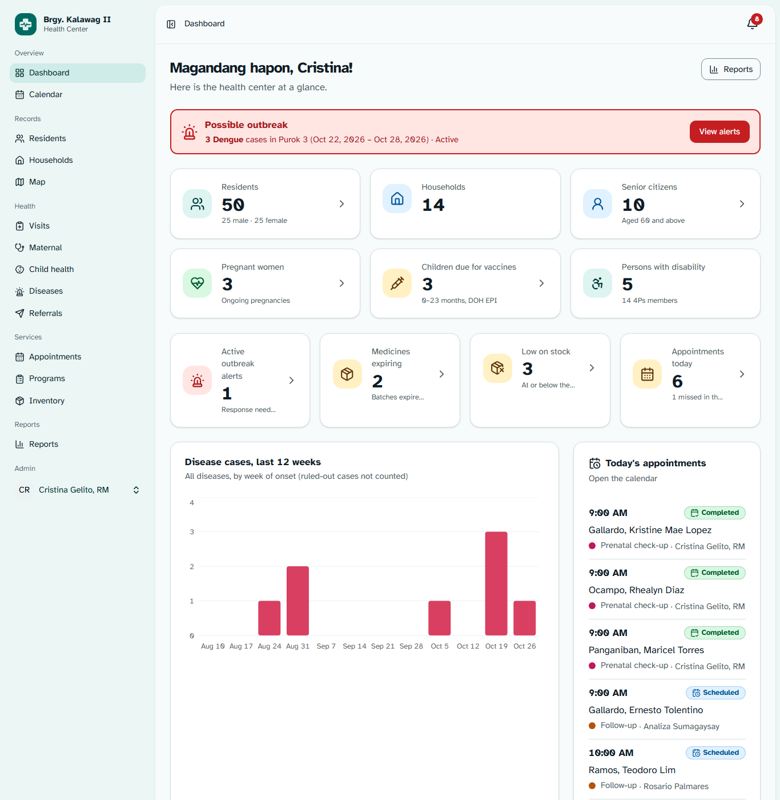
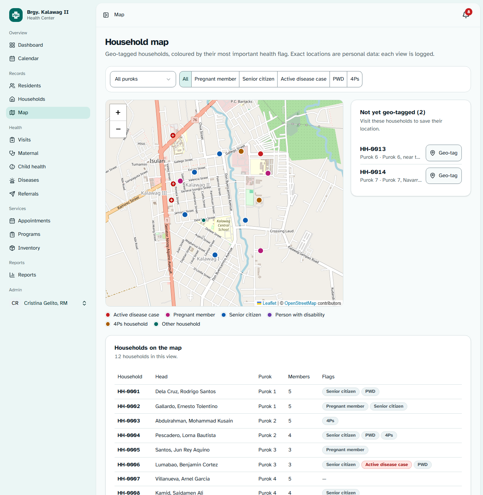
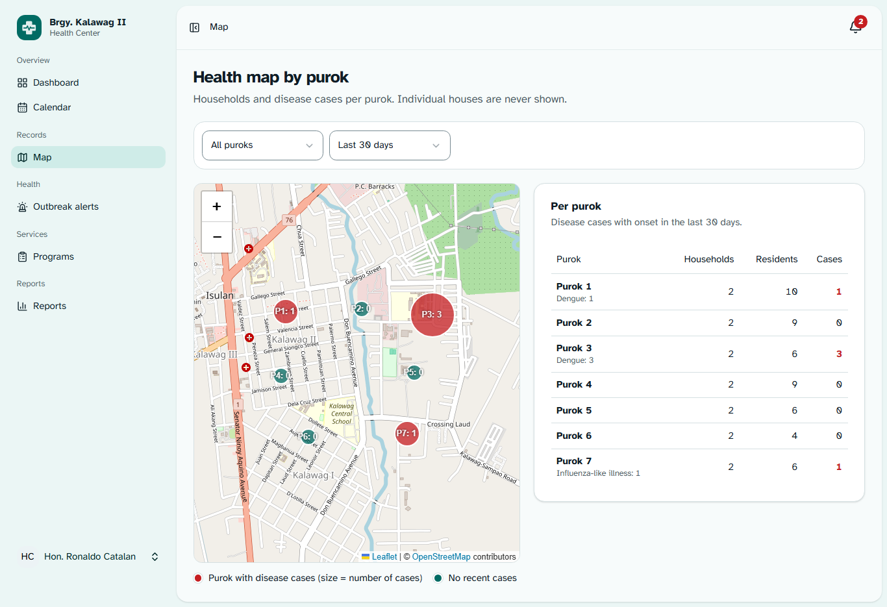
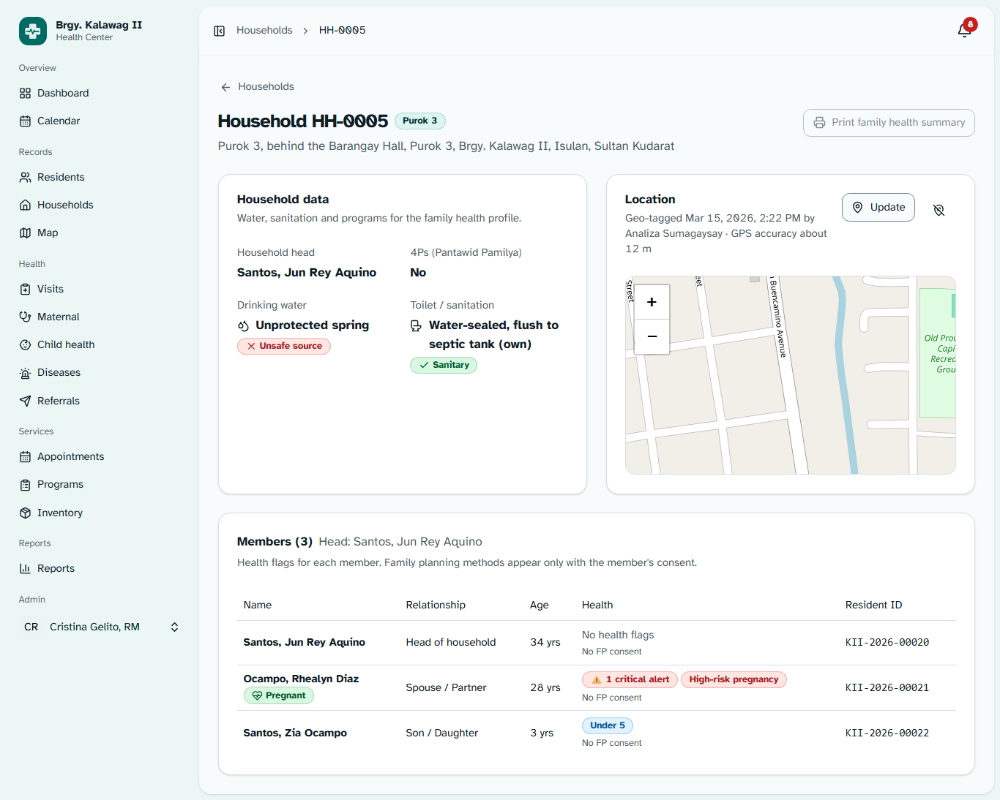
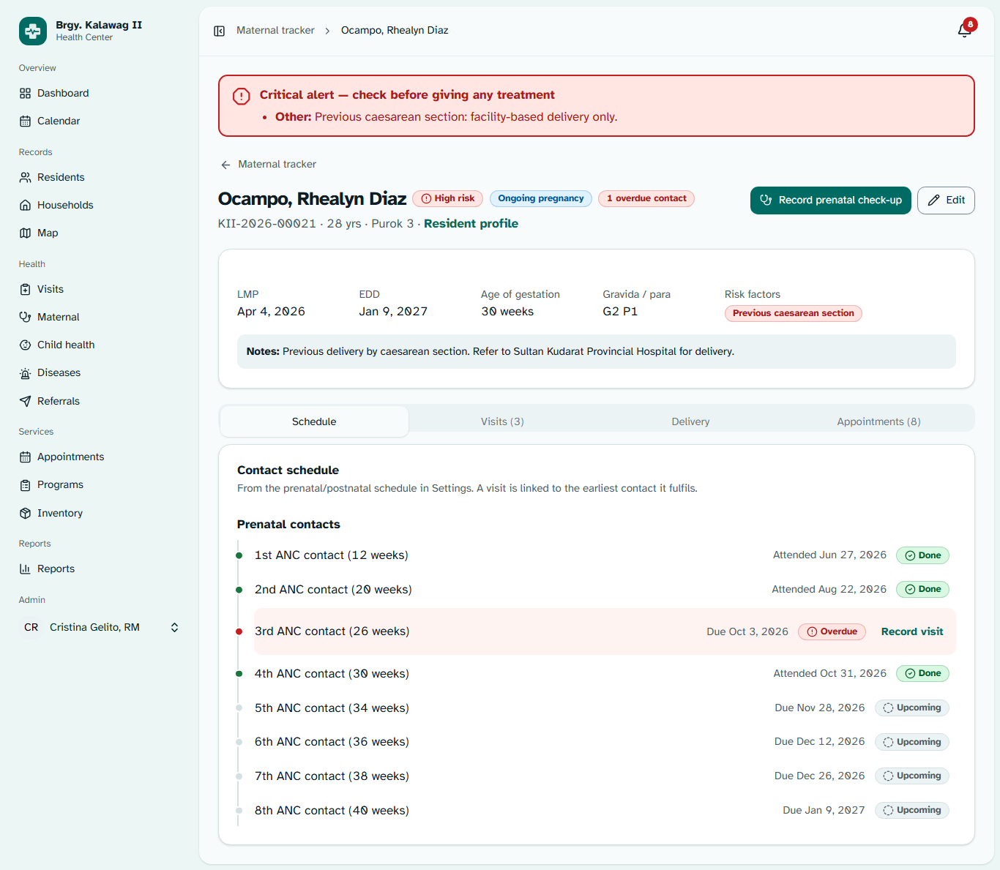
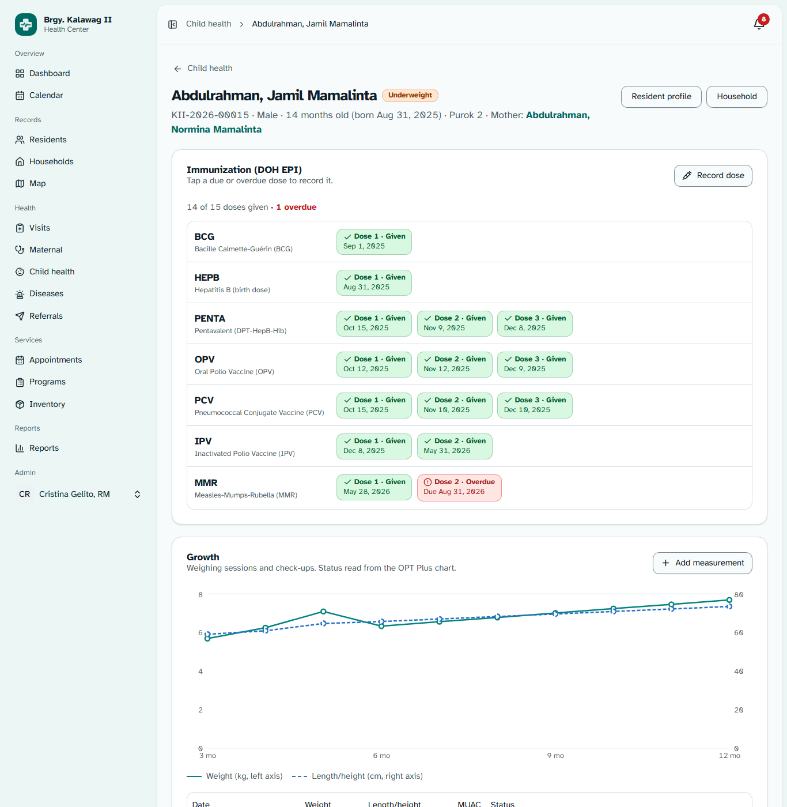
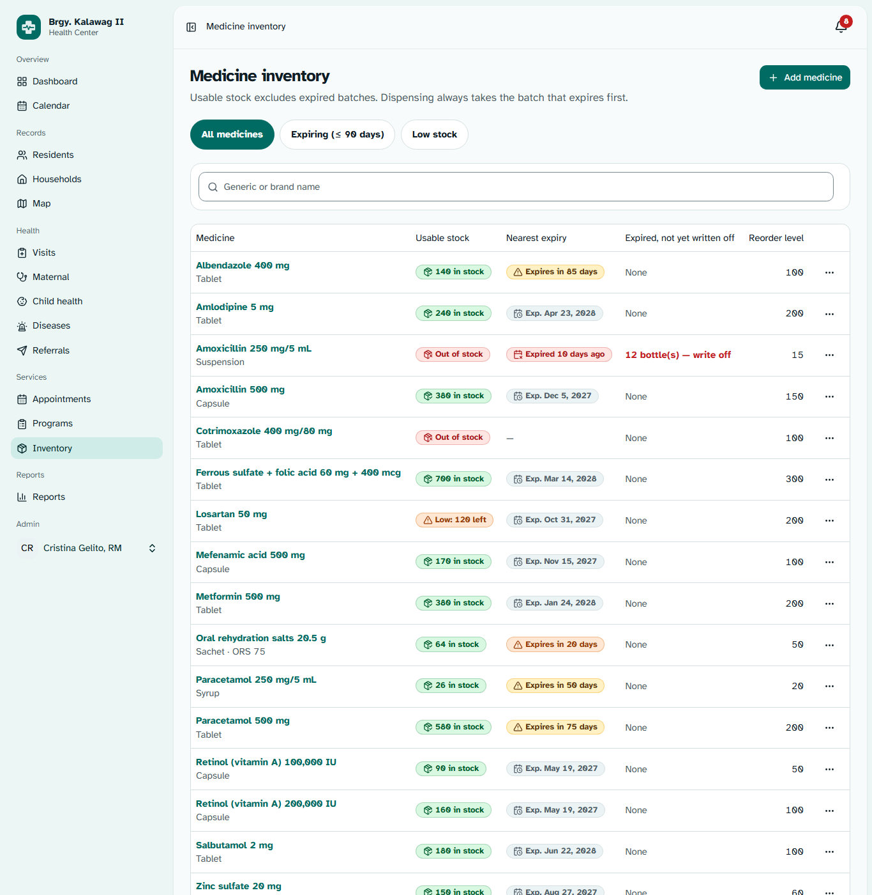
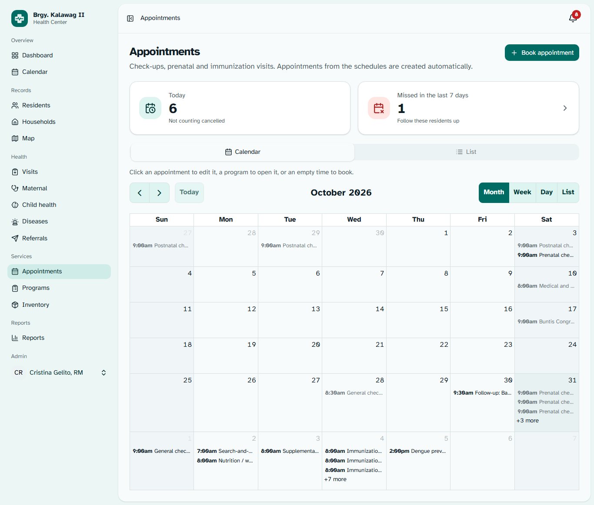

# Phase 6 (Additional Modules) — Inertia + React Pages

> **Role speaking: WEB DEVELOPER**

Every screen for modules 9–17 is built on the Phase 4 backend with the Phase 5 components. All 16 placeholders are
gone, plus a new **Visits** page and extensions to the resident profile, household page and dashboard.
Screenshots (headless Edge, seeded data, 1366 px unless noted): `docs/screenshots/additional/06…20`.

|                                                                  |                                                                                  |
| ---------------------------------------------------------------- | -------------------------------------------------------------------------------- |
|          |                         |
|  |  |
|          |                    |
|          |                            |

---

## 1. Pages

| Page                    | File                                                      | Highlights                                                                                                                                                                                                                                                                                                                                           |
| ----------------------- | --------------------------------------------------------- | ---------------------------------------------------------------------------------------------------------------------------------------------------------------------------------------------------------------------------------------------------------------------------------------------------------------------------------------------------- |
| Household map           | `pages/map/index.tsx`                                     | Staff: canvas markers by flag, purok + flag filters in the URL, "Not yet geo-tagged" card with Geo-tag links, the same households as a table (keyboard / screen-reader alternative). Officials: "Health map by purok" — circles at purok centres, per-purok table, 7/14/30/90-day filter, no houses.                                                 |
| Family health profile   | `pages/households/show.tsx`                               | Household data (water source ✓/✕ safe, toilet ✓/✕ sanitary, 4Ps), Location card with mini map, Geo-tag dialog (GPS or tap), Remove location, consent prompt when no geo-tagging consent, members with health flags (critical alerts, pregnant / high-risk, under 5, cases, conditions, FP method only with consent). Print button waits for Phase 7. |
| Resident profile        | `pages/residents/show.tsx` + `components/app/residents/*` | Red critical-alert banner above the header; new tabs **Emergency contacts & alerts**, **Maternal / child growth**, **Referrals**, **Appointments**; tabs scroll in one row; compact banner in the visit sheet; consent type select; pregnancy dialog with risk-factor checkboxes and no "Delivered" option (recorded from the tracker).              |
| Health visits           | `pages/health/visits.tsx` (+ `VisitListController`)       | All visits, server-side: search, type, purok, date range, "Attended by me", sort, rows per page. No complaint/diagnosis/notes in the list.                                                                                                                                                                                                           |
| Disease surveillance    | `pages/diseases/index.tsx`                                | Outbreak banner, weekly trend (top 5 diseases, distinct dash patterns), cases-per-purok map + table, filters, case table, "Report a case" sheet (BHWs: saved as Suspected), Classify dialog, remove.                                                                                                                                                 |
| Outbreak alerts         | `pages/diseases/alerts.tsx`                               | Status filter, alert cards (count vs alert level, period, who acknowledged/closed), Acknowledge / Move to monitoring / Close (with note); read-only for Officials.                                                                                                                                                                                   |
| Maternal tracker        | `pages/maternal/index.tsx`, `show.tsx`                    | Chips All / Overdue / Due within 30 days / Postnatal; table with AOG, EDD, risk, next contact, overdue. Detail: banner, summary, tabs Schedule (`ContactSchedule` + record check-up sheet), Visits, Delivery (form with "+ Add baby" → newborn registration; then delivery card and newborn links), Appointments; Edit pregnancy dialog.             |
| Child health            | `pages/child-health/index.tsx`, `show.tsx`                | Chips Overdue vaccines / Due now / Not normal nutrition / Vitamin A due; table with EPI summary, nutrition, last weighed. Detail: banner, mother link, `ImmunizationChecklist` (tap a due dose to record it), `GrowthChart` + measurements, vitamin A / deworming status and history.                                                                |
| Referrals               | `pages/referrals/index.tsx`, `show.tsx`                   | Status chips, urgency and facility filters, "New referral" sheet. Detail: banner, `StatusStepper`, patient / reason / linked visit vitals / return slip, next-status buttons (feedback when completing, confirm when cancelling).                                                                                                                    |
| Inventory               | `pages/inventory/index.tsx`, `show.tsx`                   | Expiring / Low stock chips; stock and expiry badges; Dispense dialog (resident search → that resident's critical alerts appear before the quantity); Receive stock and Add medicine for managers. Detail: batches with expiry badges and Adjust / Transfer out / Write off; ledger with ± quantities and type filter.                                |
| Appointments & calendar | `pages/appointments/index.tsx`                            | Calendar / List tabs (`?view=calendar` from the sidebar), today and missed counts; click an event to edit in a sheet, select a slot to book; list filters and quick Completed / Missed / Cancel.                                                                                                                                                     |
| Programs                | `pages/programs/index.tsx`, `show.tsx`                    | Upcoming / Past, type filter, program cards; read-only program calendar for Officials; schedule/edit sheet; attendance checklist of eligible residents (after the program starts); Officials see counts per purok only.                                                                                                                              |
| Notifications           | `pages/notifications/index.tsx`                           | All / Unread, opens through the notification link (marks it read), mark all as read, paging.                                                                                                                                                                                                                                                         |
| Health settings         | `pages/health-settings/index.tsx`                         | Tabs by permission: outbreak thresholds, diseases, prenatal & postnatal schedule (weeks / days), immunization schedule, facilities, purok map centres (map picker).                                                                                                                                                                                  |
| Dashboard               | `pages/dashboard.tsx`                                     | Outbreak banner; stat cards for active outbreaks, medicines expiring (≤ 30 days), low stock, today's appointments (+ missed); disease trend chart; today's appointments; upcoming programs — each only when the role's data is sent.                                                                                                                 |

The sidebar's Health group now starts with **Visits**.

## 2. Browser verification

A headless-Edge run logged in as **Midwife, BHW and Barangay Official** and opened every new page — 38 page views
including tabs, the delivered pregnancy, phone widths for the map, calendar and profile — and recorded JavaScript
errors: **0**. Reviewing the screenshots found these problems, all fixed:

| Found                                                            | Cause                                                                                                                                    | Fix                                                                 |
| ---------------------------------------------------------------- | ---------------------------------------------------------------------------------------------------------------------------------------- | ------------------------------------------------------------------- |
| **Calendar showed no events** (every role)                       | The event source was a new object on each render; FullCalendar re-added it, refetched, re-rendered — 13 requests in 6 s, never displayed | Memoised event source in `CalendarView`                             |
| **Settings page: sidebar almost empty**                          | The page sent its own prop named `can`, which replaced the shared `can` permission flags                                                 | Renamed to `allowed` (checked: no other page shadows a shared prop) |
| Schedule tables' headings under the tables                       | `TableCaption` renders below the table                                                                                                   | Visible `<h3>` above each table; caption kept for screen readers    |
| Dashboard "Today's appointments" squeezed into one word per line | Row layout in the narrow side column                                                                                                     | Time + status on top, person and type below                         |
| Officials' per-purok table cut off the Cases column              | 24 rem side column                                                                                                                       | 30 rem                                                              |
| Profile tabs wrapped onto a second, centred line                 | `flex-wrap` on the tab list                                                                                                              | One row that scrolls sideways                                       |
| Disease map ignored the configured map centre                    | Hard-coded coordinates in the page                                                                                                       | `map` prop from config                                              |
| Household dialog matched water/toilet options by name            | The resource sent names only                                                                                                             | Resource now sends `water_source_id` / `toilet_type_id`             |

The growth chart looked blank in some screenshots; probing the page showed it fully drawn — the capture script resizes
the viewport just before the screenshot. A capture without the resize shows it correctly (screenshot 20).

## 3. Checks

| Check                      | Result                                                            |
| -------------------------- | ----------------------------------------------------------------- |
| Pest                       | **174 / 174 pass** (1,160 assertions) — 6 new for the Visits page |
| Larastan (level 7), Pint   | clean                                                             |
| `tsc --noEmit`, `vp check` | clean (except `featured.md`, your spec file)                      |
| `npm run build`            | succeeds                                                          |

## 4. Notes

- **How this phase was built:** four builders worked in parallel on separate page groups (each owning its own files),
  then one integration pass ran the checks and the browser review above.
- The medicine list and maternal tracker are not paginated (a health station has dozens of medicines and a handful of
  ongoing pregnancies); every other list is server-paginated.
- The receive-stock form uses the browser's date input for the expiry date (the shared date picker stops two years ahead).
- Clicking a calendar appointment leaves `?appointment=ID` in the address bar (Inertia partial reload); harmless.
- Times are entered and shown in Philippine time (server and browsers on Asia/Manila).
- Still waiting for Phase 7: "Print family health summary" and "Print referral slip" (disabled with a tooltip).
- During the browser run I temporarily cleared "must change password" on three seeded accounts and restored it; their
  last login shows today.
