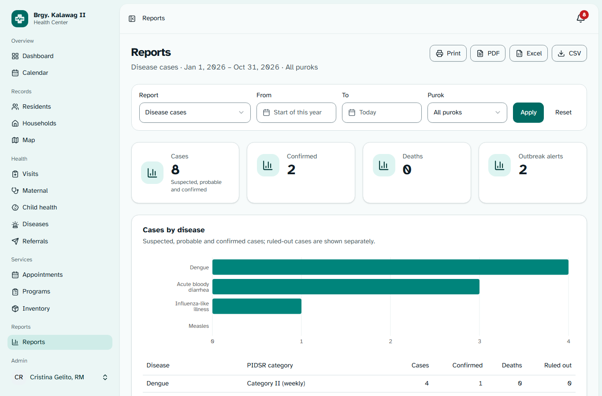
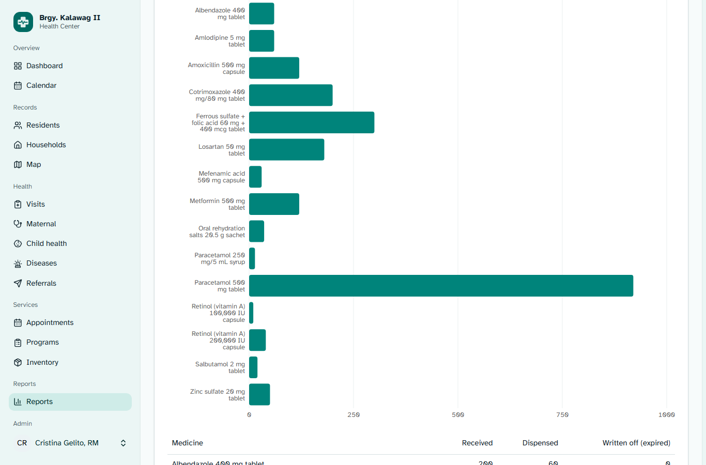
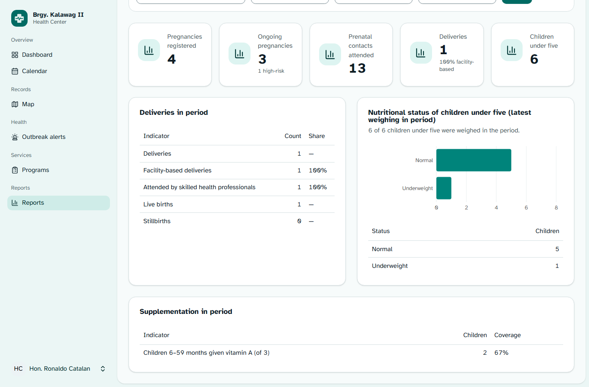
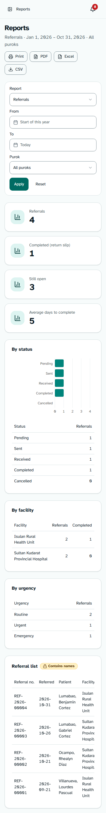

# Phase 7 (Additional Modules) — Reports, Printouts & Exports

> **Role speaking: WEB DEVELOPER**

The Reports page gains five module reports next to the existing summary. Every report exports to PDF, Excel and CSV.
Two printouts are new: the **referral slip** (with a tear-off return slip) and the **family health summary**.
Screenshots: `docs/screenshots/additional/21…24`.

|                                                                                  |                                                                                   |
| -------------------------------------------------------------------------------- | --------------------------------------------------------------------------------- |
|               |  |
|  |   |

---

## 1. Module reports

Pick a report from the new **Report** select on `/reports`. It applies immediately; the date range and purok filters
work as before. `?report=` is kept in the URL (`summary` is the default and is left out).

| Report (`report=`)                         | Totals                                                                                                             | Tables (🔒 = names; health roles only)                                                                                                                     |
| ------------------------------------------ | ------------------------------------------------------------------------------------------------------------------ | ---------------------------------------------------------------------------------------------------------------------------------------------------------- |
| Disease cases (`diseases`)                 | Cases (suspected, probable, confirmed), confirmed, deaths, outbreak alerts                                         | By disease (with PIDSR category, ruled-out shown apart), by purok, outbreak alerts raised, 🔒 case line list                                               |
| Referrals (`referrals`)                    | Referrals, completed (return slip), still open, average days to complete                                           | By status, by facility, by urgency, 🔒 referral list                                                                                                       |
| Program attendance (`programs`)            | Programs held or scheduled, completed, attendance (people)                                                         | Programs, by program type, attendance by purok                                                                                                             |
| Medicine stock (`inventory`)               | Medicines, low or out of stock, batches expiring ≤ 90 days or expired, units dispensed                             | Stock position, stock movements in period, batches expiring within 90 days or expired                                                                      |
| Maternal & child health (`maternal_child`) | Pregnancies registered, ongoing (high-risk), prenatal contacts, deliveries (facility-based %), children under five | Deliveries (facility-based, skilled attendant, live births, stillbirths), nutritional status (latest weighing), vitamin A coverage, 🔒 ongoing pregnancies |

- **One shape for all reports.** `App\Services\ModuleReportService::build()` returns `totals[]` and `tables[]`; each
  table has columns, rows, an optional chart and a `named` flag. The page (`ModuleReportView`), the PDF
  (`reports/module.blade.php`) and the Excel export all draw from that one array. A new report needs only a new
  method in the service.
- **Names are never built for Officials.** 🔒 tables are only added when the user has `diseases.view` (line list)
  or `health.view_sensitive` (referrals, pregnancies). So the data never leaves the server: there is nothing to hide
  in the browser. On screen these tables carry a "Contains names" badge.
- **Deferred loading.** The report is an `Inertia::defer` prop; the filters show at once and a skeleton holds the
  layout until the numbers arrive.
- **Medicine stock** is station-wide, so the purok filter does not apply. The report says so.
- **Vitamin A coverage** is counted over children 6–59 months, since vitamin A starts at 6 months.

## 2. Exports

The PDF / Excel / CSV buttons export whatever report is selected.

| Format | Contents                                                                                                   |
| ------ | ---------------------------------------------------------------------------------------------------------- |
| PDF    | Letterhead, period and purok, totals, every table (numbers right-aligned), RA 10173 confidentiality footer |
| Excel  | An **Overview** sheet (title, barangay, period, purok, totals) plus one sheet per table                    |
| CSV    | Everything stacked on one sheet (CSV cannot hold several), with section headings                           |

Every export writes an `exported` audit entry, e.g. _"Exported medicine stock report (XLSX) … with name lists"_.
For an Official it reads _"… aggregates only"_.

## 3. Printouts

Both open as a PDF in a new tab, ready to print. Each print is an audited `exported` entry.

| Printout              | Where                                     | Who                                    | Contents                                                                                                                                                                                                                                                               |
| --------------------- | ----------------------------------------- | -------------------------------------- | ---------------------------------------------------------------------------------------------------------------------------------------------------------------------------------------------------------------------------------------------------------------------- |
| Referral slip         | Referral page → **Print referral slip**   | Health roles (`health.view_sensitive`) | Patient details; boxed critical and warning medical alerts; primary emergency contact; ongoing pregnancy (AOG, EDD, risk factors); reason and urgency; vitals and findings from the linked visit; signature lines; tear-off **return slip** for the receiving facility |
| Family health summary | Household page → **Print family summary** | Health roles + `residents.view`        | Household (purok, water source, toilet, 4Ps); members with age and flags; health details (conditions, alerts, pregnancy, immunization and nutrition status); emergency contacts                                                                                        |

- The family summary has **no diagnoses or visit notes**. It goes home with the family.
- A member's **family planning method appears only with an active family-planning consent**. If the consent is
  revoked, the next printout leaves it out.
- Officials get 403 for both, and their buttons are hidden.

## 4. Files

| Area     | Files                                                                                                                                                                                        |
| -------- | -------------------------------------------------------------------------------------------------------------------------------------------------------------------------------------------- |
| Services | `app/Services/ModuleReportService.php`, `app/Services/FamilyHealthSummary.php`                                                                                                               |
| Exports  | `app/Exports/ModuleReportExport.php` (implements `Export` + `WithMultipleSheets`; Excel 4 needs the explicit `Export` marker), `app/Exports/ModuleReportSheet.php`                           |
| HTTP     | `ReportController` (`report` filter, `moduleReport` deferred prop, `exportModule()`), `ReportFilterRequest::report()`, `Health\ReferralController::slip()`, `HouseholdController::summary()` |
| Routes   | `referrals.slip` (`GET referrals/{referral}/slip`), `households.summary` (`GET households/{household}/summary`) in `routes/modules.php`                                                      |
| Views    | `pdf/partials/styles` and `pdf/partials/header` (shared letterhead and footer), `reports/module`, `pdf/referral-slip`, `pdf/family-health-summary`                                           |
| React    | `components/app/reports/module-report-view.tsx`, `pages/reports/index.tsx`, print buttons in `pages/households/show.tsx` and `pages/referrals/show.tsx`                                      |

## 5. Verification

| Check                                                           | Result                                                                                                                                                                                                                                                            |
| --------------------------------------------------------------- | ----------------------------------------------------------------------------------------------------------------------------------------------------------------------------------------------------------------------------------------------------------------- |
| Pest (`tests/Feature/Modules/ReportsExportsTest.php`, 12 tests) | Every report builds; Officials never get 🔒 tables or resident IDs; deferred prop; invalid `report` rejected; PDF/XLSX/CSV downloads audited; "aggregates only" export; slip and summary 403 for Officials, PDF + audit for health roles; FP method needs consent |
| Full suite                                                      | **186 / 186** passed (1,231 assertions)                                                                                                                                                                                                                           |
| Pint / Larastan level 7                                         | Clean                                                                                                                                                                                                                                                             |
| `tsc`, `vp check`, `npm run build`                              | Clean (`vp check` still flags only `featured.md`, which is left as written)                                                                                                                                                                                       |
| PDFs                                                            | All five module reports, the referral slip and the family summary rendered from MySQL sample data and reviewed                                                                                                                                                    |
| Browser (headless Edge, Midwife + Official, 1366 px and 390 px) | No console errors; Officials see counts only                                                                                                                                                                                                                      |

Fixes made during the review:

- **Excel export crashed** (`ModuleReportExport` was missing Excel 4's `Export` marker). Caught by the new tests.
- **Phone overflow:** report cards pushed tables off-screen at 390 px. Cards are now `min-w-0`, so tables scroll inside them.
- **Gaps:** a short table with no partner left an empty half row. It now takes the full row.
- The totals grid matches the number of totals, so there is no empty fifth slot.
- **Overlapping labels** in the stock movements chart. Rows are taller when labels are long.
- **Cut-off hints:** stat-card hints were truncated to one line ("Suspected, …"). They now wrap to two lines. The
  change is in `StatCard`, so it applies everywhere.
- **Larastan:** the purok-scope closure lost model types. It is now a generic `inPurok()` method.
- Numeric PDF columns were left-aligned because of CSS specificity. Fixed in the shared and summary styles.
- Vitamin A coverage used all under-fives as the denominator. Now children 6–59 months.

> Charts below the first screen came out blank in full-page captures. The DOM had every bar (checked by count and
> size), and viewport captures show them. This is a quirk of the capture tool, not the app.
