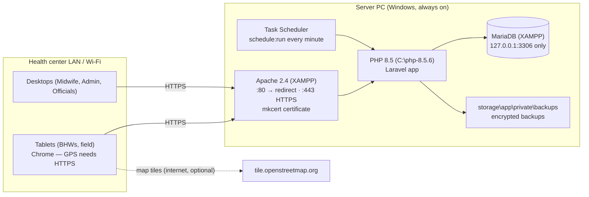

# Deployment Guide — Local Barangay Server

Barangay Health Resident Profiling System — Barangay Health Center, Kalawag II, Isulan, Sultan Kudarat.
For the **barangay IT support person** who installs and maintains the server. Backups and restores are covered
separately in [restore.md](restore.md).

The system runs on **one Windows PC at the health center**. Desktops and tablets on the same Wi-Fi/LAN open it in a
browser. It does not need the internet. Only the map tiles (OpenStreetMap) need it, and everything else keeps working
without them.



---

## 1. What you need

| Item                    | Requirement                                                                                                                                                |
| ----------------------- | ---------------------------------------------------------------------------------------------------------------------------------------------------------- |
| Server PC               | Windows 10/11 64-bit, 4 GB RAM or more, SSD, on a UPS. Wired to the router. **Static LAN address** (DHCP reservation in the router), e.g. `192.168.1.108`. |
| XAMPP                   | Apache 2.4 and MariaDB (MySQL). XAMPP's own PHP (8.0) is **not** used.                                                                                     |
| PHP                     | PHP **8.5 Thread Safe x64** in `C:\php-8.5.6` (from windows.php.net). It must be the Thread Safe build, because Apache loads `php8apache2_4.dll`.          |
| Composer, Node.js, pnpm | To install dependencies and build the frontend (`npm i -g pnpm`).                                                                                          |
| mkcert                  | `winget install FiloSottile.mkcert`. It makes the local HTTPS certificate.                                                                                 |
| App folder              | `C:\BarangayHealth\barangayHall`. Keep it **outside** `Documents`/`Desktop`, so OneDrive cannot upload health data to the cloud (RA 10173).                |

> All commands below are for **PowerShell run as Administrator**, from `C:\BarangayHealth\barangayHall` unless stated.

## 2. PHP settings

Edit `C:\php-8.5.6\php.ini`:

```ini
expose_php = Off
display_errors = Off
log_errors = On
memory_limit = 512M
date.timezone = Asia/Manila

extension=gd        ; images in PDFs (optional today: the PDFs have no images)
extension=intl
extension=mbstring
extension=openssl
extension=pdo_mysql
extension=fileinfo
extension=zip       ; Excel exports

opcache.enable=1
opcache.memory_consumption=128
opcache.validate_timestamps=1
opcache.revalidate_freq=60
```

Check: `C:\php-8.5.6\php.exe -m` lists `gd intl mbstring openssl pdo_mysql zip` and `Zend OPcache`.

## 3. Database

1. **Give MariaDB's `root` a password.** XAMPP ships without one. Open `C:\xampp\mysql\bin\mysql.exe -u root`:

    ```sql
    ALTER USER 'root'@'localhost' IDENTIFIED BY 'a-long-root-password';
    CREATE DATABASE barangay_health CHARACTER SET utf8mb4 COLLATE utf8mb4_unicode_ci;
    CREATE USER 'barangay_app'@'localhost' IDENTIFIED BY 'another-long-password';
    GRANT ALL PRIVILEGES ON barangay_health.* TO 'barangay_app'@'localhost';
    FLUSH PRIVILEGES;
    ```

    `barangay_app` can only touch this one database. It is also the account the nightly backup uses.

2. **Keep MariaDB off the network.** In `C:\xampp\mysql\bin\my.ini`, under `[mysqld]`, set `bind-address = 127.0.0.1`.
   Do not open port 3306 in the firewall.

3. **Run MariaDB as a Windows service.** XAMPP Control Panel → tick **Service** next to MySQL, then click **Start**.

## 4. Apache

1. Copy `deploy\windows\apache\barangay-health.conf` to `C:\xampp\apache\conf\extra\barangay-health.conf`.
   Edit its three `Define` lines (app folder, host name, certificate folder).
2. In `C:\xampp\apache\conf\extra\httpd-xampp.conf`, confirm that PHP 8.5 is the one loaded:

    ```apache
    LoadFile "C:/php-8.5.6/php8ts.dll"
    LoadFile "C:/php-8.5.6/libpq.dll"
    LoadFile "C:/php-8.5.6/libsqlite3.dll"
    LoadModule php_module "C:/php-8.5.6/php8apache2_4.dll"
    PHPINIDir "C:/php-8.5.6"
    ```

3. In `C:\xampp\apache\conf\httpd.conf`:
    - **comment out** `Include conf/extra/httpd-ssl.conf` (XAMPP's sample HTTPS site with its own certificate; it
      would clash with ours on port 443);
    - **add** at the end: `Include conf/extra/barangay-health.conf`.
4. Test the configuration: `C:\xampp\apache\bin\httpd.exe -t` must print `Syntax OK`.
5. **Run Apache as a Windows service.** XAMPP Control Panel → tick **Service** next to Apache, then click **Start**.
6. **Windows Firewall:** allow Apache on the private network only:

    ```powershell
    New-NetFirewallRule -DisplayName "Barangay Health (HTTP/HTTPS)" -Direction Inbound -Protocol TCP -LocalPort 80,443 -Profile Private -Action Allow
    ```

    Make sure the health-center network is set to **Private** (Settings → Network → Properties).

What the site file does:

- only `public\` is served, so `.env`, logs and backups can never be downloaded;
- port 80 redirects to HTTPS;
- TLS 1.2 and 1.3 only;
- built assets are cached for a year;
- XAMPP's `/phpmyadmin` is hidden;
- the Apache and PHP versions are not shown.

This file was tested on XAMPP's Apache 2.4.58 with PHP 8.5.6: login, every module page, PDF and Excel downloads.

## 5. HTTPS certificate (needed for GPS on tablets)

Browsers only allow **"Use my location"** on `https://` sites. The certificate comes from a small certificate
authority (CA) that belongs to this health center, made by mkcert.

```powershell
.\deploy\windows\make-certificate.ps1 -HostName kalawag2-health.local -IpAddress 192.168.1.108
```

This writes `server.pem` and `server-key.pem` (used by Apache) and `barangay-health-ca.crt` to
`C:\xampp\apache\conf\barangay\`. Restart Apache afterwards.

**Which address do people type?** Use the server's **IP address**, `https://192.168.1.108`. Android tablets cannot
use a hosts file, so a name only works if the router's DNS knows it. If the router can map
`kalawag2-health.local` → `192.168.1.108`, the name works too: both are in the certificate. Put the address people
will use in `APP_URL`.

**Trust the CA on every device, once.** Copy `barangay-health-ca.crt` there (USB cable or flash drive):

| Device         | Steps                                                                                                                                                                                     |
| -------------- | ----------------------------------------------------------------------------------------------------------------------------------------------------------------------------------------- |
| Android tablet | Settings → Security & privacy → More security settings → Encryption & credentials → **Install a certificate** → **CA certificate** → choose the file. (Wording varies a little by brand.) |
| iPad           | Open the file (AirDrop/Files) → Settings → **Profile Downloaded** → Install. Then Settings → General → About → **Certificate Trust Settings** → turn it on.                               |
| Windows PC     | Double-click the file → Install Certificate → Local Machine → **Trusted Root Certification Authorities**.                                                                                 |

Then open `https://192.168.1.108` in Chrome. There should be no warning. Test the GPS: open any household,
**Geo-tag**, then **Use my location**.

> Never copy `rootCA-key.pem` (in the folder shown by `mkcert -CAROOT`) off the server. With it, anyone could make
> certificates that every tablet trusts. The certificate expires after about 2 years: run the script again before
> then and restart Apache. The tablets keep working because the CA stays the same.

## 6. Install the application

1. Copy the project to `C:\BarangayHealth\barangayHall`. Copy the source only: no `vendor`, `node_modules`,
   `.env`, `storage\logs` or backups from a development PC.
2. Create `.env` from the production template, then generate the encryption key **once**:

    ```powershell
    Copy-Item .env.production.example .env
    notepad .env      # APP_URL, DB_PASSWORD (barangay_app), BACKUP_MYSQLDUMP_PATH
    C:\php-8.5.6\php.exe artisan key:generate
    ```

    > ⚠️ **`APP_KEY` encrypts PhilHealth numbers, diagnoses, notes and every backup.** If it is lost, that data is
    > lost. Never run `key:generate` again on a server with data. Put a printed or USB copy of the finished `.env`
    > in a sealed envelope in the Barangay Hall safe, away from the backup drive.

3. Install, build, create the tables and load the reference data:

    ```powershell
    .\deploy\windows\update.ps1
    ```

    This loads roles and permissions, puroks, visit types, conditions, the EPI and prenatal schedules, notifiable
    diseases with their outbreak thresholds, and referral facilities. It loads **no residents and no accounts**.
    (`php artisan db:seed` with no class refuses to run in production, because it would load the sample barangay
    and its known passwords.)

4. Create the first Admin:

    ```powershell
    C:\php-8.5.6\php.exe artisan user:create-admin admin.teresa --name="Ma. Teresa Alonzo"
    ```

    It prints a one-time temporary password. The Admin logs in, sets their own password, then creates every other
    account under **Admin → Users**.

5. Admin's first tasks:
    - **Health settings:** rename Purok 1–7 to the real purok names and set each purok's map centre;
    - check the outbreak thresholds and facilities;
    - **Inventory:** add the medicines.

## 7. Scheduler and queue

One Windows Task Scheduler task runs `php artisan schedule:run` every minute, and Laravel decides what is due:

```powershell
.\deploy\windows\register-scheduler.ps1
```

| Schedule          | What runs                                                                                                                                                                                                                                                            |
| ----------------- | -------------------------------------------------------------------------------------------------------------------------------------------------------------------------------------------------------------------------------------------------------------------- |
| Every minute      | Queue worker: sends notifications and runs outbreak checks after a case is reported (`queue:work --stop-when-empty --max-time=55`).                                                                                                                                  |
| Hourly, 6 AM–6 PM | `health:daily-checks` runs once per day and skips the rest of the day:<br>– outbreak detection<br>– medicine expiry and low stock<br>– overdue prenatal, EPI and vitamin A care<br>– missed appointments<br>– program reminders<br>– new appointments from schedules |
| Daily 11:00 PM    | Encrypted database backup and rotation (`backup:run`).                                                                                                                                                                                                               |
| Daily midnight    | Prune old records; delete read notifications older than 90 days.                                                                                                                                                                                                     |

The task runs as **SYSTEM**, so it works with nobody logged in. Each command has an overlap lock. A slow run is never
started twice, so notifications are not doubled and two backups never run at once.

Check it works:

```powershell
Get-ScheduledTaskInfo -TaskName 'Barangay Health Scheduler'   # LastTaskResult 0, LastRunTime recent
C:\php-8.5.6\php.exe artisan schedule:list                    # next due times
C:\php-8.5.6\php.exe artisan queue:failed                     # should be empty
```

## 8. Go-live checklist

| ✓   | Check                                                                                                          |
| --- | -------------------------------------------------------------------------------------------------------------- |
| ☐   | `.env`: `APP_ENV=production`, `APP_DEBUG=false`, `APP_URL=https://…`, `SESSION_SECURE_COOKIE=true`             |
| ☐   | Sealed copy of `.env` (with `APP_KEY`) in the Barangay Hall safe                                               |
| ☐   | `http://192.168.1.108` redirects to `https://`; no certificate warning on a tablet and a PC                    |
| ☐   | "Use my location" works on a tablet (Geo-tag a test household, then remove the location)                       |
| ☐   | `https://…/.env` and `https://…/phpmyadmin` show **Not Found**                                                 |
| ☐   | MariaDB `root` has a password; `bind-address = 127.0.0.1`; port 3306 not open                                  |
| ☐   | Apache and MySQL run as services and come back after a restart of the PC                                       |
| ☐   | Task Scheduler task registered; the next morning, **Backups** shows last night's _Success_                     |
| ☐   | **Back up now** works, and the file decrypts on another PC with the sealed `.env` ([restore.md](restore.md))   |
| ☐   | Every staff account created by the Admin; staff changed their temporary passwords                              |
| ☐   | Windows: separate login for the server PC, screen lock after 5 minutes, automatic updates outside clinic hours |

## 9. Updating to a new version

1. Tell the staff, then pick a quiet time.
2. Copy the new code over the old (keep `.env` and `storage\`).
3. Run `.\deploy\windows\update.ps1`. It:
    - turns maintenance mode on;
    - installs dependencies and builds the frontend;
    - **backs up the database**;
    - migrates and reloads the reference data;
    - rebuilds the caches;
    - restarts the queue worker;
    - turns maintenance mode off.

If a step fails, the site stays in maintenance mode ("Be right back"). Fix the problem and run the script again. To
undo a failed update, restore the backup it made and the previous code ([restore.md](restore.md)).

## 10. Troubleshooting

| Problem                                         | Likely cause and fix                                                                                                                             |
| ----------------------------------------------- | ------------------------------------------------------------------------------------------------------------------------------------------------ |
| "Use my location" does nothing or is greyed out | Not on `https://`, or the tablet does not trust the CA (§5). Location permission off for Chrome on the tablet.                                   |
| Certificate warning                             | The CA is not installed on that device, or the address typed is not in the certificate. Re-run `make-certificate.ps1` with it.                   |
| "419 Page expired" on login                     | The site was opened with `http://` or a different address than `APP_URL`. Use the `https://` address.                                            |
| Page has no styles or is blank                  | The frontend was not built: run `update.ps1` (or `pnpm run build`).                                                                              |
| No notifications or reminders                   | Task Scheduler task is missing or failing (§7: `Get-ScheduledTaskInfo`). Check `storage\logs\laravel-*.log`.                                     |
| Backup failed                                   | Wrong `BACKUP_MYSQLDUMP_PATH` (use forward slashes) or MySQL is stopped. See **Backups** page and the log.                                       |
| Map shows grey tiles                            | No internet. Markers and lists still work; tiles return when the internet does.                                                                  |
| "Service Unavailable / Be right back"           | Maintenance mode left on after an update: `C:\php-8.5.6\php.exe artisan up`.                                                                     |
| Apache will not start                           | Run `C:\xampp\apache\bin\httpd.exe -t`. Port 443 may be used by another program (Skype, IIS): `Get-NetTCPConnection -LocalPort 443` shows which. |

Logs:

- the app writes `storage\logs\laravel-YYYY-MM-DD.log` and keeps 30 days;
- Apache writes `C:\xampp\apache\logs\barangay-error.log`.

The logs hold no health data, but treat them as confidential anyway.

## 11. Data privacy (RA 10173)

- **Who may use the server PC:** only the Admin and the IT support person. Use their own Windows accounts, never a
  shared one.
- **Off-site copy:** the weekly encrypted backup on a USB drive kept in the Barangay Hall safe ([restore.md](restore.md) §1.2).
- **If a breach is suspected** (lost tablet with a session open, stolen PC, leaked export):
    - the Admin deactivates the affected accounts at once;
    - the **Audit Logs** show what was opened and exported, and by whom;
    - the Punong Barangay, as personal information controller, notifies the **National Privacy Commission within
      72 hours** of knowing about it, as well as the residents affected.
- **Retiring the server PC:** wipe the disk, or physically destroy it. Deleting files is not enough.
