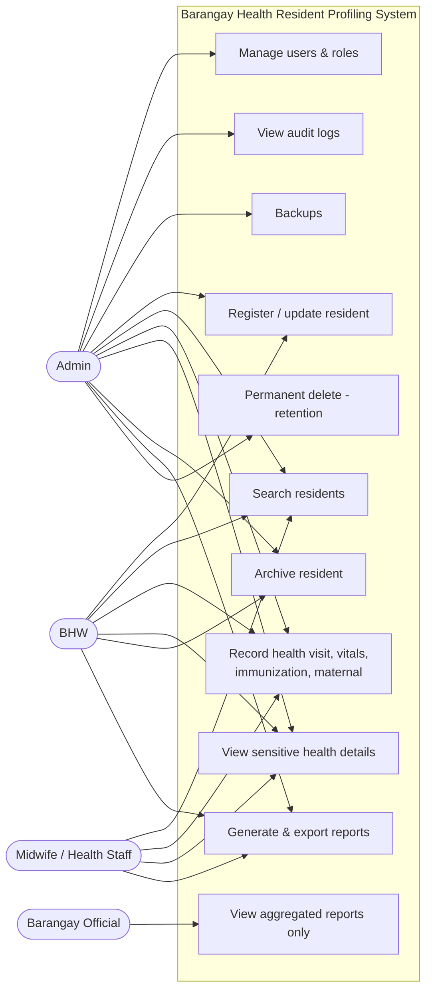
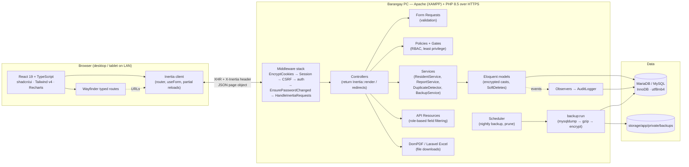
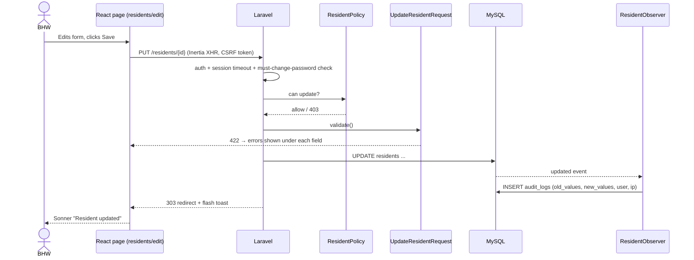

# Phase 1 — Requirements, Architecture & Security Plan

> **Role speaking: SOFTWARE ENGINEER / SYSTEM ARCHITECT**

Barangay Health Resident Profiling System — Barangay Health Center, Barangay Kalawag II, Isulan, Sultan Kudarat.

---

## 0. Confirmed decisions (deviations from `brgy.md`)

| Topic                | Spec says                    | We use                                                                                                                                                                        | Why                                                                                                   |
| -------------------- | ---------------------------- | ----------------------------------------------------------------------------------------------------------------------------------------------------------------------------- | ----------------------------------------------------------------------------------------------------- |
| Framework            | Laravel 12, Inertia 2, Ziggy | **Laravel 13, Inertia 3, Wayfinder** (already installed)                                                                                                                      | Newer, same patterns; Wayfinder gives typed route helpers in TS instead of Ziggy's untyped `route()`. |
| Database             | MySQL 8                      | **XAMPP MariaDB 10.4** (MySQL-compatible, InnoDB, utf8mb4)                                                                                                                    | What's installed on the barangay PC. Supports FULLTEXT on InnoDB and enforces CHECK constraints.      |
| Tests DB             | —                            | **In-memory SQLite**                                                                                                                                                          | Fast, isolated Pest runs. MySQL-only DDL (FULLTEXT) is guarded by driver checks in migrations.        |
| Starter kit features | —                            | **Removed:** Teams, public registration, email verification, email password reset, self-delete account. **Kept:** 2FA (optional), passkeys (optional), password confirmation. | Accounts are created by Admin only. No mail server on the barangay LAN, so Admin resets passwords.    |
| Login identifier     | username                     | **username** (switched in Phase 2/3; email login is temporary)                                                                                                                | Many BHWs don't have/use email.                                                                       |

---

## 1. Requirements summary

### 1.1 Functional requirements

| #   | Feature               | Key acceptance criteria                                                                                                                                                                               |
| --- | --------------------- | ----------------------------------------------------------------------------------------------------------------------------------------------------------------------------------------------------- |
| F1  | Login & roles         | Bcrypt-hashed passwords; 30-min idle session timeout; lockout after **5** failed attempts (15 min); forced password change on first login and after an Admin reset; privacy notice on the login page. |
| F2  | Resident registration | Profile linked to household → purok; consent recorded at registration; duplicate warning when **same last name + first name + birthdate** exists (live check while typing + server re-check on save). |
| F3  | Quick search          | Name (partial), resident code, household no., purok, birthdate; filters + server-side pagination; **< 1 s at ~10,000 residents**.                                                                     |
| F4  | Profile updating      | Form Request validation; every change written to `audit_logs` with old/new values (this _is_ the change history).                                                                                     |
| F5  | Health record history | Visits, vital signs, conditions, immunizations, maternal (prenatal/postnatal), notes; chronological timeline per resident.                                                                            |
| F6  | Reports               | Population per purok, age/sex pyramid, seniors (60+, RA 9994), PWDs, pregnant women, children due for immunization, common conditions; filter by date range + purok; PDF, XLSX/CSV, print.            |
| F7  | Backups               | Nightly scheduled `mysqldump` (gzip, encrypted), manual "Back up now" (Admin), retention rotation, documented restore.                                                                                |
| F8  | Audit log             | Append-only: who, what, when, which record, old/new values, IP; covers create/update/delete/view-sensitive/login/logout/export/backup. No edit/delete from the app.                                   |

### 1.2 Non-functional requirements

| Category        | Requirement                                                                                                            |
| --------------- | ---------------------------------------------------------------------------------------------------------------------- |
| Performance     | Search < 1 s at 10k residents; dashboard first paint < 2 s (heavy stats as deferred props).                            |
| Hardware        | Runs on a modest desktop (4 GB RAM, dual-core) acting as LAN server; clients are desktops/tablets on the same network. |
| Usability       | Large readable text (base 16px+), plain English/Filipino-friendly labels, tablet-friendly touch targets (≥ 44px).      |
| Accessibility   | WCAG 2.1 AA: contrast, keyboard navigation, labelled inputs, focus rings.                                              |
| Availability    | Works offline from the internet (LAN-only); no CDN dependencies at runtime (fonts/assets are bundled).                 |
| Privacy         | RA 10173 (Data Privacy Act) + NPC Circular 16-01 (security of personal data in government agencies).                   |
| Maintainability | Typed props (TS), Form Requests, Policies, Services; Pest feature tests; Pint + vp check in CI.                        |

---

## 2. Roles & use cases

### 2.1 Use cases per role

**Admin (Barangay Health Center Admin)**

- UC-A1 Manage user accounts (create, deactivate, reset password, assign role)
- UC-A2 View/oversee all resident and health records
- UC-A3 Generate and export reports
- UC-A4 View audit logs (filter by user, action, date, record)
- UC-A5 Run manual backup; download backup; view backup history
- UC-A6 Permanently delete archived residents past the retention period
- UC-A7 Manage lookup tables (puroks, vaccines, conditions, visit types)

**BHW (main user)**

- UC-B1 Register resident (with household + consent)
- UC-B2 Search residents
- UC-B3 Update resident profile
- UC-B4 Record health visit + vital signs
- UC-B5 Record immunization / maternal record
- UC-B6 Archive resident (moved/deceased) — soft delete
- UC-B7 Manage households (create, assign head)
- UC-B8 Generate and export reports

**Midwife / Health Staff**

- UC-M1 Search & view residents
- UC-M2 View full health records (incl. diagnosis/notes)
- UC-M3 Record/update visits, immunizations, maternal care
- UC-M4 Generate and export reports

**Barangay Official**

- UC-O1 View aggregated summary reports (counts only)
- UC-O2 Print/export aggregated reports
- _Cannot_ open any resident list, profile, or health record.

**Resident (data subject — not a system user)**

- Provides information; gives consent (recorded by BHW/Midwife).



### 2.2 Permission matrix (RBAC)

Permissions live in the `permissions` table and are attached to roles via `role_permission`; Gates are registered dynamically from that table. Every controller action checks a Policy/Gate on the server.

| Permission key                                             | Admin | BHW | Midwife |      Official       |
| ---------------------------------------------------------- | :---: | :-: | :-----: | :-----------------: |
| `users.manage`                                             |  ✅   |     |         |                     |
| `lookups.manage`                                           |  ✅   |     |         |                     |
| `residents.view`                                           |  ✅   | ✅  |   ✅    |                     |
| `residents.create`                                         |  ✅   | ✅  |         |                     |
| `residents.update`                                         |  ✅   | ✅  |   ✅    |                     |
| `residents.archive`                                        |  ✅   | ✅  |         |                     |
| `residents.force_delete`                                   |  ✅   |     |         |                     |
| `households.manage`                                        |  ✅   | ✅  |         |                     |
| `consents.record`                                          |  ✅   | ✅  |   ✅    |                     |
| `health.view_sensitive` (diagnosis, notes, PhilHealth no.) |  ✅   | ✅  |   ✅    |                     |
| `health.record`                                            |  ✅   | ✅  |   ✅    |                     |
| `reports.view`                                             |  ✅   | ✅  |   ✅    | ✅ (aggregate only) |
| `reports.export`                                           |  ✅   | ✅  |   ✅    | ✅ (aggregate only) |
| `audit.view`                                               |  ✅   |     |         |                     |
| `backups.manage`                                           |  ✅   |     |         |                     |

> ⚠️ See **Open questions** §7 — three cells above are assumptions to confirm.

---

## 3. System architecture

### 3.1 Component view



### 3.2 Request lifecycle (example: update resident)



### 3.3 Why this architecture

- **Monolith + Inertia, no REST API.** One deployable on one barangay PC; server-side routing/auth keeps all security decisions in Laravel. Only JSON endpoint planned: live duplicate check.
- **API Resources between models and pages.** Inertia props are visible in page source, so models are never passed directly; Resources decide field-by-field what each role sees.
- **Service layer** for anything reused by more than one controller (reports used by page + PDF + Excel; duplicate detection used by live check + store).
- **Observers for auditing** so no controller can "forget" to log.
- **Scheduler** via Windows Task Scheduler running `php artisan schedule:run` every minute.

---

## 4. Folder structure

```
barangayHall/
├── app/
│   ├── Console/Commands/          BackupDatabase, PruneArchivedResidents
│   ├── Enums/                     Sex, CivilStatus, ResidentStatus, AuditAction, ...
│   ├── Http/
│   │   ├── Controllers/           Dashboard, Resident, Household, HealthVisit, Immunization,
│   │   │                          MaternalRecord, Report, User, AuditLog, Backup, DuplicateCheck
│   │   ├── Middleware/            HandleInertiaRequests, EnsurePasswordChanged
│   │   ├── Requests/              Store/UpdateResidentRequest, StoreHealthVisitRequest, ...
│   │   └── Resources/             ResidentResource, HealthVisitResource, UserResource, ...
│   ├── Models/                    User, Role, Permission, Purok, Household, Resident, Consent,
│   │                              HealthVisit, VitalSign, Condition, ResidentCondition,
│   │                              Vaccine, Immunization, MaternalRecord, PrenatalVisit,
│   │                              VisitType, AuditLog, Backup
│   ├── Observers/                 Auditable observer(s)
│   ├── Policies/                  ResidentPolicy, HealthVisitPolicy, UserPolicy, ...
│   ├── Services/                  AuditLogger, DuplicateDetector, ReportService, BackupService
│   └── Exports/                   Laravel Excel export classes
├── database/
│   ├── migrations/  factories/  seeders/
├── docs/                          phase-1 … phase-6 write-ups, restore procedure, BHW manual
├── resources/
│   ├── js/
│   │   ├── components/ui/         shadcn (do not edit heavily)
│   │   ├── components/app/        DataTable, PageHeader, SearchFilters, StatCard,
│   │   │                          ConfirmDialog, HealthTimeline, DatePicker, ...
│   │   ├── layouts/               app sidebar layout, auth layout, settings layout
│   │   ├── pages/
│   │   │   ├── residents/  households/  health/  reports/
│   │   │   ├── users/  audit-logs/  backups/  auth/  settings/
│   │   │   └── dashboard.tsx
│   │   └── types/models.d.ts      mirrors API Resources
│   └── views/reports/             Blade templates for DomPDF
├── routes/  web.php  settings.php  console.php
└── tests/   Pest feature + unit tests
```

---

## 5. Security plan

### 5.1 Authentication

- **Hashing:** bcrypt (`BCRYPT_ROUNDS=12`) via Laravel's `hashed` cast.
- **Password policy:** min 10 chars, letters + numbers + mixed case; production also checks breached passwords is **off** (no internet) — the `uncompromised()` rule will be removed for LAN deployments.
- **Lockout:** track `failed_attempts` on `users`; on 5 consecutive failures set `locked_until = now()+15 min` and log `login_locked`. Fortify's per-minute throttle stays as an extra layer.
- **Forced password change:** `must_change_password` flag set on account creation and Admin reset; `EnsurePasswordChanged` middleware redirects every request to the change-password page until done.
- **Session:** `SESSION_LIFETIME=30` (idle timeout), `SESSION_ENCRYPT=true`, DB session driver, `http_only` + `same_site=lax`, `secure` cookies when served over HTTPS. Session ID regenerated on login.
- **Optional 2FA / passkeys** for Admin accounts (recommended).
- **Inactive users** (`is_active=false`) cannot log in.

### 5.2 Authorization (least privilege)

- Roles → permissions (DB tables), `Gate::before` is **not** used for Admin; Admin gets explicit permissions so the matrix stays auditable.
- Every controller action calls `$this->authorize()` / `Gate::authorize()`; routes also carry `can:` middleware as a second line.
- React receives `can.*` flags only to hide UI; backend never relies on them.
- **Barangay Official** routes are limited to `reports.*`; Resident/Health controllers deny them outright, and report queries return aggregates only (no names, no IDs).

### 5.3 Data protection (RA 10173 + NPC Circular 16-01)

| Requirement           | Implementation                                                                                                                                                                                                                                                                                 |
| --------------------- | ---------------------------------------------------------------------------------------------------------------------------------------------------------------------------------------------------------------------------------------------------------------------------------------------- |
| Consent               | `consents` table: resident, date, obtained_by, purpose, (revoked_at). Registration form requires consent checkbox + purpose.                                                                                                                                                                   |
| Encryption at rest    | Laravel `encrypted` casts (AES-256-CBC + HMAC, key = `APP_KEY`) on `philhealth_no`, `health_visits.diagnosis`, `health_visits.notes`, `resident_conditions.notes`, maternal notes. **Not encrypted:** names, birthdate, codes (they must be searchable/indexable). Backup files encrypted too. |
| Encryption in transit | HTTPS on the LAN via Apache + self-signed/local-CA certificate (mkcert); `APP_URL=https://…`, `URL::forceHttps()` in production.                                                                                                                                                               |
| Masking               | PhilHealth no. shown as `••••-•••••-12-3` everywhere except the profile's Personal Info tab for roles with `health.view_sensitive`. Lists never include diagnosis/notes.                                                                                                                       |
| Access logging        | `view_sensitive` audit entry when a profile's health tab/sensitive fields are loaded; `export` entry for every PDF/Excel/CSV download; `backup` entries.                                                                                                                                       |
| No casual hard delete | `SoftDeletes` on residents + health records; "Archive" = soft delete with reason/status. Permanent delete: Admin only, only for records archived longer than the retention period, logged.                                                                                                     |
| Privacy notice        | Shown on login page; full notice page linked.                                                                                                                                                                                                                                                  |
| Audit integrity       | `audit_logs` model has no update/delete routes; model blocks `update()`/`delete()`; on MySQL a DB user without UPDATE/DELETE grant on `audit_logs` can be used in production (documented).                                                                                                     |
| Breach readiness      | Audit logs + backups support NPC 72-hour breach notification requirements; documented in deployment guide.                                                                                                                                                                                     |

### 5.4 Application hardening

- CSRF on all state-changing requests (Laravel default, Inertia sends XSRF cookie automatically).
- XSS: React escapes output; no `dangerouslySetInnerHTML` with user data.
- SQL injection: Eloquent/query builder bindings only; sort/filter columns whitelisted.
- Mass assignment: `#[Fillable]` on every model + validated data only.
- `APP_DEBUG=false` in production; error pages don't leak stack traces.
- Security headers middleware (X-Frame-Options, X-Content-Type-Options, Referrer-Policy).
- File downloads streamed via authorized controller actions only (backups never in `public/`).

### 5.5 Backup & recovery

- Nightly 11 PM `backup:run` → `mysqldump --single-transaction` → gzip → encrypt → `storage/app/private/backups`, row in `backups` table, keep last 14 daily + 8 weekly.
- Admin "Back up now" + download.
- Restore procedure documented in `docs/restore.md` (Phase 3) and rehearsed in Phase 6.
- Recommend copying the latest backup weekly to an external drive kept off-site (e.g. Barangay Hall).

---

## 6. Baseline work completed in this phase

- Pruned starter kit: removed Teams (models, controllers, policies, pages, components, migrations, tests), registration, email verification, email password reset, self-delete account, welcome page.
- `/` now redirects to `/dashboard`; dashboard route no longer team-scoped.
- Switched `.env`/`.env.example` to MySQL (`barangay_health`, utf8mb4), `APP_NAME="Kalawag II Health Center"`, `APP_FAKER_LOCALE=en_PH`, `SESSION_LIFETIME=30`, `SESSION_ENCRYPT=true`. Database created and migrated.
- Installed **Pest 4** (+ Laravel plugin), **barryvdh/laravel-dompdf 3.1**, **maatwebsite/excel 4.0**; added missing `@babel/core` dev dependency so the frontend builds.
- Converted remaining tests to Pest; tests run without a Vite build (`withoutVite()`).
- Verified: **23/23 tests pass**, `tsc` clean, `vp check` clean, `pint` clean, `npm run build` succeeds.
- Pre-change snapshot (excluding vendor/node_modules) saved outside the project.

---

## 7. Open questions (please confirm before / during Phase 2)

1. **Midwife and registration:** Should Midwives be able to _register_ new residents (e.g. a pregnant woman walking in), or only BHWs/Admin? _Default above: no._
2. **BHW sensitive access:** Should BHWs see diagnosis/notes and the full PhilHealth no.? They record visits, so the default above is **yes**. Alternative: BHWs record vitals/complaints only; diagnosis/notes are Midwife/Admin.
3. **Retention period** for archived residents before Admin may permanently delete them. _Proposed default: 5 years after archive._
4. **Immunization schedule:** use the DOH Expanded Program on Immunization (EPI) schedule (BCG, HepB, Pentavalent ×3, OPV ×3, IPV, PCV ×3, MMR ×2) to compute "children due"? _Default: yes._
5. **Resident code format:** proposed `KII-YYYY-NNNNN` (e.g. `KII-2026-00042`). OK?
6. **Puroks:** how many puroks does Kalawag II have, and their names? (I'll seed Purok 1–7 placeholders otherwise.)
