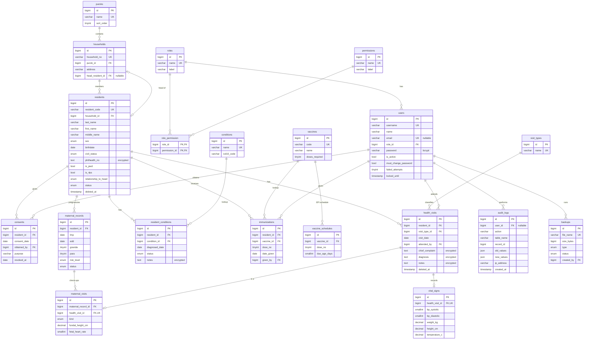

# Phase 2 — Database Architecture

> **Role speaking: DATABASE ARCHITECT / BACKEND DEVELOPER**

Engine: MariaDB 10.4 (XAMPP) / MySQL 8 compatible · InnoDB · `utf8mb4_unicode_ci` · tests on SQLite in-memory.

## 0. Decisions applied from Phase 1 open questions (defaults — say so if any is wrong)

| #   | Question                                     | Applied default                                         |
| --- | -------------------------------------------- | ------------------------------------------------------- |
| 1   | Can Midwives register residents?             | **No** (`residents.create` = Admin, BHW)                |
| 2   | Can BHWs see diagnosis/notes/PhilHealth no.? | **Yes** (`health.view_sensitive` = Admin, BHW, Midwife) |
| 3   | Retention before permanent delete            | **5 years** after archive (enforced in Phase 3)         |
| 4   | "Children due" rule                          | **DOH EPI schedule**, children 0–23 months              |
| 5   | Resident code                                | **`KII-YYYY-NNNNN`** e.g. `KII-2026-00042`              |
| 6   | Puroks                                       | **Purok 1–7 placeholders** (`LookupSeeder::PUROKS`)     |

Other changes made in this phase:

- Login is now by **username** (`config/fortify.php`), email is optional.
- App timezone set to **Asia/Manila** (ages, visit dates and "due today" depend on it).

---

## 1. ERD



---

## 2. Key design decisions

### 2.1 Normalization (3NF)

- **Purok lives on `households`, not on `residents`.** A resident's purok is a fact about where the household is; storing it on each resident would create an update anomaly when a household is re-assigned. Search/report queries join `residents → households → puroks` (all PK/FK lookups, `eq_ref` in EXPLAIN).
- **`maternal_visits` instead of a standalone `prenatal_visits`.** Each prenatal/postnatal check-up _is_ a health visit, so date, attending staff and vital signs come from the linked `health_visits` row (1:1, `UNIQUE health_visit_id`). This avoids duplicating date/vitals and makes the visit show up in the general health timeline automatically. `kind` covers both prenatal and postnatal (spec asks for both).
- **`vital_signs` is a separate 1:1 table.** Many visits (immunization, family planning) don't take vitals; separating them avoids a wide row of NULLs and lets vitals be added later.
- **`vaccine_schedules`** stores the DOH EPI schedule (dose → due age in days), so "children due for immunization" is a pure SQL anti-join, and the schedule can be updated by Admin without code changes.
- **Change history** is not a separate `resident_history` table: `audit_logs.old_values/new_values` already store every field change (one mechanism, append-only).

### 2.2 ENUM vs lookup table

| Column                                                                                                                                           | Choice                       | Why                                                                                                                                                                                            |
| ------------------------------------------------------------------------------------------------------------------------------------------------ | ---------------------------- | ---------------------------------------------------------------------------------------------------------------------------------------------------------------------------------------------- |
| `sex`, `civil_status`, `relationship_to_head`, `status`, `risk_level`, maternal `status`, visit `kind`, backup `type/status`, condition `status` | **ENUM** (+ PHP backed enum) | Closed, small, defined by law/forms (PSA civil status categories), and the **application logic branches on them** (e.g. `status = 'deceased'`). Adding a value is a code change anyway.        |
| puroks, visit types, conditions, vaccines                                                                                                        | **Lookup table**             | Barangay-specific and expected to grow (new purok, new vaccine campaign, new condition). Admin can add rows without a deploy. Conditions carry an ICD-10 code; vaccines carry a dose schedule. |
| `audit_logs.action`                                                                                                                              | **VARCHAR(30)** + PHP enum   | Append-only log must accept new action types without an `ALTER TABLE` on a large table.                                                                                                        |

### 2.3 Data types

- **DATE** for birthdate, visit_date, date_given, LMP/EDD, consent_date — these are calendar days, not instants; DATE avoids timezone shifts. **TIMESTAMP** only for system events (created_at, locked_until, last_login_at).
- **DECIMAL** for measurements (`weight_kg DECIMAL(5,2)`, `height_cm DECIMAL(5,1)`, `temperature_c DECIMAL(4,1)`) — exact values as written on the chart; FLOAT would print 36.799999.
- **SMALLINT UNSIGNED** for BP/pulse, **TINYINT UNSIGNED** for dose_no/gravida/para.
- **TEXT** for encrypted columns — Laravel's ciphertext (base64 JSON with IV + MAC) is ~200+ chars even for a 14-char PhilHealth number.

### 2.4 Derived values are not stored

`age`, senior status (60+, RA 9994), BMI, age of gestation, "due for vaccine" are all computed (`Resident::age`, `scopeSeniors()`, `VitalSign::bmi()`, `MaternalRecord::gestationalAgeWeeks()`).
**One deliberate exception — `edd`:** defaults to LMP + 280 days but is a _clinical determination_ that can be overridden by ultrasound dating, so it is stored.

### 2.5 Encryption vs searchability

| Encrypted (AES-256-CBC + HMAC, `encrypted` cast)      | Not encrypted (must be searchable/indexable)                        |
| ----------------------------------------------------- | ------------------------------------------------------------------- |
| `residents.philhealth_no`                             | names, birthdate, resident_code, household_no                       |
| `health_visits.chief_complaint`, `diagnosis`, `notes` | `resident_conditions.condition_id` (for "common conditions" counts) |
| `resident_conditions.notes`                           | `is_pwd`, `is_4ps`, `status`, maternal `status` / `edd`             |
| `maternal_records.notes`                              | vital-sign numbers (needed for ranges/CHECKs)                       |

Encrypted columns **cannot be searched, sorted, or indexed** — each value has a random IV, so the same plaintext produces different ciphertext. This is why "common conditions" uses the coded `resident_conditions` table rather than the free-text diagnosis. Audit logs will store `"[encrypted field changed]"` for these columns instead of plaintext (Phase 3).

### 2.6 Referential actions (ON DELETE / ON UPDATE)

All FKs are `ON UPDATE CASCADE`. ON DELETE rule by intent:

| Rule         | Where                                                                                                                                                   | Reason                                                                                                                                                   |
| ------------ | ------------------------------------------------------------------------------------------------------------------------------------------------------- | -------------------------------------------------------------------------------------------------------------------------------------------------------- |
| **RESTRICT** | `residents.household_id`, `households.purok_id`, every lookup FK (`visit_type_id`, `condition_id`, `vaccine_id`), `users.role_id`, every `*_by` user FK | Never lose clinical history by deleting a parent. Users are **deactivated, never deleted**, so attribution (who attended/obtained consent) is permanent. |
| **CASCADE**  | resident → consents, health_visits, conditions, immunizations, maternal_records; visit → vital_signs, maternal_visits                                   | Only fires on **permanent** delete (retention policy, Admin-only). Normal archiving is a soft delete and touches nothing.                                |
| **SET NULL** | `households.head_resident_id`                                                                                                                           | If the head's record is permanently deleted, the household survives and a new head can be assigned.                                                      |

### 2.7 Soft deletes

`deleted_at` on `residents`, `health_visits`, `resident_conditions`, `immunizations`, `maternal_records`. "Archive" = soft delete + `status` (`moved`/`deceased`) + `archive_reason`.

### 2.8 CHECK constraints (MySQL/MariaDB; enforced again by Form Requests)

16 named constraints, e.g. `vital_signs_bp_pair_check (bp_systolic > bp_diastolic)`, `maternal_records_para_check (para <= gravida)`, `maternal_records_dates_check (edd > lmp)`, temperature 30–45 °C, FHR 60–220. They live in `App\Support\MysqlSchema::check()` and are skipped on the SQLite test DB. `CURDATE()`-based checks (e.g. birthdate not in the future) are not allowed in MySQL CHECKs, so those are validation-only.

---

## 3. Data dictionary

Legend: PK primary key · FK foreign key · UK unique · NN not null · 🔒 encrypted · SD soft delete.

### roles / permissions / role_permission

| Column                        | Type            | Constraint                   | Description                           |
| ----------------------------- | --------------- | ---------------------------- | ------------------------------------- |
| roles.id                      | BIGINT UNSIGNED | PK                           |                                       |
| roles.name                    | VARCHAR(30)     | UK, NN                       | `admin`, `bhw`, `midwife`, `official` |
| roles.label                   | VARCHAR(60)     | NN                           | Display name                          |
| roles.description             | VARCHAR(255)    |                              | What the role may do                  |
| permissions.name              | VARCHAR(60)     | UK, NN                       | e.g. `health.view_sensitive`          |
| permissions.label             | VARCHAR(120)    | NN                           | Plain-language description            |
| role_permission.role_id       | BIGINT          | PK, FK → roles CASCADE       |                                       |
| role_permission.permission_id | BIGINT          | PK, FK → permissions CASCADE |                                       |

### users

| Column               | Type             | Constraint              | Description                                              |
| -------------------- | ---------------- | ----------------------- | -------------------------------------------------------- |
| id                   | BIGINT UNSIGNED  | PK                      |                                                          |
| username             | VARCHAR(50)      | UK, NN                  | Login name (lower-cased)                                 |
| name                 | VARCHAR(150)     | NN                      | Full name (kept as `name` for starter-kit compatibility) |
| email                | VARCHAR(255)     | UK, nullable            | Optional                                                 |
| role_id              | BIGINT           | FK → roles RESTRICT, NN | Single role per user                                     |
| password             | VARCHAR(255)     | NN                      | bcrypt hash                                              |
| is_active            | BOOLEAN          | NN, default 1           | Deactivated users cannot log in                          |
| must_change_password | BOOLEAN          | NN, default 1           | Forced change on first login / after reset               |
| failed_attempts      | TINYINT UNSIGNED | NN, default 0           | Consecutive failed logins                                |
| locked_until         | TIMESTAMP        | nullable                | Lockout end time                                         |
| last_login_at        | TIMESTAMP        | nullable                |                                                          |
| password_changed_at  | TIMESTAMP        | nullable                |                                                          |
| two_factor_*         | TEXT / TIMESTAMP | nullable                | Optional 2FA (Fortify)                                   |

### puroks

| Column     | Type             | Constraint | Description     |
| ---------- | ---------------- | ---------- | --------------- |
| id         | BIGINT           | PK         |                 |
| name       | VARCHAR(50)      | UK, NN     | "Purok 1"       |
| sort_order | TINYINT UNSIGNED | NN         | Report ordering |

### households

| Column                  | Type         | Constraint                        | Description       |
| ----------------------- | ------------ | --------------------------------- | ----------------- |
| id                      | BIGINT       | PK                                |                   |
| household_no            | VARCHAR(20)  | UK, NN                            | `HH-0001`         |
| purok_id                | BIGINT       | FK → puroks RESTRICT, NN, indexed |                   |
| address                 | VARCHAR(255) | NN                                | Street / landmark |
| head_resident_id        | BIGINT       | FK → residents SET NULL, nullable | Household head    |
| created_by / updated_by | BIGINT       | FK → users RESTRICT               |                   |

### residents (SD)

| Column                  | Type                                                                                                      | Constraint                            | Description            |
| ----------------------- | --------------------------------------------------------------------------------------------------------- | ------------------------------------- | ---------------------- |
| id                      | BIGINT                                                                                                    | PK                                    |                        |
| resident_code           | VARCHAR(20)                                                                                               | UK, NN                                | `KII-2026-00042`       |
| household_id            | BIGINT                                                                                                    | FK → households RESTRICT, NN, indexed |                        |
| last_name / first_name  | VARCHAR(100)                                                                                              | NN, indexed                           |                        |
| middle_name             | VARCHAR(100)                                                                                              | nullable                              |                        |
| suffix                  | VARCHAR(10)                                                                                               | nullable                              | Jr., Sr., III          |
| sex                     | ENUM('male','female')                                                                                     | NN                                    |                        |
| birthdate               | DATE                                                                                                      | NN, indexed                           | Age computed from this |
| birthplace              | VARCHAR(150)                                                                                              | nullable                              |                        |
| civil_status            | ENUM(single, married, widowed, separated, live_in)                                                        | NN                                    |                        |
| contact_no              | VARCHAR(20)                                                                                               | nullable                              |                        |
| philhealth_no           | TEXT                                                                                                      | 🔒 nullable                           | Masked in UI           |
| is_pwd / is_4ps         | BOOLEAN                                                                                                   | NN, default 0                         | Flags for reports      |
| relationship_to_head    | ENUM(head, spouse, child, parent, sibling, grandchild, grandparent, in_law, other_relative, non_relative) | NN                                    |                        |
| status                  | ENUM(active, moved, deceased)                                                                             | NN, default active                    |                        |
| archive_reason          | VARCHAR(255)                                                                                              | nullable                              | Why archived           |
| created_by / updated_by | BIGINT                                                                                                    | FK → users RESTRICT                   |                        |
| deleted_at              | TIMESTAMP                                                                                                 | nullable                              | Archive marker         |

### consents

| Column       | Type         | Constraint                 | Description                 |
| ------------ | ------------ | -------------------------- | --------------------------- |
| resident_id  | BIGINT       | FK → residents CASCADE, NN |                             |
| consent_date | DATE         | NN                         |                             |
| obtained_by  | BIGINT       | FK → users RESTRICT, NN    | BHW/Midwife who obtained it |
| purpose      | VARCHAR(255) | NN                         | Stated purpose (RA 10173)   |
| revoked_at   | DATE         | nullable                   | Consent withdrawal          |

### visit_types / conditions / vaccines / vaccine_schedules (lookups)

| Column                         | Type         | Constraint                              | Description                                |
| ------------------------------ | ------------ | --------------------------------------- | ------------------------------------------ |
| visit_types.name               | VARCHAR(60)  | UK, NN                                  | General Consultation, Prenatal Check-up, … |
| conditions.name                | VARCHAR(120) | UK, NN                                  | Essential hypertension, …                  |
| conditions.icd10_code          | VARCHAR(10)  | nullable                                | I10, E11, …                                |
| vaccines.code                  | VARCHAR(20)  | UK, NN                                  | BCG, PENTA, MMR, …                         |
| vaccines.doses_required        | TINYINT      | NN, CHECK 1–10                          |                                            |
| vaccine_schedules.vaccine_id   | BIGINT       | FK → vaccines CASCADE                   |                                            |
| vaccine_schedules.dose_no      | TINYINT      | NN, UK(vaccine_id, dose_no), CHECK 1–10 |                                            |
| vaccine_schedules.due_age_days | SMALLINT     | NN, indexed                             | Age when the dose is due                   |

### health_visits (SD)

| Column                              | Type   | Constraint                                             | Description                  |
| ----------------------------------- | ------ | ------------------------------------------------------ | ---------------------------- |
| resident_id                         | BIGINT | FK → residents CASCADE, NN                             |                              |
| visit_type_id                       | BIGINT | FK → visit_types RESTRICT, NN                          |                              |
| visit_date                          | DATE   | NN                                                     |                              |
| attended_by                         | BIGINT | FK → users RESTRICT, NN                                |                              |
| chief_complaint / diagnosis / notes | TEXT   | 🔒 nullable                                            |                              |
| created_by / updated_by             | BIGINT | FK → users                                             |                              |
| Indexes                             |        | (resident_id, visit_date), (visit_date, visit_type_id) | timeline; date-range reports |

### vital_signs

| Column                        | Type              | Constraint                                  | Description    |
| ----------------------------- | ----------------- | ------------------------------------------- | -------------- |
| health_visit_id               | BIGINT            | FK CASCADE, UK                              | 1:1 with visit |
| bp_systolic / bp_diastolic    | SMALLINT UNSIGNED | CHECK 50–300 / 30–200, systolic > diastolic | mmHg           |
| weight_kg                     | DECIMAL(5,2)      | CHECK 0.5–500                               |                |
| height_cm                     | DECIMAL(5,1)      | CHECK 20–272                                |                |
| temperature_c                 | DECIMAL(4,1)      | CHECK 30–45                                 |                |
| pulse_rate / respiratory_rate | SMALLINT UNSIGNED | CHECK 20–250 / 5–80                         | per minute     |

### resident_conditions (SD)

| Column         | Type                               | Constraint               | Description |
| -------------- | ---------------------------------- | ------------------------ | ----------- |
| resident_id    | BIGINT                             | FK CASCADE               |             |
| condition_id   | BIGINT                             | FK → conditions RESTRICT |             |
| diagnosed_date | DATE                               | nullable                 |             |
| status         | ENUM(active, controlled, resolved) | NN                       |             |
| notes          | TEXT                               | 🔒                       |             |
| recorded_by    | BIGINT                             | FK → users RESTRICT      |             |

### immunizations (SD)

| Column                   | Type         | Constraint            | Description             |
| ------------------------ | ------------ | --------------------- | ----------------------- |
| resident_id / vaccine_id | BIGINT       | FK CASCADE / RESTRICT |                         |
| dose_no                  | TINYINT      | NN, CHECK 1–10        |                         |
| date_given               | DATE         | NN, indexed           |                         |
| given_by                 | BIGINT       | FK → users RESTRICT   |                         |
| lot_no                   | VARCHAR(40)  | nullable              | Vaccine lot for recalls |
| remarks                  | VARCHAR(255) | nullable              |                         |

No UNIQUE on (resident, vaccine, dose) because a soft-deleted wrong entry would block the corrected one; uniqueness among non-deleted rows is enforced in validation (Phase 3).

### maternal_records (SD) / maternal_visits

| Column                          | Type                                 | Constraint                             | Description                      |
| ------------------------------- | ------------------------------------ | -------------------------------------- | -------------------------------- |
| maternal_records.lmp            | DATE                                 | nullable                               | Last menstrual period            |
| maternal_records.edd            | DATE                                 | NN, CHECK edd > lmp                    | Expected delivery                |
| gravida / para                  | TINYINT                              | NN, CHECK para ≤ gravida, gravida 1–20 |                                  |
| risk_level                      | ENUM(low, high)                      | NN                                     |                                  |
| status                          | ENUM(ongoing, delivered, terminated) | NN                                     | "Pregnant women" = ongoing       |
| outcome_date                    | DATE                                 | nullable                               |                                  |
| notes                           | TEXT                                 | 🔒                                     |                                  |
| maternal_visits.health_visit_id | BIGINT                               | FK CASCADE, UK                         | Date/staff/vitals come from here |
| maternal_visits.kind            | ENUM(prenatal, postnatal)            | NN                                     |                                  |
| fundal_height_cm                | DECIMAL(4,1)                         | nullable                               |                                  |
| fetal_heart_rate                | SMALLINT                             | CHECK 60–220                           | bpm                              |

### audit_logs (append-only)

| Column                  | Type                       | Constraint                    | Description                                                                                                                                                   |
| ----------------------- | -------------------------- | ----------------------------- | ------------------------------------------------------------------------------------------------------------------------------------------------------------- |
| user_id                 | BIGINT                     | FK → users RESTRICT, nullable | NULL for failed logins / scheduler                                                                                                                            |
| action                  | VARCHAR(30)                | NN                            | created, updated, deleted, restored, force_deleted, viewed_sensitive, exported, login, logout, login_failed, locked, password_changed, password_reset, backup |
| table_name / record_id  | VARCHAR(64) / BIGINT       | nullable                      | Target record                                                                                                                                                 |
| description             | VARCHAR(255)               | nullable                      | Human summary                                                                                                                                                 |
| old_values / new_values | JSON                       | nullable                      | Encrypted fields redacted                                                                                                                                     |
| ip_address / user_agent | VARCHAR(45) / VARCHAR(255) | nullable                      |                                                                                                                                                               |
| created_at              | TIMESTAMP                  | NN, default now               | No `updated_at`                                                                                                                                               |

The model throws on `updating`/`deleting`; no route edits or deletes logs. For production, a DB account without UPDATE/DELETE on `audit_logs` is documented in Phase 6.

### backups

| Column                    | Type                           | Constraint           | Description        |
| ------------------------- | ------------------------------ | -------------------- | ------------------ |
| file_name                 | VARCHAR(255)                   | UK, NN               |                    |
| size_bytes                | BIGINT UNSIGNED                | nullable             |                    |
| type                      | ENUM(scheduled, manual)        | NN                   |                    |
| status                    | ENUM(running, success, failed) | NN                   |                    |
| error                     | TEXT                           | nullable             |                    |
| created_by                | BIGINT                         | FK → users, nullable | NULL for scheduled |
| created_at / completed_at | TIMESTAMP                      |                      |                    |

---

## 4. Index plan

| Index                                                                                                 | Serves                                                                                                         | Why                                                                                                 |
| ----------------------------------------------------------------------------------------------------- | -------------------------------------------------------------------------------------------------------------- | --------------------------------------------------------------------------------------------------- |
| `residents.resident_code` UNIQUE                                                                      | Lookup by ID / QR                                                                                              | `const` access, 1 row                                                                               |
| `residents (last_name, first_name, birthdate)`                                                        | Prefix name search (`LIKE 'gal%'`), sorting by name, **duplicate detection** (all three equality → index-only) | Leftmost-prefix rule: one index serves "last name", "last + first", and "last + first + birthdate". |
| `residents (first_name)`                                                                              | Searching by first name only                                                                                   | The composite can't help when `last_name` isn't constrained.                                        |
| `residents (birthdate)`                                                                               | Birthdate search, infant/child cohorts                                                                         | Range scans                                                                                         |
| `residents (status, deleted_at, birthdate)`                                                           | Every report ("active, not archived, aged X")                                                                  | Two equalities then a range → index-only range scan for seniors/age groups.                         |
| `residents FULLTEXT (last_name, first_name, middle_name)`                                             | Word search anywhere ("cruz" → "Dela Cruz")                                                                    | B-tree can't serve `LIKE '%cruz%'`. MySQL only.                                                     |
| `residents (household_id)` (FK)                                                                       | Household members, purok joins                                                                                 |                                                                                                     |
| `households.household_no` UNIQUE, `households (purok_id)` (FK)                                        | Household search, purok filter / per-purok counts                                                              |                                                                                                     |
| `health_visits (resident_id, visit_date)`                                                             | Profile timeline                                                                                               |                                                                                                     |
| `health_visits (visit_date, visit_type_id)`                                                           | Visit reports by date range                                                                                    |                                                                                                     |
| `immunizations (resident_id, vaccine_id, dose_no)`                                                    | "Children due" anti-join                                                                                       | `Not exists` optimization, 1 row probe per dose                                                     |
| `maternal_records (status, edd)`                                                                      | Pregnant women list ordered by due date                                                                        |                                                                                                     |
| `resident_conditions (condition_id, status)`                                                          | Common conditions                                                                                              |                                                                                                     |
| `audit_logs (table_name, record_id)`, `(user_id, created_at)`, `(action, created_at)`, `(created_at)` | Record history, audit filters                                                                                  | Log grows fastest; filters are always time-bounded                                                  |

Not indexed on purpose: `sex`, `is_pwd`, `is_4ps` (2 values — low selectivity; filtering after a selective index is cheaper than an extra index on every write).

---

## 5. Main queries — EXPLAIN & timings

Measured on the barangay PC's MariaDB with **10,051 residents / 2,514 households** (`PerformanceSeeder`), cold query cache (`SQL_NO_CACHE`).

| #   | Query                                                                                 | Plan (key / type / rows)                                                                                   | Time      |
| --- | ------------------------------------------------------------------------------------- | ---------------------------------------------------------------------------------------------------------- | --------- |
| Q1  | Search `cruz` (prefix last OR first OR fulltext word), join household + purok, page 1 | name composite + fulltext; joins `eq_ref`                                                                  | **82 ms** |
| Q1  | …count for pagination                                                                 | same                                                                                                       | 18 ms     |
| Q1c | Prefix `San%` + purok 3 + female, page 3                                              | `residents_name_birthdate_index` range                                                                     | 2.5 ms    |
| Q2  | Duplicate check (last, first, birthdate)                                              | composite `ref const,const,const`, **Using index**, 1 row                                                  | 0.7 ms    |
| Q3  | Resident code                                                                         | `const`, 1 row                                                                                             | <1 ms     |
| Q4  | Population per purok                                                                  | puroks (7) → households `ref` → residents `ref`                                                            | 71 ms     |
| Q5  | Age/sex distribution                                                                  | `status_deleted_birthdate` index                                                                           | 58 ms     |
| Q6  | Seniors                                                                               | `range` on `(status, deleted_at, birthdate)`, **Using index**                                              | 5.9 ms    |
| Q7  | Children due for immunization                                                         | residents `range` on birthdate (~190 children) → schedule → immunizations `ref` **Not exists**             | 19 ms     |
| Q8  | Pregnant women                                                                        | full scan of 4 rows (optimizer correctly prefers scan on tiny table; `(status, edd)` kicks in as it grows) | <1 ms     |
| Q9  | Common conditions                                                                     | full scan of 16 rows (same reasoning)                                                                      | <1 ms     |
| Q10 | Visits by date range + purok                                                          | visit_types → health_visits `ref`, residents/households `eq_ref`                                           | <1 ms     |

**All well under the 1-second requirement.** Q6 was 4,915 rows on `(status, deleted_at)` before the index was widened to `(status, deleted_at, birthdate)`; after the change it's an index-only range scan.

### Q7 — children due for immunization (core logic)

```sql
SELECT r.id, r.resident_code, r.last_name, r.first_name, v.code, s.dose_no,
       r.birthdate + INTERVAL s.due_age_days DAY AS due_date
FROM residents r
JOIN vaccine_schedules s ON s.due_age_days <= DATEDIFF(CURDATE(), r.birthdate)
JOIN vaccines v          ON v.id = s.vaccine_id
LEFT JOIN immunizations i ON i.resident_id = r.id AND i.vaccine_id = s.vaccine_id
                         AND i.dose_no = s.dose_no AND i.deleted_at IS NULL
WHERE r.deleted_at IS NULL AND r.status = 'active'
  AND r.birthdate > CURDATE() - INTERVAL 2 YEAR       -- EPI target: 0–23 months
  AND i.id IS NULL                                     -- dose not yet given
ORDER BY due_date;
```

Sargability rule used everywhere: **never wrap the indexed column in a function** — `birthdate <= CURDATE() - INTERVAL 60 YEAR` uses the index; `TIMESTAMPDIFF(YEAR, birthdate, CURDATE()) >= 60` would scan every row.

### Search strategy for the app (Phase 3)

1. Looks like a code (`KII-…`, `HH-…`) → exact UNIQUE lookup.
2. Otherwise → `last_name LIKE 'term%' OR first_name LIKE 'term%' OR MATCH(...) AGAINST ('+term*' IN BOOLEAN MODE)` (fulltext only on MySQL; SQLite tests fall back to `LIKE`).
3. Filters (purok, sex, age group, status) are `AND`ed; sort columns whitelisted; `paginate(15)`.

---

## 6. Migrations

| File                                                                    | Creates                                                                    |
| ----------------------------------------------------------------------- | -------------------------------------------------------------------------- |
| `0000_01_01_000000_create_roles_and_permissions_tables`                 | roles, permissions, role_permission (before users, for `users.role_id` FK) |
| `0001_01_01_000000_create_users_table`                                  | users (redesigned: username, role, lockout, forced change), sessions       |
| `2026_10_30_000001_create_puroks_and_households_tables`                 | puroks, households                                                         |
| `2026_10_30_000002_create_residents_table`                              | residents + FULLTEXT + `households.head_resident_id` FK                    |
| `2026_10_30_000003_create_consents_table`                               | consents                                                                   |
| `2026_10_30_000004_create_clinical_lookup_tables`                       | visit_types, conditions, vaccines, vaccine_schedules                       |
| `2026_10_30_000005_create_health_visits_and_vital_signs_tables`         | health_visits, vital_signs + CHECKs                                        |
| `2026_10_30_000006_create_resident_conditions_and_immunizations_tables` | resident_conditions, immunizations                                         |
| `2026_10_30_000007_create_maternal_tables`                              | maternal_records, maternal_visits + CHECKs                                 |
| `2026_10_30_000008_create_audit_logs_and_backups_tables`                | audit_logs, backups                                                        |

Models (`app/Models`) were added in this phase too so seeders/tests can use them: casts (enums, dates, 🔒 `encrypted`), relationships, `SoftDeletes`, computed `age`/`full_name`, `seniors()`/`agedBetween()`/`pregnant()` scopes, append-only guard on `AuditLog`, `Role::for()` and `User::hasPermission()`. Policies, observers and services follow in Phase 3.

---

## 7. Seeders

| Seeder                            | Contents                                                                                                                                                                                                                                                                                                                                                                                                                                        |
| --------------------------------- | ----------------------------------------------------------------------------------------------------------------------------------------------------------------------------------------------------------------------------------------------------------------------------------------------------------------------------------------------------------------------------------------------------------------------------------------------- |
| `RbacSeeder`                      | 4 roles, 15 permissions, default matrix from `PermissionName::forRole()`                                                                                                                                                                                                                                                                                                                                                                        |
| `LookupSeeder`                    | Purok 1–7, 8 visit types, 12 conditions with ICD-10, 11 vaccines + DOH EPI schedule (BCG, HepB, Penta×3, OPV×3, IPV×2, PCV×3, MMR×2)                                                                                                                                                                                                                                                                                                            |
| `UserSeeder`                      | `admin`, `bhw.analiza`, `bhw.rosario`, `mw.cristina`, `kgd.ronaldo` — password `Kalawag2026!` (override `SEED_DEFAULT_PASSWORD`), **all forced to change it on first login**                                                                                                                                                                                                                                                                    |
| `ResidentSeeder`                  | 14 households, **51 residents** across 7 puroks: 10 seniors (oldest 85), 5 PWDs, 13 4Ps members, Maguindanaon/Ilonggo/Tagalog names, 3 ongoing pregnancies (1 high-risk), 1 recent delivery, 6 young children with EPI records — **3 children / 10 doses currently due** (dates are relative to today, so the report always has data), chronic conditions with follow-up visits and vitals, consents for everyone, 1 archived deceased resident |
| `PerformanceSeeder` (manual only) | +10,000 residents / 2,500 households via bulk insert, for load testing                                                                                                                                                                                                                                                                                                                                                                          |

```bash
php artisan migrate:fresh --seed                     # clean sample data
php artisan db:seed --class=PerformanceSeeder        # optional 10k load test
```

## 8. Verification

- `migrate:fresh --seed` on MariaDB ✅ · 16 CHECK constraints + FULLTEXT present ✅ · PhilHealth stored as ciphertext ✅
- **33/33 Pest tests** (new: seeder output, official = reports only, admin-only force delete/user management, encryption at rest, computed age, soft delete, append-only audit) ✅
- Larastan ✅ · Pint ✅ · `tsc` ✅ · `vp check` ✅ · `npm run build` ✅
