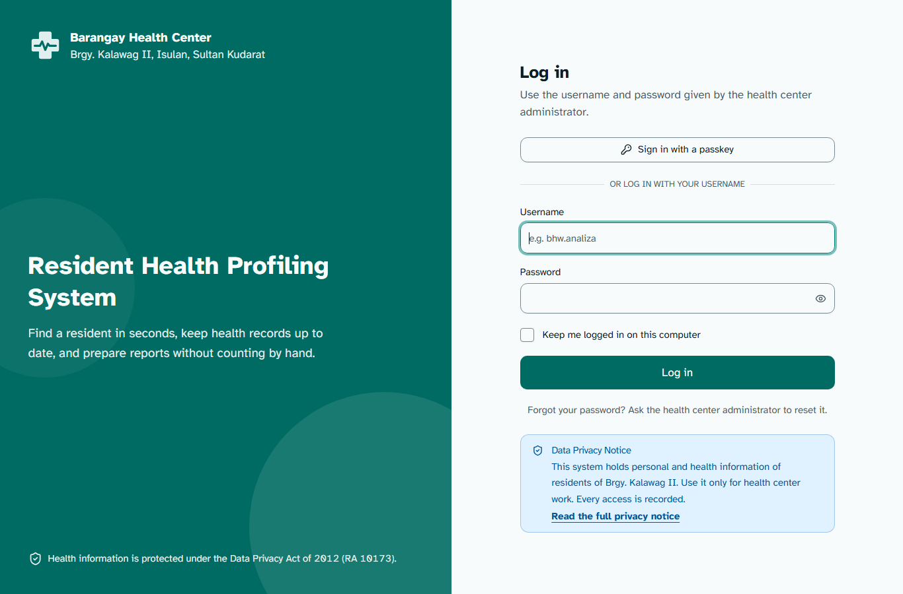
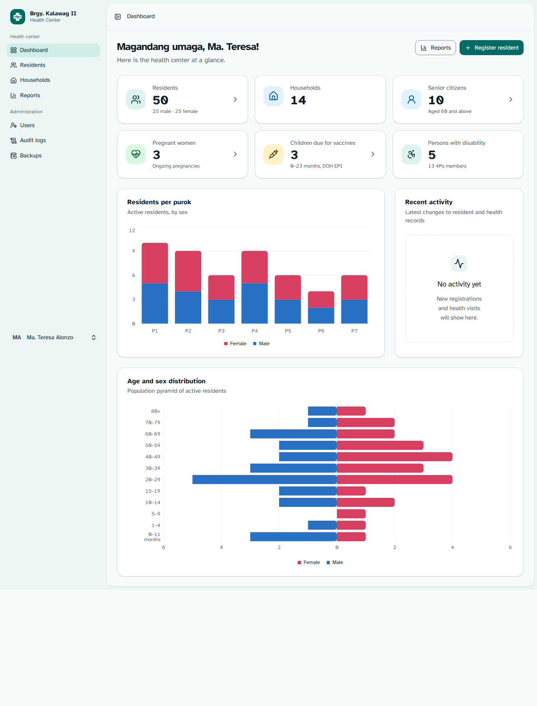
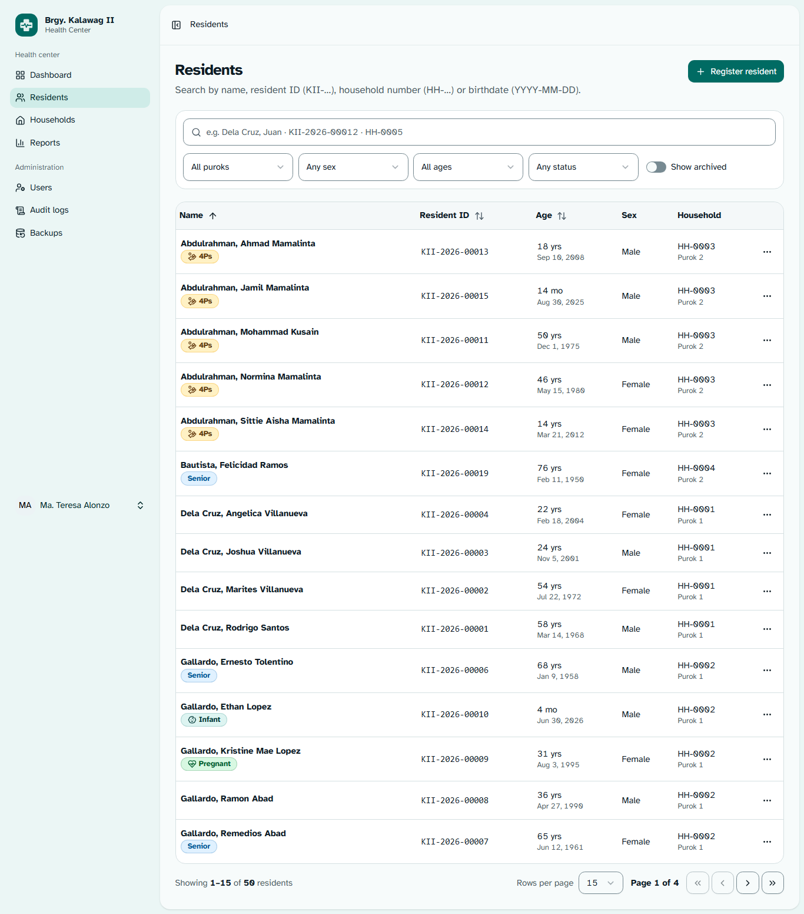
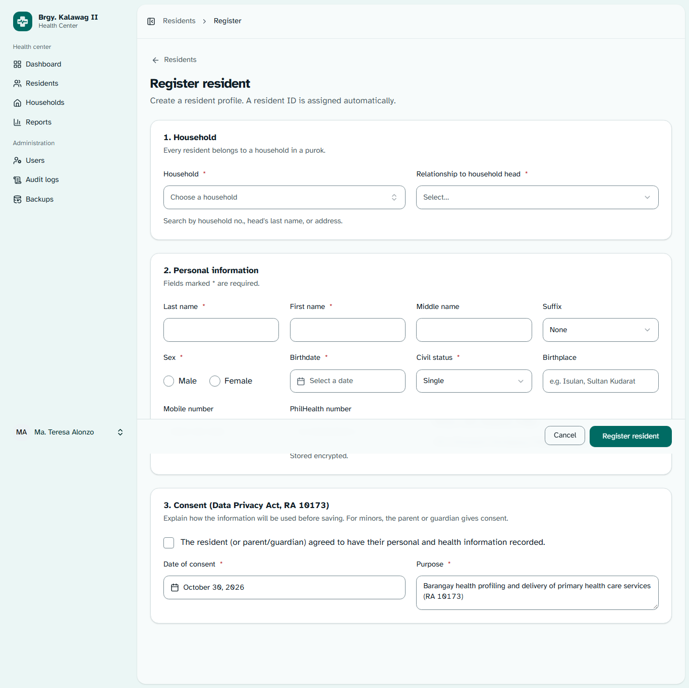
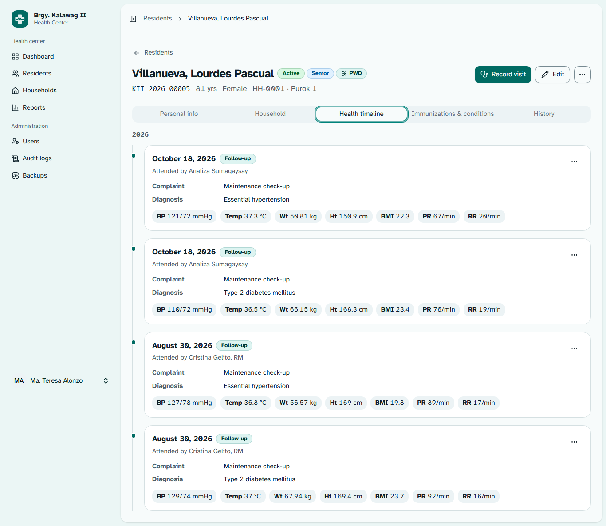
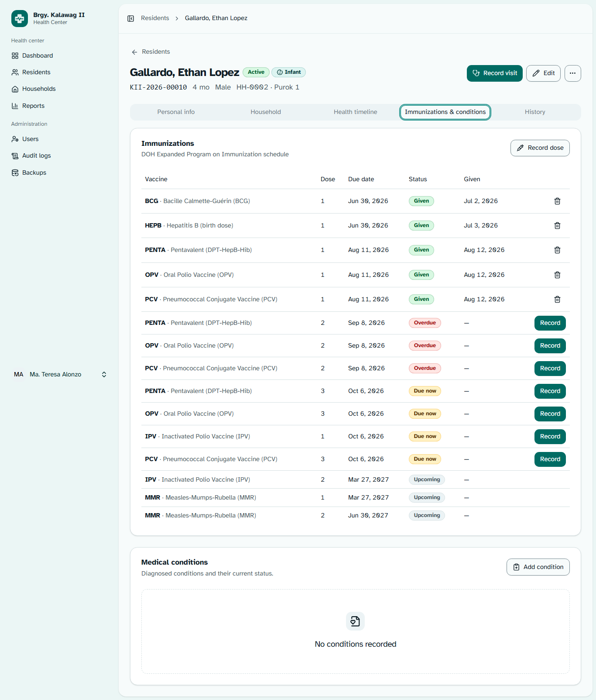
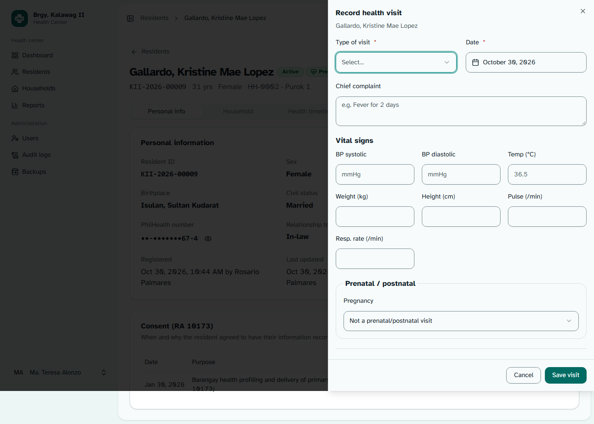
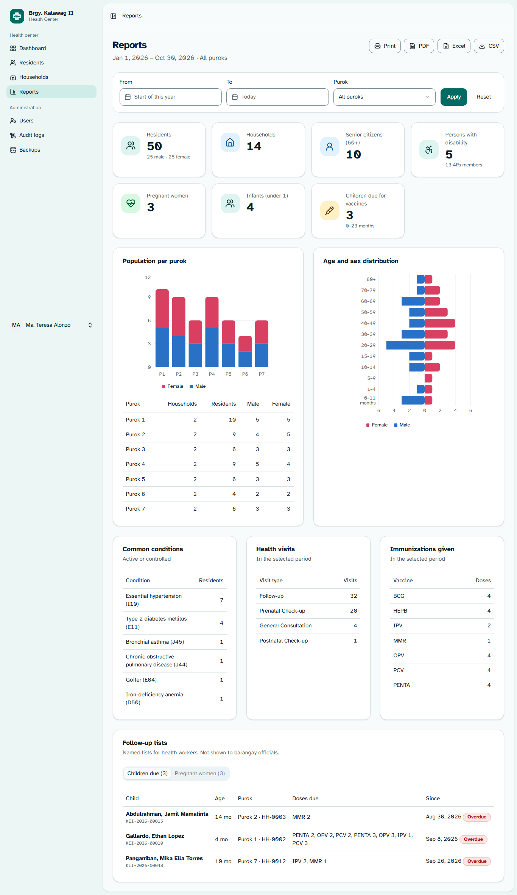
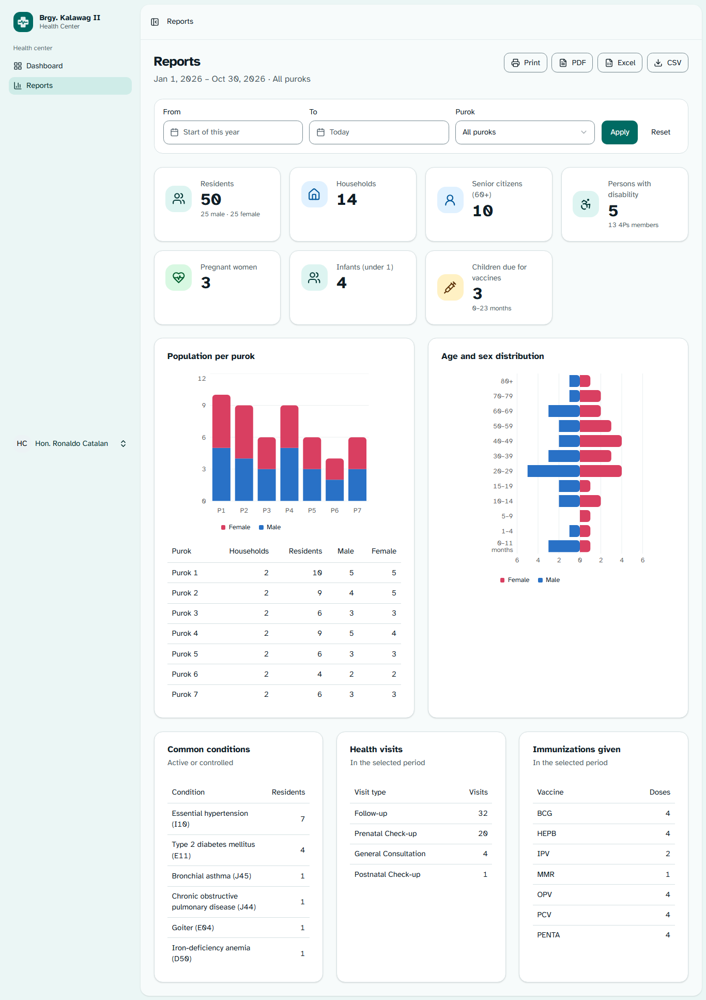
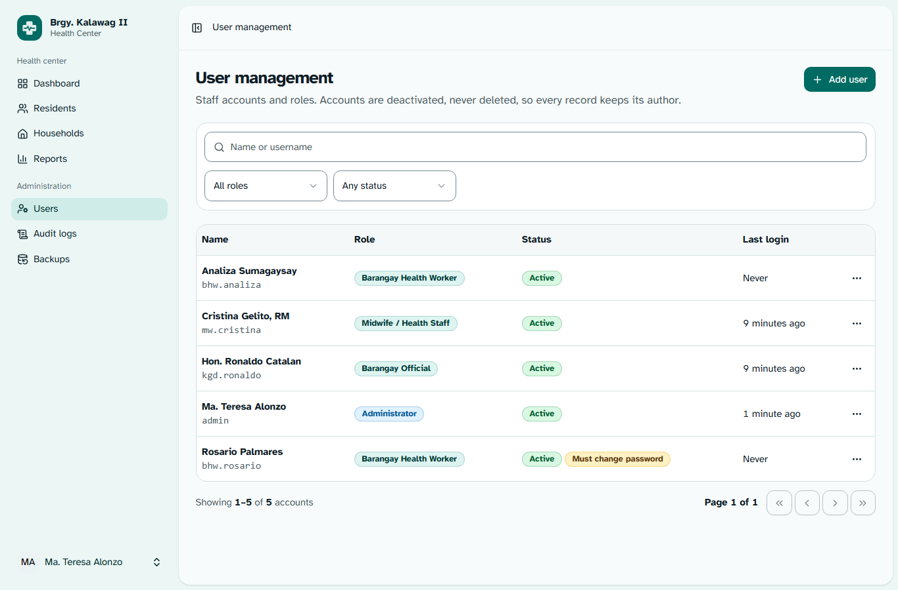

# Phase 5 — Inertia + React Pages

> **Role speaking: WEB DEVELOPER**

Every screen from the Phase 4 design is built and connected to the Phase 3 backend. All screenshots
below were captured from the running app (headless Microsoft Edge, 1366 px wide unless noted) with
the seeded sample data.

---

## 1. Pages

| Page                     | File                                                                                            | Highlights                                                                                                                                                                                                                    |
| ------------------------ | ----------------------------------------------------------------------------------------------- | ----------------------------------------------------------------------------------------------------------------------------------------------------------------------------------------------------------------------------- |
| Login                    | `pages/auth/login.tsx` + `layouts/auth/auth-split-layout.tsx`                                   | Username login, passkey option, **Data Privacy Notice** with full notice dialog, "ask the admin to reset" instead of email reset                                                                                              |
| Change password (forced) | `pages/auth/change-password.tsx`                                                                | First login / after admin reset                                                                                                                                                                                               |
| Dashboard                | `pages/dashboard.tsx`                                                                           | Greeting in Filipino, 6 deferred stat cards (link to filtered lists), purok chart, age/sex pyramid, recent activity (health workers only)                                                                                     |
| Residents                | `pages/residents/index.tsx`                                                                     | Server-side DataTable; search + purok/sex/age/status filters + _Show archived_; sort; rows-per-page; row menu: View, Edit, Archive, Restore, Delete permanently                                                               |
| Register / Edit resident | `pages/residents/create.tsx`, `edit.tsx`, `components/app/residents/resident-form.tsx`          | 3 card sections; household Combobox (partial-reload search) + inline "Create new household"; **live duplicate warning**; consent section; sticky Save bar                                                                     |
| Resident profile         | `pages/residents/show.tsx`                                                                      | Tabs: Personal info (+ consents) · Household · Health timeline · Immunizations & conditions (EPI schedule with Given/Due/Overdue/Upcoming) · Maternal · History; health tabs **deferred** and absent for roles without access |
| Quick entry              | `components/app/residents/visit-sheet.tsx`, `health-dialogs.tsx`, `archive-resident-dialog.tsx` | Visit **Sheet** with vitals + prenatal/postnatal fields; Dialogs for immunization (prefilled from schedule), condition, pregnancy (EDD auto from LMP), consent; AlertDialog for archive/remove                                |
| Households               | `pages/households/index.tsx`, `show.tsx`                                                        | List + New household dialog; detail with members, Add member (prefills household), Edit (incl. head), Delete only when empty                                                                                                  |
| Reports                  | `pages/reports/index.tsx`                                                                       | Date range + purok filter, totals, charts with data tables, conditions/visits/immunizations, follow-up lists (health workers only), **PDF / Excel / CSV** as plain download links, Print                                      |
| Users                    | `pages/users/index.tsx`                                                                         | Table + filters; Add/Edit dialog (can't change own role/status); Reset password; Unlock; one-time **temporary password** dialog with Copy                                                                                     |
| Audit logs               | `pages/audit-logs/index.tsx`                                                                    | Read-only table with user/action/record/date filters; detail Sheet with before → after                                                                                                                                        |
| Backups                  | `pages/backups/index.tsx`                                                                       | Health banner (stale if > 2 days), schedule info, Back up now, history with Download (encrypted file)                                                                                                                         |
| Profile settings         | `pages/settings/profile.tsx`                                                                    | Shows username and role (read-only)                                                                                                                                                                                           |

Shared pieces added in this phase: `components/app/fields.tsx` (TextField, SelectField, RadioField, DateField, TextareaField, CheckboxField — label/hint/error/aria wired once), a health-center logo, role-based sidebar, "My account" in the user menu.

## 2. How the pages talk to Laravel

| Concern              | Implementation                                                                                                                                                                                                     |
| -------------------- | ------------------------------------------------------------------------------------------------------------------------------------------------------------------------------------------------------------------ |
| Routes               | Wayfinder typed helpers (`ResidentController.update(id)`, `show(id)`, `.url({ query })`) — no hard-coded URLs                                                                                                      |
| Forms                | `useForm` + `form.submit(Controller.action())`; Laravel Form Request errors appear under each field via `FormField`                                                                                                |
| Tables               | `useTableQuery`: filters/sort/page in the URL, `router.get` with `preserveState`, `preserveScroll`, `replace`, **partial reload** (`only: ['residents','filters']`), 300 ms debounced search                       |
| Heavy data           | Deferred props with `<Deferred>` + skeletons (dashboard stats/charts, profile health + history, report summary + lists)                                                                                            |
| Combobox search      | Partial reload of an `Inertia::optional` prop (`householdOptions`) — no JSON API                                                                                                                                   |
| Live duplicate check | The single JSON endpoint, called with `fetch` 300 ms after typing; server re-checks on save                                                                                                                        |
| Flash                | `toast` → Sonner; `duplicates`, `temporaryPassword`, `createdHousehold` read from `usePage().flash`                                                                                                                |
| Downloads            | `<a href>` to export/backup URLs (not Inertia visits)                                                                                                                                                              |
| Errors               | 403 / 419 on Inertia requests → back to the page with an **error toast** showing the policy's reason (e.g. "Archived records must be kept for 5 years…") instead of an error page in a modal (`bootstrap/app.php`) |

## 3. Browser verification

A headless-Edge script logged in as **Admin**, **Barangay Official** and **Midwife**, opened every page
(21 visits, including tabs and the visit sheet, at desktop, tablet and phone widths) and recorded
JavaScript errors: **0 errors**. Problems it found, all fixed:

| Found                                                | Fix                                                                           |
| ---------------------------------------------------- | ----------------------------------------------------------------------------- |
| Search box squeezed to an icon when 4+ filters       | Search gets its own full-width row; filters below                             |
| Resident ID column cut off on phones                 | ID moves under the name on small screens                                      |
| Select boxes 38 px instead of 44 px                  | Override shadcn's `data-[size=default]:h-9`                                   |
| Purok chart clipped / skipped labels in narrow cards | Every label shown ("P1…P7"); bar animation disabled (also lighter on old PCs) |
| Pyramid axis ticks uneven (5, 2, 1, 4, 5)            | Symmetric whole-number ticks                                                  |
| Greeting said "Ma." / "Hon."                         | Given-name logic ("Ma. Teresa", "Ronaldo")                                    |
| Passkey divider under the button on login            | Passkey above the form, "Or log in with your username"                        |

|                                                                       |                                                            |
| --------------------------------------------------------------------- | ---------------------------------------------------------- |
|                                     |                  |
|                        |           |
|                |  |
|                       |                      |
|  |                          |

All 16 screenshots are in [`docs/screenshots/`](screenshots/) (also for the Phase 6 BHW manual).

## 4. Checks

107 Pest tests (3 new: Inertia error toasts) · Larastan level 7 · Pint · `tsc` · `vp check` (0 warnings) · `npm run build`.

## 5. Notes / decisions

- Opening a profile loads the health tabs in the background, so for health roles **every profile view is logged as `viewed_sensitive`** — even if the health tabs aren't clicked. This is the stricter reading of RA 10173 logging.
- Prenatal/postnatal check-ups appear in the **Health timeline** (with a Prenatal badge, FHR and fundal height); the Maternal tab shows the pregnancy summary and count of check-ups rather than repeating them.
- The seed data has no audit history (seeding runs without events), so "Recent activity" is empty until people start using the system.
- During verification I temporarily cleared "must change password" on four seeded accounts and restored it afterwards; their _last login_ now shows today's test logins.
